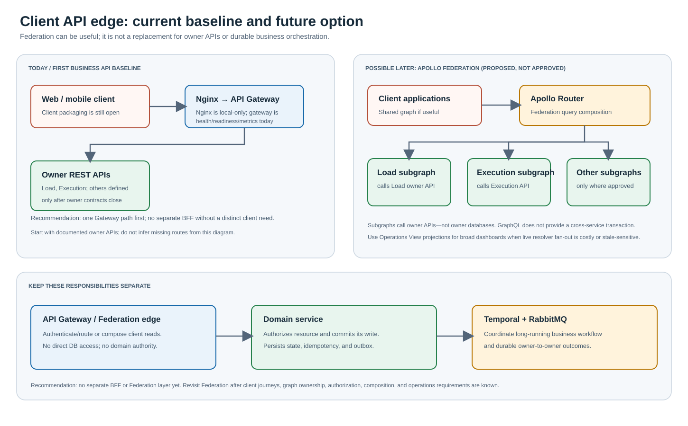

# Client API edge options

This note separates the current repository baseline from possible future
client-facing API composition. It is an architecture recommendation, not an
approved implementation decision or a specification for new routes.

## Current position

- The target includes a client-facing API Gateway and owner-specific service
  APIs. The current repository gateway only provides health, readiness, and
  metrics; it is not yet a TMS API edge.
- Load and Execution have partial OpenAPI specifications. Other HTTP
  operation inventories are not yet defined.
- TMS services own their data and business transitions. The API edge must not
  access service databases or become an alternate business authority.
- A production ingress/load-balancer choice is not yet approved. Local
  development uses Nginx in front of the API Gateway; that does not make
  Nginx the selected production ingress.

## Recommendation

**Do not add a separate BFF or Apollo Federation layer to the first
implementation increment.** First close domain-owned HTTP contracts,
authorization, and operational acceptance. The initial API Gateway can route
those APIs without adding another independently deployed hop.

**Keep Apollo Federation as a viable future client API option.** It may be
beneficial when multiple client applications need a coherent graph across
independently owned domains, there is a stable consumer need for cross-domain
read composition, and the organization can operate schema composition,
authorization, performance, and partial-failure behavior. Apollo Router
could be the federation edge and provide presentation-level aggregation,
making a second, separate BFF unnecessary for clients that can share the
same graph.

Federation does not replace domain APIs, ownership, or workflow
orchestration. A subgraph must call its owning service boundary rather than
read its database. Mutations remain owner-authorized and idempotent; a
multi-service business operation remains a Temporal/RabbitMQ workflow, not a
GraphQL distributed transaction. Broad dispatcher screens may be better
served by an explicit Operations View projection than by a costly graph of
live cross-service resolver calls.

Add a distinct BFF only if a real client has materially different
presentation behavior, security policy, caching, or release cadence that
cannot be served cleanly by the shared Gateway/Federation edge. Do not create
one merely because the architecture contains microservices.

## Decision gates before selecting Federation

1. Identify the client applications, user journeys, and cross-domain
   responses that justify a graph instead of owner REST APIs or a read
   projection.
2. Define graph/subgraph ownership, schema-composition checks, deprecation
   and versioning policy, and a release-compatibility process.
3. Define identity propagation and field/resource authorization at each
   owner. Hiding a field in the graph is not a substitute for owner
   authorization.
4. Bound query depth, complexity, batching, response size, rate limits, and
   resolver fan-out. Define cache behavior for sensitive and rapidly changing
   operational facts.
5. Specify partial data/error behavior and tracing across Router, subgraphs,
   owner services, and any read projection.
6. Preserve command idempotency and return durable operation identifiers for
   long-running work; do not keep client HTTP requests open for a saga.

Until these gates close, keep the Gateway/API contracts transport-neutral
where practical and do not claim Apollo Federation is approved or installed.

