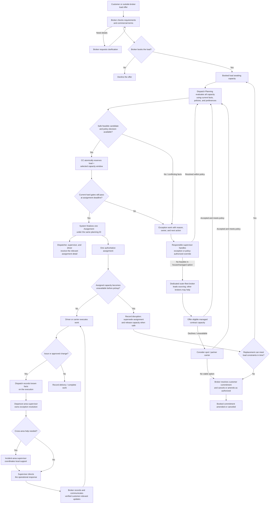
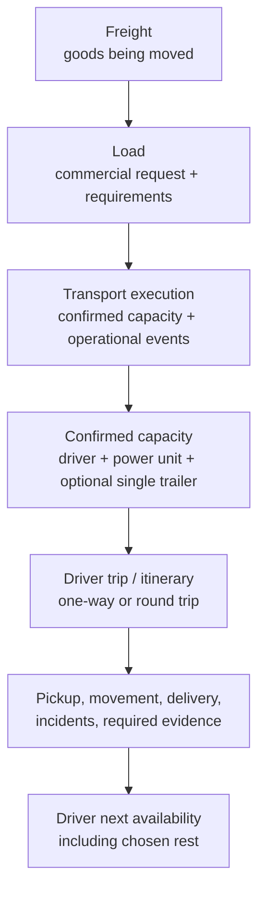
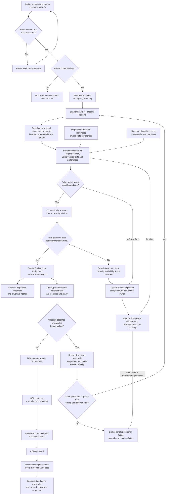

# TMS business operating model

This document is the detailed operating-model reference for our modeled
50–100-truck US company across LA, West, Central, and East. It contains a
mix of agreed company-model choices and unvalidated operating hypotheses; it
is not evidence that one carrier, industry convention, or law requires each
rule. The [TMS system blueprint](./TMS_SYSTEM_BLUEPRINT.md) is canonical for
target architecture, confirmed decisions, and implementation status. Treat
unconfirmed details here as hypotheses until researched, reviewed, and
explicitly adopted. Verify regulatory and contractual requirements with
authoritative sources before encoding them as rules.

The first implementation slice has not been selected. This document owns
detailed business operating rules and hypotheses, not a requirement for one
service, database, or event per step. See the
[first-slice candidate](./FIRST_SLICE_CANDIDATE.md), the
[technical workflow and logical schema](./TECHNICAL_WORKFLOW.md), and the
[company role model](./RESPONSIBILITIES.md) for related detail.

## The basic path

For every load offer, whether received directly from a customer or through
another broker, the handling broker alone decides whether to book, clarify,
or decline it. That decision does not require a supervisor's capacity
review. Booking creates the commercial load commitment and starts capacity
planning; capacity secured and execution remain separate records. Loads
booked by the previous day receive planning priority through 4 p.m. local
time; same-day loads remain eligible for planning throughout the day.
Ordinary loads target Assignment no later than the calendar day before
pickup; same-booking-day pickup follows a separate emergency path whose
detailed handling remains to be defined.

Dispatch Planning evaluates every capacity configuration supported by
current, sourced facts—not just options a dispatcher happened to nominate.
It explains feasibility, hard exclusions, company benefit, employee
preferences, and its policy-driven choice. CC is a peer service: it creates
the Reservation and atomically claims the load and selected
driver/power-unit/optional-single-trailer capacity window. After the
configured review window, the system rechecks hard gates and finalizes the
Assignment by default. People are notified and can intervene where a real
exception or policy-authorized judgment exists; routine loads do not wait
for an approval click. Changed or stale facts stop unsafe automation and
route an explained action to its owner.

For a follow-on load, the current load's BOL must be uploaded and its
execution marked in progress before the trio can enter the planning pool.
The dispatcher records and verifies the trio's next-available date/time;
the next load's pickup cannot be earlier. This supports the next operating
window without committing a trio months ahead. A unit returning from
repair/recovery can enter the planning pool after driver readiness and
return-to-service status are checked. Configuration changes are limited to
the home base with driver agreement and must be recorded before planning;
multiple trailers and routine component swaps are out of scope.

The supervisor may initiate a reasoned exception or an override only where
policy permits it. Neither human intervention nor automated selection can
bypass hard eligibility, safety, or concurrency gates. If an exception
review misses its deadline or an automatic hard gate fails, release the load
claim and return the load to the queue; this does not establish that any
capacity component is available. Exact deadline calculation and timezone
remain open.
The final Assignment is distinct and linked to the commitment revision. The
execution remains active through delivery, while verified availability
updates the capacity-use window for future non-overlapping work.

### Human agency, preferences, and fair allocation

Treat **eligible**, **available**, **preferred**, and **willing** as separate
facts. Eligibility is determined by verified hard requirements; availability
uses verified next-available time and non-overlapping claims. Driver route
preferences and strong avoid-preferences are not silently converted into
ineligibility, but technical availability is not proof of willingness.

Routine Reservations and Assignments do not wait for wiser approval. Before
Assignment, however, the wiser may challenge or redirect a Reservation or
select another feasible candidate when policy allows, always recording the
reason. A new candidate must pass the same gates and receive its own atomic
CC claim. A strong avoid-preference or explicit driver objection blocks
automatic finalization of that proposal and creates a human-owned discussion
and resolution under a bounded review hold that preserves the current claim.
If the hold expires unresolved, release the load claim back to the queue
without asserting that the capacity is available. It is not an unqualified
legal or contractual veto; the resolution and authority must follow
applicable work agreements and law. No system path silently converts an
objection into acceptance.

Dispatch Planning considers competing eligible loads and trios together
within a planning horizon rather than greedily assigning each load in
isolation. It seeks safe load coverage while balancing declared preferences
and prior preference outcomes over time. If the preferred loads are already
reserved, it explains the conflicting claims and retains the preference for
future feasible opportunities; it does not automatically assign an
undesired leftover merely because preferred work was taken. Availability
near or far affects feasibility and timing but does not by itself establish
preference or willingness.

If a load is canceled near departure, first terminalize any unstarted
execution and safely close its claim. Then reassess the driver's actual
availability, rest, and remaining loads for that day. If no acceptable
replacement is resolved, assign a human-owned discussion and next action
rather than silently forcing a disliked route. Employment, carrier, and
compensation consequences remain subject to qualified review.

When material facts are stale or conflicting, automatic finalization stops.
The system identifies the source, age, and correction owner. The wiser is
accountable for oversight and for a permitted override made with visible
warnings, but is not presumed at fault for stale information the system
failed to detect or surface. Preserve the inputs, freshness/version checks,
candidate explanations, preferences or objections, human action and reason,
and outcomes so the company can review what happened and improve the
controls.

### Loads approaching the day-before assignment target

If an ordinary load is still unassigned as the day-before target approaches,
record why and assign an accountable next action rather than treating every
shortfall as the same failure:

- No verified in-house or managed trio can meet the requirements: the
  dedicated outer-fleet broker owns the external-capacity sourcing task and
  its due time. The area broker retains commercial ownership of the booked
  load.
- Capacity facts are missing, stale, or conflicting: the system identifies
  the exact failed input and assigns it to the responsible dispatcher,
  capacity source, or supervisor for correction. Failure to manually
  nominate an otherwise eligible trio is not a reason to miss the load.
- The policy cannot choose safely, or an authorized human decision is
  genuinely required: the departure-area supervisor owns the exception
  backlog and next action, not a routine approval queue.
- Eligible capacity was allocated to higher-priority work under policy,
  leaving this load without a feasible in-house/managed match: the area
  broker owns sourcing this load externally, with the dedicated outer-fleet
  broker supporting within the remaining time.
- The area booked beyond known or reasonably forecast capacity: the area
  broker must flag the overage to the dedicated outer-fleet broker and
  participate in finding outside capacity, rather than treating managed
  capacity already counted in the plan as new supply.

These are operational accountability categories, not automatic disciplinary
scores. Capture source-fact timing, evaluated candidates, policy/decision
outcome, reason, and assigned follow-up owner. Any future participation
measure must distinguish missing or stale operational facts from no suitable
capacity, a genuine exception backlog, or brokerage overbooking.

Dispatcher nominations and priorities may add useful context, but the system
evaluates the full eligible pool even when no nomination is submitted. Do not
penalize a dispatcher because an automated choice preferred another trio,
because no matching load existed, or because they did not manually repeat
what the system already calculated. If a later measure is useful, base it on
the accuracy and timeliness of verified capacity facts, response to actionable
exceptions, and other controllable contributions—not raw nomination volume.

If assigned capacity becomes unavailable before movement starts, preserve and
supersede the prior assignment rather than silently reusing it. Return the
booked load to capacity sourcing only after the prior assignment is terminal
as no-start and its claim is closed. Reassign when another option can meet
the load's timing and requirements; otherwise the broker handles the
customer-facing amendment or cancellation under the applicable agreement.
Closing a claim does not by itself establish driver rest, equipment
serviceability, or general availability. Once movement has begun, handle
capacity failure as an execution exception rather than automatically putting
the load back in the pre-execution queue.

Assignment is automated by default within explicit company policy. Drivers
can state preferences and readiness; dispatchers contribute verified
availability and operational context; Dispatch Planning evaluates the full
eligible pool and balances company benefit with employee priorities. The
system explains its choice and CC reserves the relevant capacity before the
Assignment is finalized. A missed human nomination cannot make otherwise
eligible capacity invisible.

The company-benefit criteria are not one universal score. Policies must
define relevant objectives and hard constraints for each supported load,
direction, and trip profile. People remain responsible for information the
system cannot observe, customer/carrier conversations, policy oversight,
and exceptions. Where facts are absent or conflicting, policy does not
produce a valid choice, or judgment is genuinely required, the system stops
and creates actionable human work rather than guessing. An authorized
human may choose or override only within the same hard safety, eligibility,
contract, and concurrency constraints; every intervention records its reason.
Automation is intended to prevent avoidable work and leave employees room to
handle unexpected events, not to reduce the modeled staffing complement.

## Core work concepts

Keep these concepts separate:

- **Freight** is the physical goods being transported. A load describes the
  requested movement of that freight; it is not the freight itself.
- **Load** holds the customer/source, pickup and delivery locations,
  appointments and timing, freight/commodity and equipment requirements,
  relevant contact, and commercial instructions. Preserve its revisions from
  booking through delivery.
- **Transport execution** records how the load is carried out: confirmed
  capacity, progress, operational changes, incidents, and delivery evidence.
  Changes to customer requirements are preserved as load revisions;
  execution events link to the relevant revision without replacing the
  load's requirements. Post-delivery questions or feedback belong on the load
  record, not the closed execution.
- **Role-specific information:** brokers work from the load record;
  dispatchers and drivers work from the execution; supervisors can see both.
  Only customer-safe status and operational summaries needed for service are
  copied from execution to the load. These may include status, current
  location, on-time state, and an incident's customer-relevant reason and
  resolution. Equipment identifiers, paperwork, technical details, and
  internal notes remain in the execution.
- **Trip/itinerary** describes a driver's planned sequence of movement and
  can be linked to one or more load executions. A one-way/round-trip label
  describes direction/return plan; short/mid/long describes distance or
  duration. These are independent classifications.
- **Capacity assignment** links a driver to a power unit and, in the initial
  model, an optional single compatible trailer for an execution. A truck's
  location alone does not establish driver availability.

Do not merge multiple customer loads merely because a driver performs them
as a short round-trip or a customer pays for them as one round-trip package.
An extra-short round-trip may have special commercial treatment while
remaining distinct from a long round-trip. The proposed accountability rule
is that the supervisor for the first pickup area owns an extra-short
round-trip, even if another pickup occurs on the return and the vehicle
enters another area. Validate exact boundaries and commercial treatment
later.

The handling broker alone decides whether to book, clarify, or decline every
customer load offer, including offers received through an outside broker.
This commercial decision does not require supervisor approval or a capacity
review. Booking establishes the customer
commitment and starts capacity sourcing; it does not itself secure capacity
or create an operational assignment. Supervisors decide how to assign
capacity to a booked load, not whether to accept its offer.

When a load is booked, the system calculates a managed-carrier offer from the
booked customer rate using a contract-approved percentage within that
carrier's configured range. The booking broker confirms or updates the
optimal offer on the load record. This confirmed rate is shown to the
dedicated contract-capacity dispatcher in managed-carrier ranking and is the
rate the managed carrier accepts by having its dispatcher rank the load.
Other dispatchers do not see the managed-carrier offer. Do not expose the
customer's rate or negotiate the managed offer as an ordinary spot bid.

For an eligible managed carrier that does not prefer a load, the broker and
accountable supervisor may authorize an emergency rate increase within the
carrier's agreement. Record the emergency flag and revised offer on the
load, then return it to the managed-carrier candidate pool as a
new/modified opportunity. The carrier's dispatcher must be able to review
and rank that updated offer before it can be assigned. Do not silently
change the rate after the carrier has ranked the previous offer.

## Successful transportation path

The successful case means a broker books work the company intends to service;
every active load has one accountable supervisor and one authoritative
capacity configuration, reserved and assigned by the system under policy
unless a genuine exception needs human judgment; required pickup and delivery
records are captured; and
the driver is not assumed available again until their schedule, chosen rest,
and equipment status support it. Customer feedback is not a condition of
completion.

Prior-day loads receive planning priority until 4 p.m. local time;
same-day loads remain eligible throughout the day. CC is a standalone peer
service that owns the commitment record and exclusive load/capacity claim;
Dispatch Planning owns the policy-driven Assignment decision. A follow-on
load requires the current load's BOL and in-progress status plus a
dispatcher-verified next-available time. The next load's pickup cannot be
earlier than that time. Reservation creates an editable planning record and
an exclusive claim for the load and stable capacity configuration over its
use window; load and trio changes refresh its snapshot and history and may
require reassessment. Dispatchers inspect and challenge automated decisions;
routine approval is not required. Final Assignment is a distinct decision
record linked to the exact Reservation revision. The supervisor may initiate
a policy-authorized exception or override with rationale, but cannot bypass
hard safety, eligibility, or concurrency gates. Every closure needs a
structured reason and dispatcher-verified component status/next
availability. If the trio's condition is unknown, do not treat claim closure
as availability. The execution record continues through delivery, while
verified availability updates the capacity-use window for future
non-overlapping work.

A delay or new driver/equipment issue can move the verified next-available
time past a future reservation's planned pickup. Treat that as a schedule
conflict, not as permission to move either load silently: notify the
dispatcher and accountable supervisor, reassess the affected windows in
pickup-time order, and explicitly unassign or operationally resolve work
before changing claims. Once a future load is finally assigned, use its
normal exception/reassignment path.

Customer requirement changes during a commitment notify both supervisor
and dispatcher, refresh the recorded revision, and trigger automated
feasibility reassessment. After final Assignment, reassess the trio against
revised requirements and remaining time. If it no longer fits before
movement, confirm `no_start` before safely releasing it, automatically seek
a replacement, then use outside capacity and finally broker-led
cancellation/amendment if needed.
Record the original trio's readiness, release and next-available times,
repositioning/deadhead, idle time, and execution milestone. If movement has
begun, handle the change as an Execution exception and do not treat the trio
as immediately available. The broker reviews evidence and contract terms
for possible customer claims; the system does not infer legal entitlement or
automatically charge. The driver receives authorized assignment information
and can report a preference, objection, readiness issue, or changed
availability through the defined workflow. An objection is visible work for
human resolution, not implicit acceptance or an automatic rejection.

For a load picked up in LA that is expected to return toward home, begin
ranking and nominating feasible return-home loads as soon as the pickup BOL
is uploaded and execution is in progress, even while the outbound load is
still moving. The next pickup must respect the dispatcher's verified
next-available time. This is especially important before a driver reaches
the prior destination. Planning/Reservation is not a requirement that the
driver continue working: protected rest remains the driver's choice and
must be respected.

The load and execution close when the POD and any profile-specific
completion-evidence gates are satisfied. The execution remains terminal and
is never reopened; an authorized factual correction is appended with a link
to the original fact, preserving the original evidence and audit history.
Customer questions, comments, and change requests belong to the load's
commercial record. For changes before completion, update the existing load
and, when affected, its transportation record. Preserve a change block
identifying changed fields and prior values; do not cancel and recreate work
merely to represent an authorized change, or trigger automatic reassignment
cascades.

## Load readiness and operational record

Before the load enters capacity confirmation, the broker checks that the
customer's instructions are clear enough to transport safely and meet the
commitment. The exact field checklist is determined by freight, route,
equipment, and applicable requirements; research will define it rather than
assuming one universal form. The readiness check must establish that:

- Required legal rules and customer requirements are met for the particular
  freight and movement; inapplicable requirements are not imposed.
- Freight, truck, and trailer suitability and safety have been checked.
- The driver is healthy, legally eligible, and qualified for any special
  freight or handling requirement.
- Pickup and delivery locations, facilities, appointments, and time
  commitments are specified. Preserve exact customer-mandated choices;
  where alternatives are allowed, the broker can select a feasible
  location/window against capacity and secure appointments.
- Customer contacts, operating instructions, access constraints, and other
  details needed to perform the movement are available.

Missing or ambiguous requirements return to the customer for clarification
before capacity is committed. The matching process applies the researched
requirements relevant to that load and excludes non-applicable checks.
Preserve customer requirements separately from appointment choices and
later revisions.

The execution log records operational facts and evidence:

- At pickup and delivery, record arrival, service start, and service end
  times where applicable. Attach the bill of lading (BOL) at pickup and the
  proof of delivery (POD) at delivery.
- Device location, not a driver's self-reported arrival claim, establishes
  arrival at pickup or delivery. Until the device indicates arrival at the
  location, do not change the execution to pickup or delivery status.
- On BOL/POD upload, record the paperwork's pickup/delivery start time as
  the corresponding arrival/start time. Compare that time with the
  device-established arrival: a small discrepancy can prompt a device check;
  a large discrepancy is investigated with dispatch and the relevant
  facility when needed. The acceptable interval is still to be defined.
- A significant delay or discrepancy must be reported by the driver to
  dispatch, even if the facility continues to load or unload. Dispatch keeps
  the customer informed through the broker. Communication is relevant
  context in review; no automatic driver score or disciplinary outcome is
  defined here.
- Device-confirmed pickup arrival changes status to **Pickup**; BOL receipt
  changes it to **In progress**. Device-confirmed delivery arrival changes
  status to **Delivery**; POD and any profile-specific completion evidence
  change it to **Finished/Completed** and close both the load and execution.
- Record loading/unloading service start and end times to distinguish wait
  time from service duration.
- A customer may be granted access to permitted log-book events when the
  company chooses to expose them; internal operational notes are not
  automatically customer-visible.
- These timestamps preserve actual dwell and transit duration and support
  later review of delay or detention claims; they do not by themselves
  determine fault or entitlement.
- Dispatch monitors the driver log and obtains a progress update about once
  or twice daily, unless reliable automation supplies it. Automation is a
  later implementation choice.

If an incident is reported, the driver contacts dispatch and dispatch
records the known facts on the execution. Notify the accountable
departure-area supervisor and the supervisor for the incident area when
different; the broker copies only customer-relevant status, reason, and
resolution to the load and communicates verified updates. If a required
supervisor acknowledgement is not received within the agreed interval,
dispatch follows up directly. The interval and incident-specific response
procedure remain to be defined.

## Driver and equipment availability

Availability has two distinct parts:

- **Technical eligibility:** equipment is serviceable and the driver is
  legally and operationally eligible to begin the next assignment, including
  required rest and available driving hours. Reassess after delivery.
- **Driver-reported readiness:** the driver states before assignment how
  much of their guaranteed rest they plan to take and reports any additional
  need that affects readiness. The dispatcher uses this information when
  ranking loads. A load must not be confirmed on the assumption that the
  driver will forgo protected rest.
- **Scheduled time off:** do not assign new loads to a driver on a known day
  off. An unexpected absence removes the driver from new capacity planning
  and follows the applicable exception process.

These checks happen at different times: declared readiness informs daily
dispatcher nominations; the supervisor reviews the latest known capacity
state when preassigning and finalizing; technical eligibility is checked
again after the prior delivery. If a driver's health or readiness changes
unexpectedly, dispatch records the change and the supervisor coordinates
operational replanning. For a load not yet in execution, return it to
sourcing when a replacement can meet its constraints; otherwise the broker
handles any customer-facing commitment change or cancellation. Changes
after movement begins follow the execution exception workflow.
The dispatcher team covers a dispatcher who is off; no load assignment
depends on an off-duty dispatcher being available.

## Contract capacity in the successful path

Contract drivers and their dedicated dispatchers follow the same operational
milestones as in-house capacity where the agreement supports it: assignment,
notification, pickup, progress, incidents, delivery, and POD. Contract
capacity remains lower priority when sourcing a load, but once committed,
the company tracks the execution and customer communication through
completion. Contract rates are required when comparing their capacity.
Responsibility for vehicle/driver costs or cargo loss is governed by the
applicable agreement and is outside this workflow.

Keep two outer-capacity paths distinct:

- **Spot outside carrier:** until the carrier is brought into the company's
  managed outer-fleet pool, brokers handle it as an ordinary external
  carrier: source capacity, negotiate, and confirm the spot offer through
  the normal external-carrier process.
- **Managed outer-fleet carrier:** once a carrier has accepted and picked up
  a company load tracked in the system, its known truck and availability may
  be considered for future loads. The carrier remains contract capacity, not
  in-house fleet.

Future matching assistance may identify and rank feasible load matches for
in-house drivers/trucks and managed carriers. It is not part of the Ring 1
manual nomination flow. When introduced, dispatchers should be able to
review or rerank suggestions using relevant driver/team knowledge; managed
dispatchers must exclude any load the carrier is not ready to haul at its
confirmed offer. The agreement determines each carrier's permitted
percentage range. A later rate algorithm may use evidence and analytics;
until then, a configured default must be confirmed by the booking broker.
Any managed-carrier offer that is treated as acceptance of a settled rate
must state that condition explicitly before it enters the eligible pool.
Dispatch Planning applies company-benefit policy across feasible in-house
and managed candidates. Availability, qualification, equipment fit,
contractual readiness, and customer timing remain hard constraints; the
system records the policy, inputs, decision, and relevant revisions.

Managed capacity follows the same CC boundary: once the automated matcher
selects an eligible candidate, CC claims the load and trio window and
Dispatch records the Assignment. Its dispatcher is notified and may report
changed readiness. After a managed carrier is assigned, do not swap the
carrier or load as ordinary optimization. A genuine readiness change is an
exception: record it, safely unassign/release the old claim, and re-source
the still-booked load when a replacement can meet its constraints. If
movement has begun, use the execution exception workflow rather than
automatically re-queueing it. If a carrier completes delivery without a
confirmed next assignment, its dispatcher must return it to the eligible
pool before normal matching resumes; authorized human selection remains
available only when policy allows it.

## Dedicated outer-fleet sourcing

The dedicated outer-fleet broker works proactively from the capacity-planning
stage, identifying loads likely to remain unassigned or low priority for
in-house capacity and sourcing managed contractors or spot carriers for
them. The role also seeks suitable outer capacity in areas where the company
has little or no in-house presence, avoiding unnecessary competition with
the in-house fleet. This does not reserve low-priority loads exclusively to
that broker; other brokers may still source outside capacity.

Do not assume outside carriers have accounts or sign in to the platform.
For spot capacity, the dedicated broker may notify listed carriers through
email or another external channel:

- For a usual load, open at the lowest rate the company is prepared to offer
  and negotiate up to the broker-authorized optimal rate.
- For an emergency load, open at the optimal rate and negotiate up to the
  full customer rate when authorized.
- The carrier may reply with a bid or contact the broker directly. The broker
  conducts and records the negotiation; whether a deal is reached depends on
  the negotiation, not an automated bidding workflow.

For managed capacity, offer the confirmed optimal rate immediately rather
than starting at the low end of a negotiation. If company policy allows an
emergency increase for a suitable but unpreferred load, the broker and
supervisor authorize and record it; the updated offer returns to the managed
dispatcher for explicit ranking.

There is no dedicated outer-fleet supervisor initially. The dedicated
outer-fleet broker owns external sourcing and carrier negotiation; any
human capacity override must use explicitly delegated authority. The
departure-area supervisor remains accountable for operational outcomes
unless responsibility is explicitly transferred. If outer
capacity grows enough to justify a dedicated supervisor, that role may
oversee the contract-capacity program and dispatch coordination without
taking over individual load accountability by default. Contractor crashes
and other service failures remain part of the later exception workflow.

## Customer rate and load changes

Treat the booked customer rate as fixed under the accepted customer
agreement; a customer rate reduction is not assumed valid without the
company's agreement. The actual contract and applicable rules govern and
must be validated. If the customer rate increases, the company decides
whether any additional compensation is due to a managed carrier; do not
automatically pass through an increase.

If the customer requests a rate, freight, or load-requirement change after
booking, and that change is legally permitted and approved, update the
existing load and its transportation record where the change affects
execution. Record a change block identifying the changed fields; do not
create a replacement load and cancel the old one merely to record the change.
Handle the operational impact as a fleet-wide change, not a contractor-only
workflow. A rate increase does not automatically alter carrier compensation.
The changed-fields block also gives future analytics a direct marker for
loads that were revised without scanning every unchanged load.
For a change to load requirements after capacity has been assigned:

1. The broker records the requested customer change and confirms what the
   customer is authorized to change under the agreement.
2. Notify the assigned dispatcher and driver, or the managed carrier's
   dispatcher and carrier, plus the accountable supervisor. Record the
   carrier's response when managed capacity is involved.
3. Recheck safety, legality, equipment/driver suitability, timing, and
   economics for the current assignment and any replacement capacity.
4. The carrier's willingness to accept the change is input, not the
   company's approval. Once the broker accepts an allowed change and Load
   records a new revision, the system automatically rechecks eligibility,
   timing, feasibility, and company benefit. If policy can safely retain or
   reassign capacity, it proceeds through the normal protected commitment
   path. Missing facts, unresolved commercial terms, or no feasible
   replacement create actionable human work.
5. The broker and authorized company role remain responsible for negotiated
   customer/carrier terms, customer communication, and any cancellation or
   claim decision. Do not silently change accepted carrier compensation,
   load scope, or the customer commitment. Preserve original values, approved
   changed fields, policy inputs, decisions, and change history.

Automation covers repeatable operational feasibility and capacity actions;
it does not invent acceptance of commercial terms, automatically cancel a
customer commitment, recalculate carrier compensation without policy, or
assert legal entitlement. Where a validated policy does not yet exist, the
system surfaces the case for human handling rather than pretending the
change workflow is wholly automated.

## Matching by trip direction

Keep homebound and outbound capacity matching distinct:

- **Homebound loads:** emphasize operational fit—driver/truck eligibility,
  location, timing, equipment, and progress toward home. Drivers broadly
  share the homebound objective, so matching is primarily a technical and
  company-positioning problem.
- **Outbound loads:** apply the same feasibility checks, then account for
  drivers' preferred destinations and routes. This is a preference-allocation
  problem: preferred destinations may be oversubscribed, and not every
  driver's preference can be met on each trip.

Treat ordinary outbound preferences as soft requests, not promises. A driver
may also record a strong avoid-preference; a strong avoid or explicit
objection blocks automatic finalization and requires human resolution rather
than silently becoming consent. When similarly suitable drivers compete for
a limited set of preferred destinations, configured policy balances
preferred assignments over time, giving consideration to drivers who have
gone longer without a preferred placement. Dispatch Planning evaluates
competing loads and trios together within its planning horizon, not as
isolated greedy matches. Company benefit and area coverage remain explicit
ranking inputs; no preference balance can override feasibility, customer
commitments, safety, or verified readiness. The system exposes prior
preferred assignments as explainable context, not as a performance score.
The lookback period, allocation objective, and exact tie-break rule remain
to be defined; cases the policy cannot resolve safely go to a supervisor.

## Daily planning and commitment stages

Every day, Dispatch Planning evaluates available driver/truck/trailer
configurations for eligible loads. A trio enters the candidate pool when its
prior pickup/movement cycle makes it available or when it returns to service
after repair/recovery. Prior-day loads have planning priority until 4:00 p.m.
in the applicable operating area's local time; same-day loads remain eligible
all day. Dispatchers maintain verified readiness, next availability, driver
preferences, and operational context. Their nominations may express a
priority but do not restrict the system from matching another valid option.

Dispatch Planning applies hard eligibility, load requirements, timing,
driver/dispatcher preferences, and company-benefit policy to the full
eligible pool. CC claims the load and every member of the selected trio for
the capacity window. Unless a genuine exception enters a bounded human-review
path, the system finalizes the Assignment linked to the exact commitment
revision. Dispatchers and supervisors can inspect or challenge the decision;
routine approval is not required.

If a capacity or customer-requirement change makes the committed trio
infeasible or no longer beneficial, notify the supervisor and dispatcher.
An explicit release requires a reason and verified capacity status; releasing
the load claim does not itself establish trio availability. The booked load
returns to the queue when another trio can meet its requirements and timing,
otherwise the broker handles the customer commitment. Safety, qualification,
and hours-of-service rules remain hard constraints throughout.

## Availability and capacity priority

- In-house availability is about the **driver**, not merely a truck's
  location. Drivers need their agreed rest time and may take it where they
  are. An idle or nearby truck does not make its driver available.
- Treat driver schedule/rest, legal eligibility, and truck condition as
  separate facts. A truck defect may make a driver/truck pairing unsuitable,
  but does not automatically impose a fixed or fractional availability
  penalty. The detailed effect of an issue on future availability remains
  undefined.
- When sourcing capacity for a load, the proposed acquisition order remains:
  suitable in-house capacity, then lease-agreement/owner-operator capacity,
  then partner carrier, when that order benefits the company and meets the
  commitment.
- Company benefit includes suitable coverage and strategic presence beyond
  the strongest local market, not just immediate rate or trip length. Do not
  force a priority order if it breaks timing, customer requirements,
  agreements, or sensible economics. If no option works, decline or cancel
  under the applicable terms.
- For company-owned fleet distribution, use a provisional target of at least
  10% and no more than 50% of the fleet in each non-home area. The LA home area
  is exempt from the upper bound because trucks return there. Whether
  presence is measured by truck count, and over what time window, remains
  open; the percentages are a planning guardrail, not a forecast.
- Apply hard constraints before preferences: safety/legal eligibility,
  driver-guaranteed rest, load/equipment compatibility, and customer
  commitments define what is feasible. Dispatch Planning applies the
  configured company-benefit and area/homeward-positioning policy across
  feasible capacity, incorporating dispatcher facts and driver preferences.
  The choice and reasons are explainable; preferences never override a hard
  constraint.
- In-house dispatchers maintain configuration, readiness, and driver/team
  context. Their nominations and priorities may inform the ranking but are
  not a gate: the system evaluates every otherwise eligible trio. Managed
  capacity enters the eligible pool only after the carrier's authorized
  dispatcher reports a current offer/readiness. Automated Assignment may
  select either group according to the same configured company-benefit
  criteria; humans review exceptions rather than every routine result.
- If multiple candidates remain tied or policy does not define a safe
  deterministic choice, do not guess. Route the case to the accountable
  supervisor with the candidates and unresolved criteria visible.
- If a contractor declines, release the CC load claim and return the booked
  load to sourcing; assess and record that carrier's actual next availability
  separately before treating its capacity as available. After delivery, a
  contractor may not be nominated for a reload until the broker selects it
  from the unassigned pool.
- Exact assignment, reassignment, and cancellation windows come from the
  applicable customer instructions, appointment, and agreement; there is no
  universal cutoff in this model.

## Regional working assumptions

- **West:** faster turnover; make primary assignment decisions quickly and
  allow less discretionary reassignment. Do not spend effort sourcing
  contractors/partners when beneficial in-house capacity is available.
- **East:** fewer daily loads and longer journeys allow more deliberate
  decisions and closer attention to contractor/partner options. Up to two
  assignment rounds (initial choice plus one reconsideration) may be allowed
  only when deadlines leave time.
- **Central and LA:** their distinct decision cadences remain to be defined.
- **West broker split (proposed):** one broker focuses mainly on outgoing
  loads; the other mainly brings trucks toward LA and also handles outgoing
  loads. The return-focused broker activates incoming sourcing when about
  two-thirds of the fleet is outside the LA home area, starting with
  West and continuing until outward deployment can resume. The denominator,
  home-area boundary, and stop condition remain to be defined.
- Geographic presence may justify a suitable lower-rate load when it
  maintains service outside the strongest market.

## One-time versus dedicated work

A one-time load is a single customer movement. A dedicated program is a
recurring lane, schedule, or capacity commitment that produces individual
loads. Each execution still needs an accountable assignment and handoffs.
For dedicated work, assign the program to a dispatcher who already manages
spot drivers when feasible; route each successive load to that dispatcher
and use their available dedicated drivers first. If none can cover a load,
the dispatcher may add a driver or change the dedicated group. A dispatch
team may grow to about 15 drivers, including dedicated drivers. If the
dedicated contract ends, its drivers return to spot work without changing
dispatchers. The dispatcher is dedicated to the work only if staffing
requires it; the program does not automatically require a separate
dispatcher or exclusive trucks.
