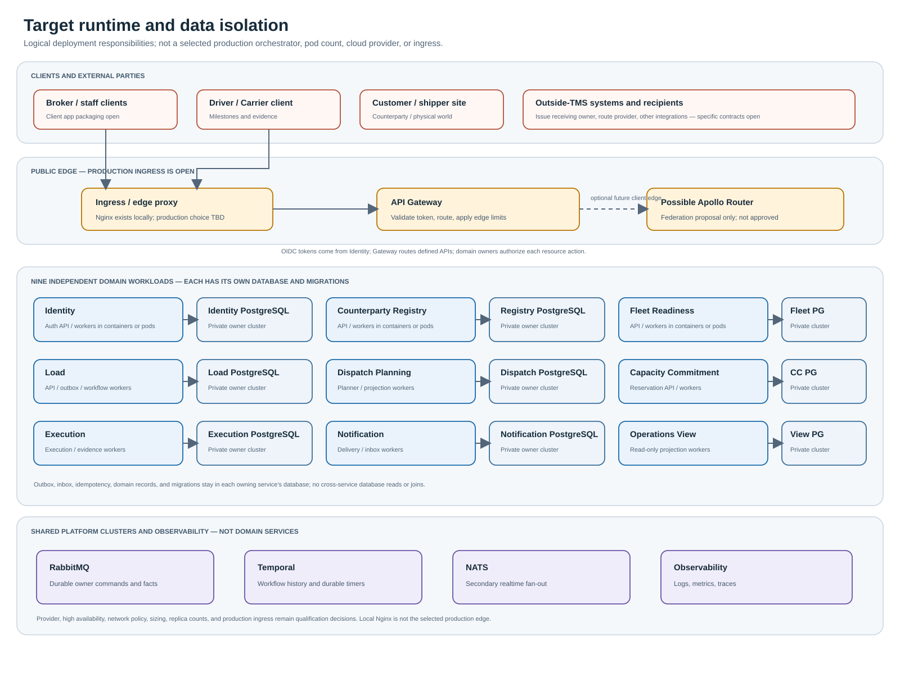
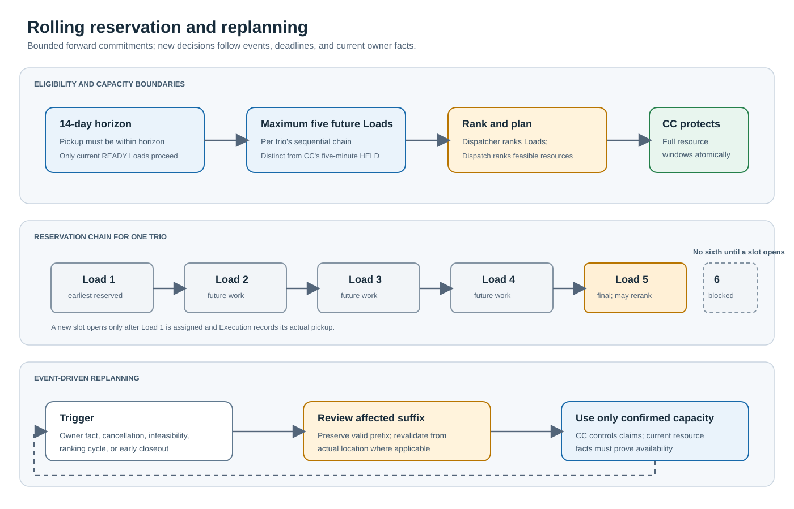
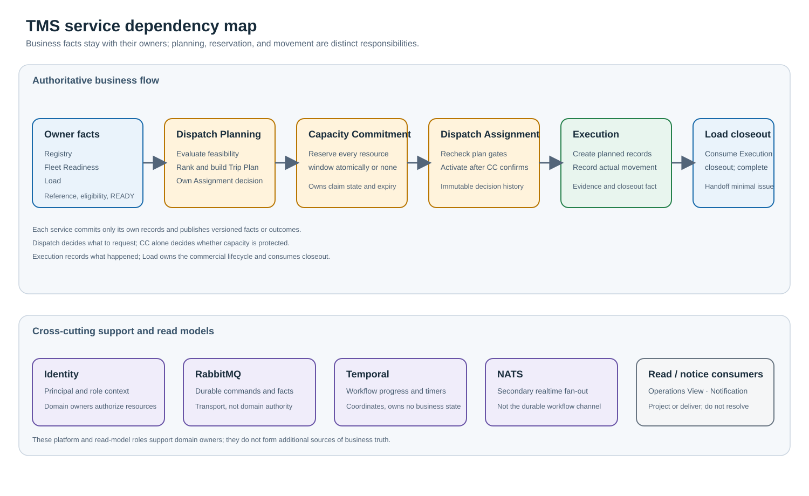

# TMS service interaction map

This document explains where each service's technical responsibility starts
and ends, which facts it owns, and how the services cooperate through one
Load's lifecycle. It complements the [system blueprint](TMS_SYSTEM_BLUEPRINT.md),
which owns the architecture baseline, and the
[technical workflow](TECHNICAL_WORKFLOW.md), which owns detailed invariants
and logical schemas.

This is the target architecture, not a claim that the services or
interactions have been implemented. Exact HTTP and message coverage remains
partial; consult the [API specification index](../api/README.md) and
[open-decision register](OPEN_QUESTIONS.md) before treating an interaction
as an implementation-ready contract.
The [map catalog](../maps/README.md) contains standalone SVG diagrams grouped
by system concern; the linked text documents remain authoritative. RabbitMQ,
Temporal, and NATS are shared platform components, not business services.

## The essential distinction

The services do not all perform the same kind of work:

- **Domain owners** commit authoritative records and publish versioned facts.
  Other services may keep projections, but cannot change the owner's truth.
- **Dispatch Planning** makes the matching and Assignment decisions. It does
  not own the Load, fleet-readiness facts, or capacity reservation.
- **Capacity Commitment (CC)** is the authority for whether complete
  resource-time windows are protected. It does not select the resources or
  decide which Load should receive them.
- **Temporal** coordinates the multi-service process and remembers workflow
  progress; it does not own business state.
- **RabbitMQ** carries durable commands and facts. It is transport, not a
  business decision-maker.
- **NATS** is secondary realtime fan-out; it does not carry the durable
  business workflow or replace RabbitMQ owner facts.
- **Notification** delivers actionable messages; it does not own or resolve
  the underlying work.
- **Operations View** builds read-only operational projections; it cannot
  authorize or commit a business change.

In the normal service-write pattern, an owner commits its state, outbox fact,
and idempotency result atomically. Consumers persist inbox identity and
apply each effect idempotently. Cross-service workflow steps use durable
messages and Temporal coordination rather than synchronous
service-to-service HTTP chains.

## Service responsibility and boundaries

| Service or component         | Responsibility begins when                                                                                                                   | It owns and commits                                                                                                                             | Its responsibility ends when                                                                                                                            |
| ---------------------------- | -------------------------------------------------------------------------------------------------------------------------------------------- | ----------------------------------------------------------------------------------------------------------------------------------------------- | ------------------------------------------------------------------------------------------------------------------------------------------------------- |
| **API Gateway**              | An authorized client submits an API request.                                                                                                 | Edge authentication/transport handling and routing; it does not own domain records.                                                             | The owning service returns its durable outcome.                                                                                                         |
| **Identity**                 | A staff member or driver authenticates, or an identity administrator changes an account/grant.                                               | Principals, credentials, sessions, and role grants.                                                                                             | It supplies signed identity context; the domain owner still authorizes the specific resource and transition.                                            |
| **Counterparty Registry**    | Customer or Carrier identity/status changes.                                                                                                 | Organization identity, distinct Customer/Carrier profiles, status, and registry facts.                                                          | It publishes versioned facts for consumers; it does not validate Load terms, Carrier qualifications, or capacity.                                       |
| **Fleet Readiness**          | Driver, equipment, availability, readiness, or planning-critical Carrier eligibility facts change.                                           | Operational resource records and verified, versioned eligibility/readiness facts.                                                               | It publishes facts and validity changes; it does not select Loads or Assignments.                                                                       |
| **Load**                     | A broker submits a booking, amendment, cancellation, or other Load-owned write.                                                              | Commercial commitment, immutable Load revisions, lifecycle, readiness/completeness, Load guards, and minimal Load-linked issue/handoff records. | Its authoritative Load outcome and facts are durably published; it does not decide the resource match or claim capacity.                                |
| **Dispatch Planning**        | A current Load revision is `READY`, a relevant owner fact changes, a ranking/deadline trigger occurs, or authorized replanning is requested. | Planning attempts, evaluated projections, Trip Plans, ranking decisions, and immutable pending/active Assignment decisions.                     | It has a feasible decision and hands the complete resource-time set to CC, or reports the Load unassigned/held with reasons.                            |
| **Capacity Commitment (CC)** | Dispatch requests reserve, confirm, replace, or release for a complete Trip Plan revision.                                                   | Atomic resource-window reservations, claims, expiry, and transition history.                                                                    | It returns an authoritative all-or-none reservation outcome. It does not choose candidates or activate Assignment.                                      |
| **Execution**                | Dispatch publishes an active Assignment.                                                                                                     | Planned Trip/per-Load Execution records, actual movement facts, stop outcomes, evidence, and immutable closeout facts.                          | The transportation attempt has an authoritative terminal outcome and closeout fact; it does not own the commercial Load or downstream issue resolution. |
| **Notification**             | An owner publishes a notification-worthy task, decision, or deadline.                                                                        | Notification recipients, delivery attempts, acknowledgement, and delivery/recovery state.                                                       | The notice is delivered, pending, or visibly failed; acknowledgement means receipt, not business resolution.                                            |
| **Operations View**          | It consumes versioned facts from domain owners.                                                                                              | Read-only projections, freshness watermarks, and reconciliation/rebuild state.                                                                  | It presents current or explicitly stale/unknown data; it never writes to the source owner.                                                              |
| **Temporal**                 | A durable per-Load or related workflow trigger is accepted.                                                                                  | Workflow/orchestration progress and durable timers only.                                                                                        | It coordinates the next owner command or waits for an owner outcome; it cannot substitute for an owner's state transition.                              |
| **RabbitMQ**                 | An owner outbox item is ready for publication or a durable command is sent.                                                                  | No business record.                                                                                                                             | The message is delivered/retried/parked under transport policy; consumers remain responsible for owner-correct effects.                                 |
| **NATS**                     | A secondary realtime update is available for fan-out.                                                                                        | No business record or durable workflow state.                                                                                                   | Connected realtime consumers receive the update; durable recovery uses owner facts and projections, not NATS delivery.                                  |

These are responsibilities, not a requirement to create a service for every
business noun. Each selected service owns its own database. Cross-service
references use stable identifiers and contracts, not cross-service foreign
keys.

## One Load through the technical system

Solid arrows in the diagram represent a request or result in the coordinated
workflow; dashed arrows represent asynchronous publication/delivery. The
diagram is conceptual: operation names and payloads that are not present in
the service-owned specifications are not finalized by this picture.

## Handoff sequence: trigger, owner action, and dependency

| Step                                       | Trigger                                                                                 | Service action and durable result                                                                                                                                             | Required dependency / why it cannot be skipped                                                                                                                                                    |
| ------------------------------------------ | --------------------------------------------------------------------------------------- | ----------------------------------------------------------------------------------------------------------------------------------------------------------------------------- | ------------------------------------------------------------------------------------------------------------------------------------------------------------------------------------------------- |
| 1. Establish reference and readiness facts | Registry or Fleet Readiness writes a material fact.                                     | The owner commits the fact and publishes its owner revision; Load and Dispatch update local projections as applicable.                                                        | Planning must evaluate current, owner-sourced facts. A projection is a copy for decision-making, not authority to change the source.                                                              |
| 2. Book                                    | Broker submits through the gateway.                                                     | Load validates booking-critical fields and current Customer status, then commits the submission, Load, initial revision, lifecycle transition, outbox, and idempotent result. | Load is the only owner of the commercial commitment. Booking must not imply capacity.                                                                                                             |
| 3. Bind a Carrier when required            | A `contract_capacity_dispatcher` sends a manual tender to an existing approved Carrier. | The dispatcher records tender rounds, counteroffers, response/deadline, and explicitly selects one accepted tender as binding.                                                | Communication is through the existing external channel; TMS does not provide a Carrier portal. Acceptance binds Carrier selection, not capacity. Exact tender record/API ownership remains open.  |
| 4. Establish planning eligibility          | Load commits or amends a revision and computes stage readiness.                         | Load publishes `READY` or `HELD` for that exact revision. Temporal starts/signals the Load workflow after the durable fact.                                                   | Planning cannot act on an old revision, a `HELD` Load, or information copied from an unverified source.                                                                                           |
| 5. Evaluate and rank                       | Current `READY` fact, relevant owner update, timer, or authorized request.              | Dispatch evaluates hard gates, applies the approved profiles/rankings, persists attempt and plan history, then emits a plan request or an unassigned/held result.             | Dispatch owns the decision, but consumes Load, Registry, Fleet, and route-estimate facts; it cannot manufacture missing readiness. For a bound tender, it may consider only the selected Carrier. |
| 6. Protect capacity                        | Dispatch proposes a complete plan.                                                      | CC atomically holds the complete set of resource windows or rejects it with no partial claim.                                                                                 | Dispatch decides what to request; only CC can authoritatively protect capacity and arbitrate contention.                                                                                          |
| 7. Finalize and activate Assignment        | CC returns a temporary hold.                                                            | Load guards the exact revision; Dispatch rechecks gates; CC confirms; Dispatch commits the active Assignment and publishes its fact.                                          | The guard prevents racing Load changes; confirmation prevents a false Assignment; Assignment remains Dispatch-owned.                                                                              |
| 8. Create and run Execution                | Active Assignment fact arrives.                                                         | Execution idempotently creates planned records; actual pickup changes Execution to `IN_PROGRESS`; subsequent facts are appended as movement occurs.                           | Assignment is a plan, not proof of movement. Execution is the authority for actual movement and evidence.                                                                                         |
| 9. Close transportation                    | Final actual outcomes and required POD/evidence exception are available.                | Execution writes one immutable closeout fact; Load consumes it and transitions to `COMPLETED`. Any minimal issue is handed off separately.                                    | Execution determines its closeout; Load owns its lifecycle; an issue does not reopen either record.                                                                                               |
| 10. Present and notify                     | Any owner fact or actionable work item is published.                                    | Operations View refreshes projections; Notification tracks delivery/acknowledgement.                                                                                          | Neither projection nor notice can become a substitute for the authoritative owner's record or decision.                                                                                           |

Cancellation follows a separate coordinated release workflow. Load records
`CANCELLATION_PENDING` and blocks new progression; Dispatch, CC, and Execution
confirm applicable release/void outcomes; Load becomes `CANCELLED` only when
all required owner confirmations are durable. See
[cancellation and downstream release](TECHNICAL_WORKFLOW.md#cancellation-and-downstream-release).

## Replanning feedback

Planning is event- and deadline-triggered, not a continuous poll. A current
Load revision becoming `READY`, a relevant versioned Registry/Fleet/CC fact,
an approved ranking cycle, or a durable operational deadline can wake the
per-Load workflow. The workflow passes the owner identity and revision to
Dispatch; stale and duplicate revisions do not produce new decisions.

Dispatch Planning applies the rolling 14-day horizon and five-Load limit,
dispatcher Load ranking, and resource feasibility rules documented in
[D-511](DECISIONS.md).
The final Load in the current chain remains eligible for re-ranking; a sixth
Load is not added until a slot opens. Dispatcher ranking of Loads is distinct
from Dispatch's feasibility/ranking of resource candidates.

Cancellation or infeasibility causes Dispatch to review the affected
unstarted chain suffix, preserve any valid prefix, and replan or release only
the affected work. CC remains the authority for atomic replacement/release
of capacity claims; Dispatch cannot assume a resource is free because its
own planning lease ended. After an early Execution closeout, Execution
publishes the actual location and outcome. Dispatch immediately revalidates
the unstarted suffix from that location, but may use the trio as available
only after current resource-owner facts confirm availability. These are
replanning triggers, not new sources of business truth.

## Dependency view

The diagram shows logical dependencies, not a claim that every service
synchronously calls every other service. Business messages flow through
durable owner contracts. The exact message inventories, snapshot
reconciliation paths, and operation-specific authorization remain capability
gates in the [readiness matrix](IMPLEMENTATION_READINESS.md).

For the numbered interaction and channel/timing view, see the
[technical interaction sequence](../maps/load-lifecycle/technical-interaction-sequence.svg).
For the response to timeouts, broker outages, stale projections, failed
reservations, or interrupted handoffs, see
[partial failures and recovery](../maps/load-lifecycle/partial-failures.svg).

## Why Dispatch Planning appears to do more

Dispatch Planning is the visible decision point because it combines multiple
inputs and initiates the reservation/Assignment path. It is not the owner of
most inputs or outcomes:

- Registry defines who the Customer and Carrier are and their current status.
- Fleet Readiness establishes whether drivers, equipment, and Carrier facts
  are eligible and available.
- Load defines what was commercially booked and which revision is current.
- CC decides whether the requested complete capacity set is actually
  protected.
- Load's revision guard prevents Dispatch from assigning against a changed
  commitment.
- Execution—not Dispatch—records what physically occurred and whether its
  closeout gate passed.
- Notification and Operations View make work visible without taking over
  business authority.

Each service therefore has a concrete responsibility even when it does not
perform the central matching algorithm: it maintains its own authoritative
records, validates its own transitions, emits versioned facts, and provides
durable outcomes needed by the next owner. The system works only when these
boundaries cooperate; Dispatch cannot safely replace them with a single
planner database or assumed facts.

## Important implementation boundary

This map clarifies responsibility and dependency order; it does not close
the remaining detailed contracts. Current gaps include complete HTTP
inventories for most services, remaining command/fact schemas,
snapshot-reconciliation exchanges, operation-level authorization matrices,
and workflow-specific failure/acceptance cases. Build only the interactions
whose owning contract and required dependency gates are closed; do not infer
missing routes or messages from this map.
