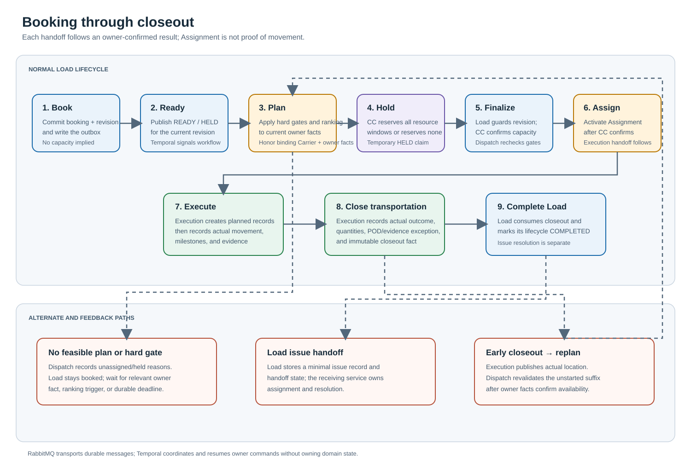
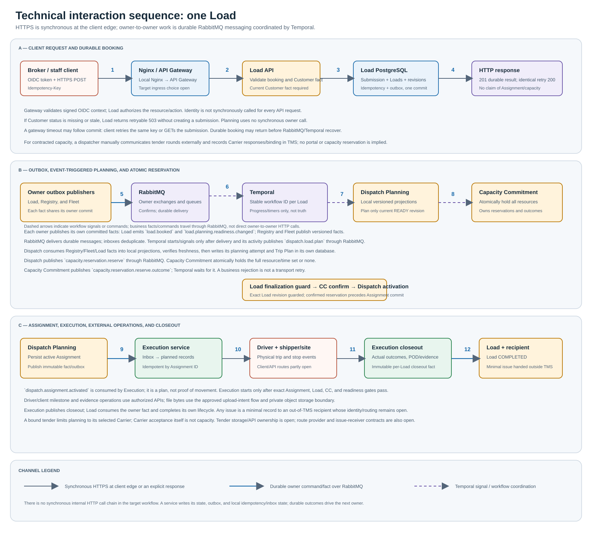
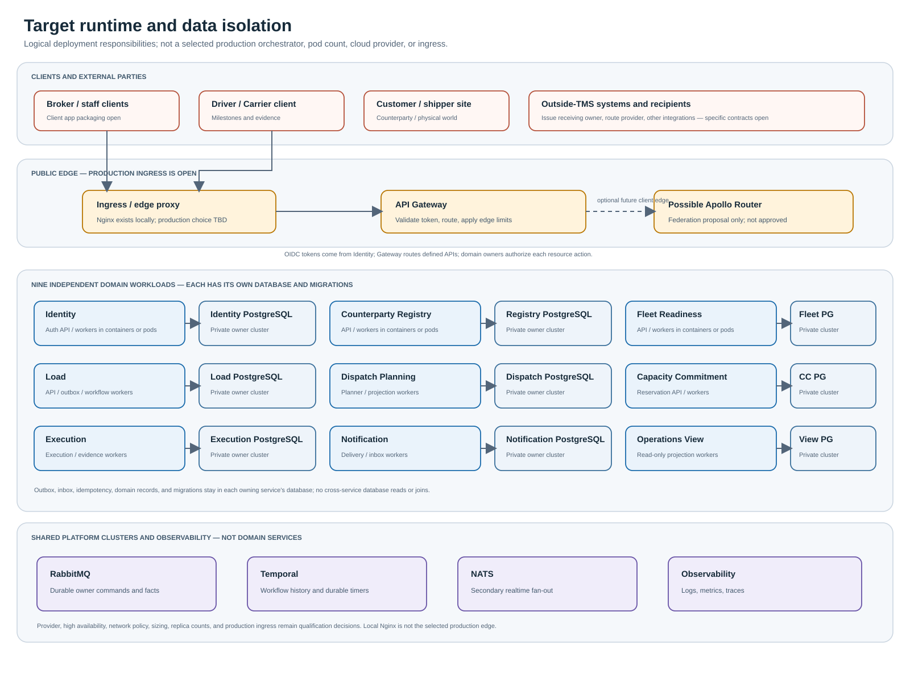
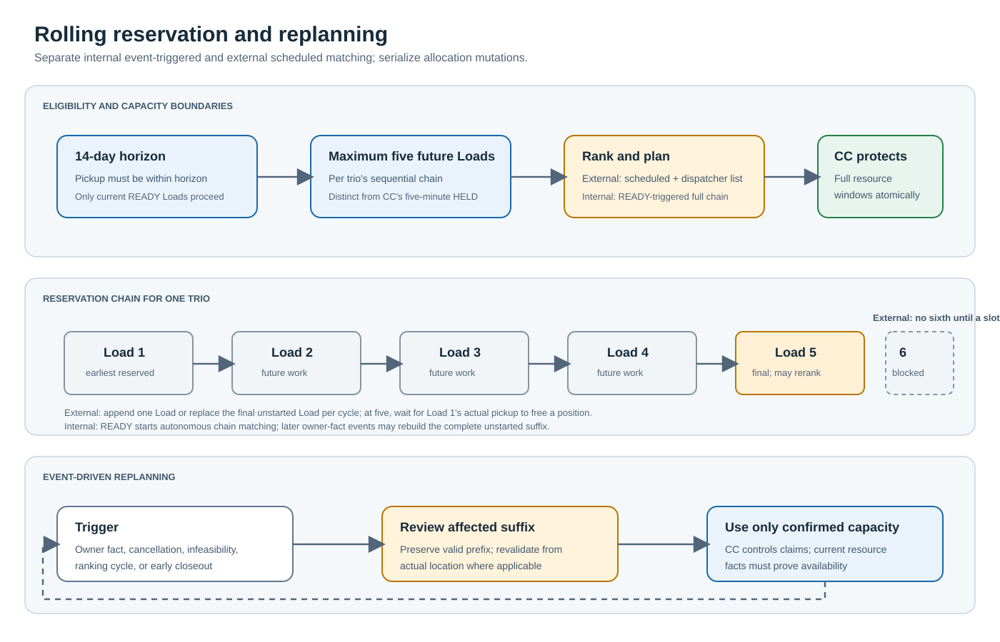
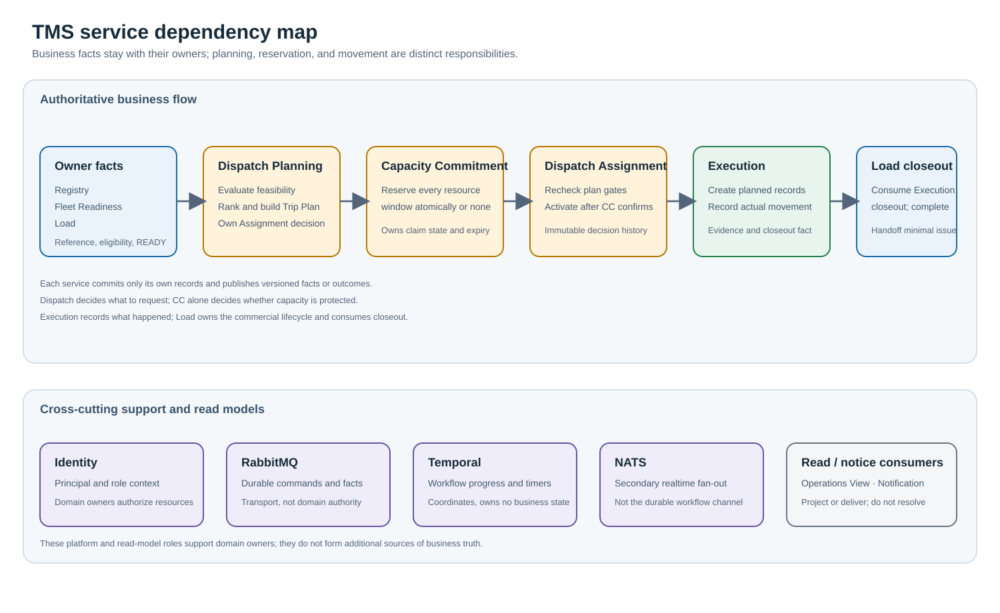

# TMS service interaction map

This document explains where each service's technical responsibility starts
and ends, which facts it owns, and how the services cooperate through one
Load's lifecycle. It complements the [system blueprint](TMS_SYSTEM_BLUEPRINT.md),
which owns the architecture baseline, and the
[technical workflow](TECHNICAL_WORKFLOW.md), which owns detailed invariants
and logical schemas.

This is the target architecture, not a claim that the services or
interactions have been implemented. Exact HTTP and message coverage remains
partial; consult the [API specification index](../api/README.md) and
[open-decision register](OPEN_QUESTIONS.md) before treating an interaction
as an implementation-ready contract.
The [map catalog](../maps/README.md) contains standalone SVG diagrams grouped
by system concern; the linked text documents remain authoritative. PostgreSQL,
RabbitMQ, Temporal, NATS, and observability products are platform tools, not
business microservices or business-data owners. They may run as separate
processes or managed products without becoming company business services.
See the proposed [application-wide service catalog](../SERVICE_CATALOG_AND_INTEGRATION_ARCHITECTURE.md)
for the distinction between business services, adapters, connectors, and
platform tools.

## The essential distinction

The services do not all perform the same kind of work:

- **Domain owners** commit authoritative records and publish versioned facts.
  Other services may keep projections, but cannot change the owner's truth.
- **Adapters** isolate a single internal consumer from an external
  application's protocol, credentials, and schema. **Connectors** may reuse
  an external integration for multiple internal consumers, while preserving
  each owner's contract and data authority. Neither decides operational
  readiness, financial meaning, or Load/Trio matches.
- **Dispatch Planning** makes the matching and Assignment decisions. It does
  not own the Load, fleet-readiness facts, or capacity reservation.
- **Capacity Commitment (CC)** is the authority for whether complete
  resource-time windows are protected. It does not select the resources or
  decide which Load should receive them.
- **Temporal**, **RabbitMQ**, and **NATS** are platform tools: respectively,
  workflow coordination, durable messaging, and secondary realtime fan-out.
  They are runtime dependencies, not business microservices, and do not own
  business state.
- **Notification** delivers actionable messages; it does not own or resolve
  the underlying work.
- **Operations View** builds read-only operational projections; it cannot
  authorize or commit a business change.

In the normal service-write pattern, an owner commits its state, outbox fact,
and idempotency result atomically. Consumers persist inbox identity and
apply each effect idempotently. Cross-service workflow steps use durable
messages and Temporal coordination rather than synchronous
service-to-service HTTP chains.

## Service boundaries and runtime components

| Service or platform component      | Responsibility begins when                                                                                                                               | It owns and commits                                                                                                                                                                                                                                  | Its responsibility ends when                                                                                                                                                                                              |
| ---------------------------------- | -------------------------------------------------------------------------------------------------------------------------------------------------------- | ---------------------------------------------------------------------------------------------------------------------------------------------------------------------------------------------------------------------------------------------------- | ------------------------------------------------------------------------------------------------------------------------------------------------------------------------------------------------------------------------- |
| **API Gateway (edge component)**   | An authorized client submits an API request.                                                                                                             | Edge authentication/transport handling and routing; it does not own domain records.                                                                                                                                                                  | The owning service returns its durable outcome.                                                                                                                                                                           |
| **Identity**                       | A staff member or driver authenticates, or an identity administrator changes an account/grant.                                                           | Principals, credentials, sessions, and role grants.                                                                                                                                                                                                  | It supplies signed identity context; the domain owner still authorizes the specific resource and transition.                                                                                                              |
| **Counterparty Registry**          | Customer or Carrier identity/status changes.                                                                                                             | Organization identity, distinct Customer/Carrier profiles, status, and registry facts.                                                                                                                                                               | It publishes versioned facts for consumers; it does not validate Load terms, Carrier qualifications, or capacity.                                                                                                         |
| **Fleet Readiness**                | Driver, equipment, availability, repair, ELD, or planning-critical Carrier eligibility evidence changes.                                                 | Operational resource records and verified, versioned technical-readiness and reliability assessments, using evidence from the owning repair/ELD services or adapters.                                                                                | It publishes facts and validity changes; it does not own repair/ELD source records, calculate financial costs, select Loads, or activate Assignments.                                                                     |
| **Load**                           | A broker submits a booking, amendment, cancellation, or other Load-owned write.                                                                          | Commercial commitment, immutable Load revisions, lifecycle, readiness/completeness, Load guards, and minimal Load-linked issue/handoff records.                                                                                                      | Its authoritative Load outcome and facts are durably published; it does not decide the resource match or claim capacity.                                                                                                  |
| **Financial/Accounting (planned)** | Posted/settled revenue, expense actuals, settlement evidence, or cost inputs change.                                                                     | Actual financial facts plus normalized cost aggregates/rates by approved time period and operating context (including loaded/empty and territory); supports analysis and forecasting over those facts.                                               | It publishes versioned financial facts/aggregates; the reporting/visualization surface may be a separate consumer. It does not own technical readiness or calculate planning-specific Load/resource estimates or matches. |
| **Operational Economics**          | A relevant source or model revision changes, affecting one or more standalone estimate scopes; or Dispatch requests a bounded read for its frozen cycle. | Immutable independent Load, power-unit/trailer, and driver/team estimates; optional reusable Load-only route/time inputs; separate read models and provenance. It refreshes affected scopes only, not all Loads/resources or Load/Trio combinations. | It publishes/version-returns independent estimates and explicit missing/stale/incomplete scopes. It does not calculate candidate-specific routes, Load/Trio pair values, or Dispatch's combined matrix.                   |
| **Dispatch Planning**              | A scheduled planning cycle begins; an authorized same-day/emergency exception is requested; or safety/recovery validation is required.                   | Planning attempts, evaluated projections, Trip Plans, pair contribution/index and ranking decisions, and immutable pending/active Assignment decisions.                                                                                              | It joins exact Economics estimates, persists the combined matrix, and hands the complete resource-time set to CC or reports the Load unassigned/held.                                                                     |
| **Capacity Commitment (CC)**       | Dispatch requests reserve, confirm, replace, or release for a complete Trip Plan revision.                                                               | Atomic resource-window Reservations, claims, expiry, and transition history.                                                                                                                                                                         | It returns an authoritative all-or-none reservation outcome. It does not choose candidates or activate Assignment.                                                                                                        |
| **Execution**                      | Dispatch publishes an active Assignment.                                                                                                                 | Planned Trip/per-Load Execution records, actual movement facts, stop outcomes, evidence, and immutable closeout facts.                                                                                                                               | The transportation attempt has an authoritative terminal outcome and closeout fact; it does not own the commercial Load or downstream issue resolution.                                                                   |
| **Notification**                   | An owner publishes a notification-worthy task, decision, or deadline.                                                                                    | Notification recipients, delivery attempts, acknowledgement, and delivery/recovery state.                                                                                                                                                            | The notice is delivered, pending, or visibly failed; acknowledgement means receipt, not business resolution.                                                                                                              |
| **Operations View**                | It consumes versioned facts from domain owners.                                                                                                          | Read-only projections, freshness watermarks, and reconciliation/rebuild state.                                                                                                                                                                       | It presents current or explicitly stale/unknown data; it never writes to the source owner.                                                                                                                                |
| **Temporal (workflow tool)**       | A durable per-Load or related workflow trigger is accepted.                                                                                              | Workflow/orchestration progress and durable timers only.                                                                                                                                                                                             | It coordinates the next owner command or waits for an owner outcome; it cannot substitute for an owner's state transition.                                                                                                |
| **RabbitMQ (message broker)**      | An owner outbox item is ready for publication or a durable command is sent.                                                                              | No business record.                                                                                                                                                                                                                                  | The message is delivered/retried/parked under transport policy; consumers remain responsible for owner-correct effects.                                                                                                   |
| **NATS (realtime messaging tool)** | A secondary realtime update is available for fan-out.                                                                                                    | No business record or durable workflow state.                                                                                                                                                                                                        | Connected realtime consumers receive the update; durable recovery uses owner facts and projections, not NATS delivery.                                                                                                    |

These are responsibilities, not a requirement to create a service for every
business noun. Each selected service owns its own database. Cross-service
references use stable identifiers and contracts, not cross-service foreign
keys.

The minimal core should be tested first with deterministic, contract-shaped
simulated inputs behind the same replaceable adapters intended for later
integrations. Live vendor connections are not prerequisites for proving core
ownership, validation, and failure behavior. A simulated adapter is a test
source, not a new business owner or a success-shaped fallback for missing
production facts.

## One Load through the technical system

Solid arrows in the diagram represent a request or result in the coordinated
workflow; dashed arrows represent asynchronous publication/delivery. The
diagram is conceptual: operation names and payloads that are not present in
the service-owned specifications are not finalized by this picture.

## Operational Economics sources, planning gates, and Execution start

### Operational Economics inputs

Economics produces independent, versioned estimates; it does not own the
source facts or calculate Load/Trio matches. Its detailed input rules and
open mappings belong to the [Operational Economics service specification](OPERATIONAL_ECONOMICS_SERVICE.md).

| Input                                                                                    | Authoritative source                                                                           | Use and boundary                                                                                                                                                                 |
| ---------------------------------------------------------------------------------------- | ---------------------------------------------------------------------------------------------- | -------------------------------------------------------------------------------------------------------------------------------------------------------------------------------- |
| Contract linehaul, approved accessorials, deductions, stops, and the exact Load revision | Load                                                                                           | Revenue terms come from the committed commercial Load revision, not from an accounting estimate.                                                                                 |
| Power-unit, trailer, and driver/team identity, configuration, and owner revisions        | Fleet Readiness                                                                                | Identifies the independent resource estimates; Fleet Readiness is not authoritative for wages, fuel invoices, or other actual costs.                                             |
| Posted/settled actuals and normalized context-specific cost aggregates                   | Planned Financial/Accounting service                                                           | Sources may include accounting, payroll, fuel, tolls/permits, maintenance/repair/tires, purchasing, and reefer fuel. Exact fields, dimensions, and allocation rules remain open. |
| Route distance and travel duration                                                       | Provider-neutral route-estimation boundary; D-518 selects Trimble Maps as the initial provider | Preserve source, request/profile, response, constraints, times, and model/policy provenance. The adapter deployment and precise handoff remain open.                             |
| Stop/work service duration                                                               | Company completed-trip history from Execution, calibrated under D-519                          | Use categorized, versioned assumptions. Cohort sufficiency, categories, and the production handoff remain open.                                                                  |
| Public market benchmarks                                                                 | Official public datasets only after field-level approval                                       | Explicitly labeled fallback only. Candidate datasets are not approved runtime inputs until applicability, period, units, licensing, and freshness are confirmed.                 |

The selected precedence is company owner facts and actuals/quotes first,
provider estimates second, and approved public benchmarks as an explicitly
labeled fallback. Economics records the exact source identity/revision,
observation/effective times, units/currency, and model/schema versions used.
Dispatch Planning consumes the exact standalone estimates and owns the
Load/Trio calculations, combined matrix, and decision. A missing or stale
required estimate holds the affected candidate for visible review; it does
not make the resource ineligible by itself, and it must not be replaced by an
unapproved default.

### Planning input and hard-gate sequence

Load readiness is a prerequisite to planning, not a capacity decision.
Dispatch Planning evaluates only the exact current `READY` Load revision,
with current owner facts. A hard gate is evaluated before candidate ranking;
preferences, scores, urgency, or a manual nomination cannot override it. The
sequence below summarizes [D-499](DECISIONS.md#d-499--establish-initial-dispatch-planning-hard-gates-and-ranking)
and the [shared Dispatch Planning policy](../contracts.md#initial-dispatch-planning-policy).

| Order                                    | Check and authoritative source                                                                                           | Pass condition / failure handling                                                                                                                                                                                                                                                                                                                                                                                     |
| ---------------------------------------- | ------------------------------------------------------------------------------------------------------------------------ | --------------------------------------------------------------------------------------------------------------------------------------------------------------------------------------------------------------------------------------------------------------------------------------------------------------------------------------------------------------------------------------------------------------------- |
| 0. Freeze current facts                  | Load, Counterparty Registry, Fleet Readiness, Capacity Commitment (CC), and the applicable policy/source owners          | Dispatch uses versioned owner facts and a consistent planning snapshot. A revision gap is reconciled with the owner. A stale projection or missing/expired hard-gate fact is unknown, never approval; block the affected decision until refreshed. Projection application targets p95 lag of five seconds and a stale mark after 30 seconds; these are not fact-validity TTLs.                                        |
| 1. Load and binding Carrier              | Load; Counterparty Registry; Fleet Readiness                                                                             | Load is not canceled, is `READY` at the exact current revision, and has no conflicting active Assignment. If a binding Carrier exists, consider only that Carrier. It must be `ACTIVE` in the Registry, with each required Fleet Readiness eligibility fact current, valid, and verified. An active Customer is required at booking; a later Customer suspension/closure does not automatically hold existing Loads.  |
| 2. Equipment                             | Fleet Readiness; Load requirements                                                                                       | Each segment has one eligible power unit and compatible trailer, available for the whole window and free of blocking maintenance status. Check the Load's profile, dimensions, weight, temperature, and known handling requirements. Missing/stale facts fail closed. Declared dimensions and equipment limits do not prove complete trailer packing or stack strength.                                               |
| 3. Drivers                               | Fleet Readiness; verified Carrier/driver relationship and applicable approved policies                                   | Each segment has one qualified, available driver, or two when an explicit requirement calls for a team, eligible for the assigned equipment and operating requirements for the full segment. The initial TMS does not calculate or certify regulatory HOS compliance. An unapproved legal/safety rule cannot be presumed satisfied; automated finalization for affected work stays disabled pending qualified review. |
| 4. Route, schedule, and geometry         | Load stops/windows; route-estimation provider boundary; versioned stop-service-time policy; Fleet Readiness availability | Ordered stops are covered continuously; route, stop time, appointment windows, repositioning, resource availability, and existing confirmed work must fit without overlap. Apply the configured minimum pickup notice. Missing required route/service-time estimates defers the attempt for visible human review; it is not evidence that no capacity exists.                                                         |
| 5. Capacity feasibility                  | CC's current reservation facts                                                                                           | Exclude resource windows already protected by conflicting claims; the complete plan must be capable of an all-or-none reservation. A projection or planning lease is not a capacity claim. CC's authoritative confirmation occurs after ranking; a rejection requires refresh/reallocation, not a partial Assignment.                                                                                                 |
| 6. Freeze feasible candidates, then rank | Dispatch Planning                                                                                                        | Persist one evaluation per exact Load revision/Trio, with owner revisions, gate results/reasons, route provenance, and policy versions. Only candidates passing every hard gate enter matching. Strong avoid-preferences or driver objections create a bounded review hold; they do not weaken gates.                                                                                                                 |

Economics completeness is a separate planning-input condition, not a
substitute eligibility rule. If a required estimate is missing or stale,
Dispatch does not compute/rank from it; it leaves the affected proposal
visibly held for review or refreshed inputs.

During scheduled or authorized exception cycles, Dispatch does gather and
freeze additional planning information. It consumes Load, Registry, Fleet
Readiness, and CC owner facts into local projections; refreshes feasibility
when a relevant fact changes; obtains exact, bounded Economics estimates and
route/service-time inputs; and snapshots the applicable policy version,
dispatcher preferences/system recommendation, and current confirmed
Reservations. Dispatch computes the pair contribution and matching index
itself and persists the resulting matrix and Trip Plan history. It does not
request an Economics calculation for every Load/Trio pair, query another
service's database, or mix revisions that changed after the attempt was
frozen. Missing/stale projections trigger owner reconciliation; they do not
prove that capacity is unavailable.

After ranking, Dispatch requests a complete resource-window Reservation
from CC. A selected candidate is not capacity-authorized until CC confirms
the complete claim atomically; a rejection removes it from the usable plan
and requires refreshed allocation. Once the reservation is confirmed,
Dispatch obtains Load's guard
for the exact Load revision, rechecks hard gates and the existing confirmed
Reservation, then commits and publishes the active Assignment. Finalization
does not create a Reservation. Assignment activation is not proof that
physical movement has started.

### Execution start authorization

Execution obtains its start prerequisites from the authoritative owners; it
does not infer a start from a schedule or Assignment alone.

| Information                                                                                     | Source and delivery to Execution                                                                                                                                                                                  |
| ----------------------------------------------------------------------------------------------- | ----------------------------------------------------------------------------------------------------------------------------------------------------------------------------------------------------------------- |
| Active Assignment and exact Load/Trip Plan revisions, assigned resources, reservation reference | Dispatch Planning publishes the active Assignment after reservation confirmation and Load finalization guards pass. Execution consumes it and idempotently creates `PLANNED` Trip and per-Load Execution records. |
| Current Load revision and `READY` state                                                         | Load publishes versioned owner facts. Execution uses the exact revision referenced by the Assignment.                                                                                                             |
| Confirmed Capacity Commitment                                                                   | CC publishes versioned reservation facts; the Assignment references the reservation. CC remains authoritative for its state.                                                                                      |
| Current assigned driver/equipment readiness and eligibility                                     | Fleet Readiness publishes versioned facts with source, observation time, owner revision, and fact-specific validity.                                                                                              |
| Authenticated reporting principal                                                               | Identity supplies signed identity context. Execution, not Identity, authorizes the specific actor, resource, and operation.                                                                                       |

At actual pickup/departure, an authorized actor reports the actual event to
Execution. Before transitioning the relevant record from `PLANNED` to
`IN_PROGRESS`, Execution verifies that the Assignment is still active for
the exact current Load revision, the Load remains `READY`, CC remains
`CONFIRMED`, and the required Fleet Readiness facts for assigned resources
remain current and valid. On success, Execution records the actual
pickup/departure as the start fact; it does not use a planned timestamp or
treat Assignment creation as movement. The initial workflow adds no
per-start dispatcher approval or driver pre-trip attestation, per
[D-481](DECISIONS.md#d-481--define-the-execution-start-gate).

Execution consumes versioned owner facts through its projections. A missing
revision or stale projection must be reconciled with the owning service
using the typed snapshot protocol; stale data cannot authorize a start. The
five-second p95/30-second stale projection targets do not replace the
source owner's fact-specific validity rules. Availability is planning-current
for 15 minutes after observation; other qualification and maintenance facts
follow their recorded expiry or owner policy.

If any prerequisite is missing, stale, or invalid, Execution must not commit
the `IN_PROGRESS` transition as authorized. The exact start command/event
payload, operation-level authorization matrix, verification-failure codes,
and handling of a reported actual start while an owner projection is stale
remain open in the [open-decision register](OPEN_QUESTIONS.md).
Specify these before implementing the protected start API; do not silently
drop an observed event or convert it into an authorized start.

## Handoff sequence: trigger, owner action, and dependency

| Step                                       | Trigger                                                                                                                                                    | Service action and durable result                                                                                                                                                                                                                                                                                                                                                                                                                                            | Required dependency / why it cannot be skipped                                                                                                                                                                                                                                                                                                                                                                                                                                          |
| ------------------------------------------ | ---------------------------------------------------------------------------------------------------------------------------------------------------------- | ---------------------------------------------------------------------------------------------------------------------------------------------------------------------------------------------------------------------------------------------------------------------------------------------------------------------------------------------------------------------------------------------------------------------------------------------------------------------------- | --------------------------------------------------------------------------------------------------------------------------------------------------------------------------------------------------------------------------------------------------------------------------------------------------------------------------------------------------------------------------------------------------------------------------------------------------------------------------------------- |
| 1. Establish reference and readiness facts | Registry or Fleet Readiness writes a material fact.                                                                                                        | The owner commits the fact and publishes its owner revision; Load and Dispatch update local projections as applicable.                                                                                                                                                                                                                                                                                                                                                       | Planning must evaluate current, owner-sourced facts. A projection is a copy for decision-making, not authority to change the source.                                                                                                                                                                                                                                                                                                                                                    |
| 2. Book                                    | Broker submits through the gateway.                                                                                                                        | Load validates booking-critical fields and current Customer status, then commits the submission, Load, initial revision, lifecycle transition, outbox, and idempotent result.                                                                                                                                                                                                                                                                                                | Load is the only owner of the commercial commitment. Booking must not imply capacity.                                                                                                                                                                                                                                                                                                                                                                                                   |
| 3. Bind a Carrier when required            | A `contract_capacity_dispatcher` sends a manual tender to an existing approved Carrier.                                                                    | The dispatcher records tender rounds, counteroffers, response/deadline, and explicitly selects one accepted tender as binding.                                                                                                                                                                                                                                                                                                                                               | Communication is through the existing external channel; TMS does not provide a Carrier portal. Acceptance binds Carrier selection, not capacity. Exact tender record/API ownership remains open.                                                                                                                                                                                                                                                                                        |
| 4. Establish planning eligibility          | Load commits or amends a revision and computes stage readiness.                                                                                            | Load publishes `READY` or `HELD` for that exact revision. Temporal starts/signals the Load workflow after the durable fact.                                                                                                                                                                                                                                                                                                                                                  | Planning cannot act on an old revision, a `HELD` Load, or information copied from an unverified source.                                                                                                                                                                                                                                                                                                                                                                                 |
| 5. Evaluate and rank                       | External Load: scheduled allocation at 10:00, 13:00, 16:00, or 19:00. Internal Load: exact current `READY` revision or relevant owner-fact change. The 07:00 run remains a read-only external forecast; authorized recovery exceptions are separate. | Economics refreshes only standalone scopes affected by relevant source/model revisions, independently of the Dispatch clock. Dispatch serializes the two matching lanes; it freezes current facts, filters the lane's candidate set, batch-reads only the unique Load/resource/team estimate scopes needed, obtains candidate-specific route results, completes hard gates, then calculates pair economics and persists the lane-specific matrix/chain attempt. No estimate is requested per Load/Trio pair. | Dispatch owns candidate-specific route/schedule feasibility and matching. Internal/local and external/long-haul Loads and Trio pools use separate matrices; all approved complexity levels are supported in both. Internal matching is autonomous and event-triggered. External matching waits for its scheduled cycle and uses the frozen dispatcher/system list policy. Both consume Load, Registry, Fleet, CC, route-provider, Economics, and applicable HOS/availability facts. Missing estimates or stale owner facts defer the affected candidate rather than proving infeasibility. |
| 6. Protect capacity                        | An external scheduled/authorized exception cycle or an event-triggered internal attempt selects an eligible plan.                                            | Dispatch requests the complete resource-window claim; CC confirms the temporary `HELD` claim as persistent `CONFIRMED`, or atomically replaces the complete existing claim when an approved reallocation/recovery applies.                                                                                                                                                                                                                                                   | A forecast or unconfirmed match is not a Reservation. The 07:00 external forecast creates/replaces no Reservations; it does not block the separate internal event-triggered path. CC is the sole capacity authority; on replacement rejection, the old confirmed claim remains active.                                                                                                                                                                                                |
| 7. Finalize and activate Assignment        | Pickup-day finalization or authorized early finalization, using an existing confirmed Reservation.                                                         | Dispatch refreshes Load/resource evidence, obtains the exact-revision Load guard, rechecks hard gates and the confirmed Reservation, then commits and publishes the active Assignment.                                                                                                                                                                                                                                                                                       | Finalization never creates a Reservation. A missing/stale/invalid claim or failed guard means no Assignment; preserve capacity for recovery. The Assignment remains Dispatch-owned and follows confirmed capacity.                                                                                                                                                                                                                                                                      |
| 8. Create and run Execution                | Active Assignment fact arrives.                                                                                                                            | Execution idempotently creates planned records; actual pickup changes Execution to `IN_PROGRESS`; subsequent facts are appended as movement occurs.                                                                                                                                                                                                                                                                                                                          | Assignment is a plan, not proof of movement. Execution is the authority for actual movement and evidence.                                                                                                                                                                                                                                                                                                                                                                               |
| 9. Close transportation                    | Final actual outcomes and required POD/evidence exception are available.                                                                                   | Execution writes one immutable closeout fact; Load consumes it and transitions to `COMPLETED`. Any minimal issue is handed off separately.                                                                                                                                                                                                                                                                                                                                   | Execution determines its closeout; Load owns its lifecycle; an issue does not reopen either record.                                                                                                                                                                                                                                                                                                                                                                                     |
| 10. Present and notify                     | Any owner fact or actionable work item is published.                                                                                                       | Operations View refreshes projections; Notification tracks delivery/acknowledgement.                                                                                                                                                                                                                                                                                                                                                                                         | Neither projection nor notice can become a substitute for the authoritative owner's record or decision.                                                                                                                                                                                                                                                                                                                                                                                 |

Cancellation follows a separate coordinated release workflow. Load records
`CANCELLATION_PENDING` and blocks new progression; Dispatch, CC, and Execution
confirm applicable release/void outcomes; Load becomes `CANCELLED` only when
all required owner confirmations are durable. See
[cancellation and downstream release](TECHNICAL_WORKFLOW.md#cancellation-and-downstream-release).

The morning forecast estimates maximum feasible Load coverage against the
cycle snapshot, then reports expected coverage and fleet capacity at risk of
remaining idle to supervisors. The chief supervisor responsible for the LA
homeland receives the homeland-specific estimate and any gap between desired
and technically feasible outcomes, to support broker guidance on urgent
freight needs. The forecast is informational only and does not reserve
capacity.

At the first 10:00 allocation cycle, immediately refer an unassigned Load
with no technically feasible Trio when fewer than 72 hours remain until its
required fulfillment deadline. Unknown or stale eligibility evidence is a
visible block, not proof that no technically feasible Trio exists. After
the 19:00 cycle, release technically feasible Loads still unassigned after
the day's allocation rounds to a designated external broker/dispatcher for
follow-up beginning the next morning. An external referral/release grants
external access but
does not remove a Load from company-fleet allocation cycles: at the cycle
snapshot, an unreserved Load remains eligible unless it has been assigned
to a contractor, and a newly available eligible company-operated unit may
claim it through that cycle's allocation. An external offer or
negotiation is not an assignment. If a company Reservation is confirmed
first, revoke broker access and stop any outstanding external offer or
negotiation, including
one already circulated. Release itself is not a contractor commitment;
coordinate the status and access change to prevent double commitment.
During the 07:00 closing run, mark a Load `EMERGENCY` when less than four
hours remain until its required fulfillment deadline. The label is for
visibility/escalation and does not bypass the four-hour minimum pickup
notice. The authoritative deadline field and missing-data behavior must be
defined before automating these thresholds.

## Replanning feedback

External (long-haul) matching runs in multiple scheduled, bounded cycles
during the dispatch operating day, not continuously or once per arriving
Load. A current external Load revision becoming `READY`, a relevant
versioned owner fact, a ranking update, or a durable deadline queues
affected work for the next external cycle. Internal (local) matching starts
an immediate durable attempt on the exact current `READY` revision or a
relevant owner-fact change; it does not wait for an external cycle. One
Dispatch coordinator serializes the two matching/reservation mutations.
Same-day or emergency external work may enter an immediate bounded exception
cycle only with the explicit dispatcher consent described in
[D-516](DECISIONS.md); the exception does not waive hard gates. The workflow
passes owner identity and revision to Dispatch; stale and duplicate revisions
do not produce new allocation decisions.

Dispatch Planning applies the rolling 14-day horizon, five-Load limit, and
resource feasibility rules documented in [D-511](DECISIONS.md). It
evaluates each exact Load/Trio pair against the current hard gates, then
freezes the feasible candidates, source revisions, category labels,
dispatcher inputs, and system recommendations in the planning-attempt
snapshot. A relevant fact change before the snapshot triggers a refreshed
evaluation; a change afterward invalidates or refreshes the affected
attempt rather than mixing revisions.

Under [D-527](DECISIONS.md), matching proceeds from higher to lower Load
complexity levels. A level is complete when its same-level Trios are matched,
its Loads are exhausted, or the remaining Loads have no same-level matches.
Only then may higher-level Trios compete for surplus at that level, with the
Trio closest to the Load's level preferred; unmatched Trios may subsequently
descend through verified auxiliary levels.

The external system proposes up to ten feasible Loads per Trio. Dispatchers
may remove or reorder proposals but cannot add Loads. The internal system
does not present a dispatcher Load list. Sole-qualified and sole-interested
status is assessed once from the initial matrix, in that order; preliminary
sole selections are then included in the general matrix comparison; a
superseded sole choice returns to the available pool. For contested Loads,
system and dispatcher orderings are independently normalized
to 0-100 rank points and combined as 60% system plus 40% dispatcher points.
Use the original system list for system rank and the submitted list for
dispatcher rank; system order is determined by the pair's matching index,
which is not added as a raw value to dispatcher points. While submitted
lists contain unaccounted Loads, score priority governs. After a Trio's list
is exhausted, fallback first maximizes
additional eligible allocations, then maximizes aggregate signed matching
index among equal-coverage variations. A removed Load is not permanently
excluded: fallback may select it and submit it to CC without additional
dispatcher confirmation if all hard gates pass.

Under D-530, internal Loads (both endpoints inside the LA-Long Beach CSA)
are routed to an autonomous, event-triggered matching lane. That lane may
build or rebuild the complete unstarted chain of up to five future Loads in
one attempt; every pickup must be within 14 days of the attempt time.
External Loads (all others) wait for scheduled cycles and use the dispatcher
list, with the D-527 60/40 system/dispatcher ranking. In each external cycle,
a Trio may append one Load or replace/reselect the final unstarted Load, but
not both or an interior position. Both lanes apply the same hard gates,
resource facts, and CC authority. Group membership must be explicit; all
approved complexity levels are supported in both lanes. HOS and availability
facts must be current, and a missing/unapproved HOS gate prevents autonomous
finalization.

The LA-Long Beach five-county CSA in D-515 is the single homeland reference;
drivers have no separate home-region classification. LA-destined Loads use
the same 60/40 rank score, but not preferred-destination-state input. Other
destinations may use up to three ordered preferred states. Trip-duration
bands are not used for matching, and market-competition tiers are deferred
pending zone-frequency data. The system's original proposal remains
available for acceptance; a customized version may be confirmed only if at
least one proposed Load remains. An empty submitted list accepts the
original proposal, and accepting that original proposal is the only action
if editing removes all Loads. D-528's distance enforcement remains a
prerequisite.

A preliminary selection or potential Reservation does not claim capacity.
CC alone confirms persistent Reservations and atomically replaces an
existing claim. A failed replacement leaves the old confirmed claim active.
External new Reservations are created only in scheduled allocation cycles
or separately authorized exception cycles. Internal event-triggered
attempts may create or replace Reservations as soon as their frozen
candidate plan is ready. The 07:00 external forecast creates or replaces
none. Dispatch requests a complete resource-window claim; CC
confirms the temporary hold as persistent only after the allocation cycle
succeeds. Approved replacements use CC's atomic complete-claim operation.
Assignment activation later requires current Load/resource evidence, a
valid existing confirmed Reservation, the exact-revision Load guard, and
hard-gate revalidation. Finalization never creates a Reservation; if one is
missing or invalid, no Assignment is activated. The final Load in the
current chain remains eligible for re-ranking; a sixth Load is not added
until a slot opens.

Cancellation and safety invalidation trigger immediate validation of the
affected unstarted chain. Unsafe capacity may be released promptly, but new
external matching or replacement outside an authorized exception cycle
waits for the next scheduled cycle; internal matching remains
event-triggered. At pickup-day finalization, Dispatch revalidates
current facts and the existing confirmed Reservation, obtains the Load
guard, and activates the Assignment only after all checks pass. Finalization
never creates a Reservation; a missing/invalid claim or failed guard
produces no active Assignment and is surfaced for bounded recovery. Each operation must
configure a named local-time calendar, IANA time zone, cycle cutoffs, and
minimum notice before pickup; automated finalization is disabled until
configured.

Cancellation or infeasibility causes Dispatch to review the affected
unstarted chain suffix, preserve any valid prefix, and replan or release only
the affected work. CC remains the authority for atomic replacement/release
of capacity claims; Dispatch cannot assume a resource is free because its
own planning lease ended. After an early Execution closeout, Execution
publishes the actual location and outcome. Dispatch immediately revalidates
the unstarted suffix from that location, but may use the trio as available
only after current resource-owner facts confirm availability. These are
replanning triggers, not new sources of business truth.

## Dependency view

The diagram shows logical dependencies, not a claim that every service
synchronously calls every other service. Business messages flow through
durable owner contracts. The exact message inventories, snapshot
reconciliation paths, and operation-specific authorization remain capability
gates in the [readiness matrix](IMPLEMENTATION_READINESS.md).

For the numbered interaction and channel/timing view, see the
[technical interaction sequence](../maps/load-lifecycle/technical-interaction-sequence.svg).
For the response to timeouts, broker outages, stale projections, failed
reservations, or interrupted handoffs, see
[partial failures and recovery](../maps/load-lifecycle/partial-failures.svg).

## Why Dispatch Planning appears to do more

Dispatch Planning is the visible decision point because it combines multiple
inputs and initiates the reservation/Assignment path. It is not the owner of
most inputs or outcomes:

- Registry defines who the Customer and Carrier are and their current status.
- Fleet Readiness establishes whether drivers, equipment, and Carrier facts
  are eligible and available.
- Load defines what was commercially booked and which revision is current.
- CC decides whether the requested complete capacity set is actually
  protected.
- Load's revision guard prevents Dispatch from assigning against a changed
  commitment.
- Execution—not Dispatch—records what physically occurred and whether its
  closeout gate passed.
- Notification and Operations View make work visible without taking over
  business authority.

Each service therefore has a concrete responsibility even when it does not
perform the central matching algorithm: it maintains its own authoritative
records, validates its own transitions, emits versioned facts, and provides
durable outcomes needed by the next owner. The system works only when these
boundaries cooperate; Dispatch cannot safely replace them with a single
planner database or assumed facts.

## Important implementation boundary

This map clarifies responsibility and dependency order; it does not close
the remaining detailed contracts. Current gaps include complete HTTP
inventories for most services, remaining command/fact schemas,
snapshot-reconciliation exchanges, operation-level authorization matrices,
and workflow-specific failure/acceptance cases. Build only the interactions
whose owning contract and required dependency gates are closed; do not infer
missing routes or messages from this map.
