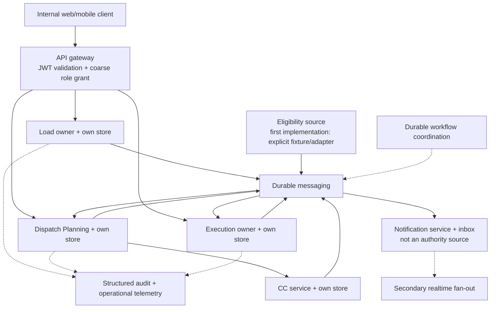
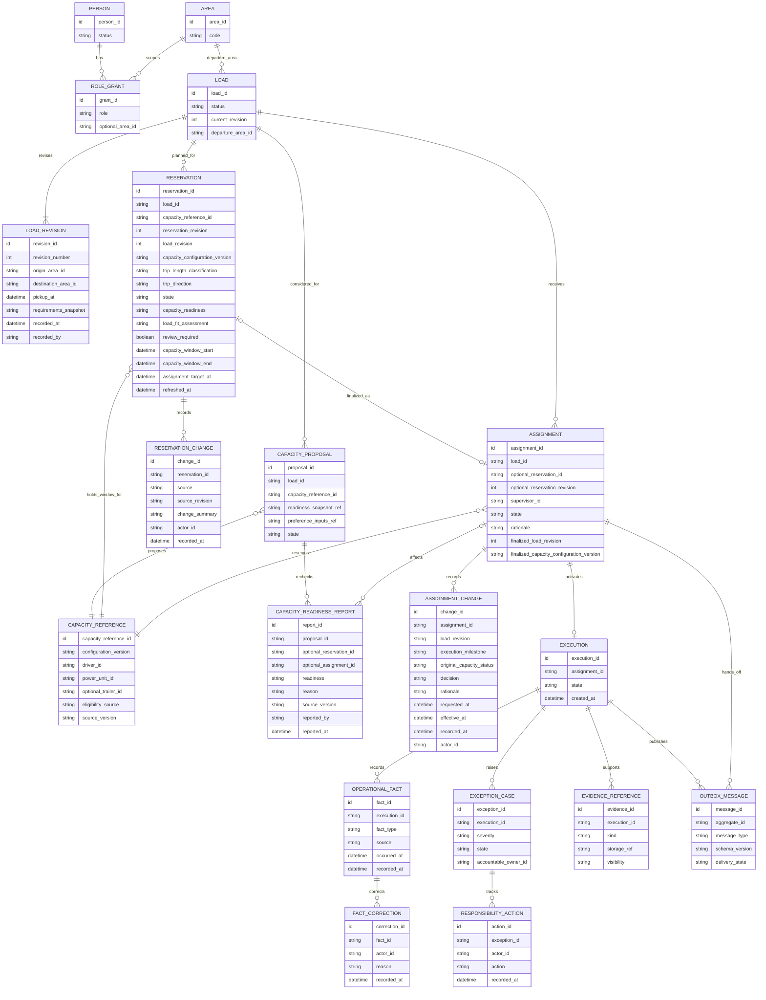

# TMS technical workflow and logical schema

This document expands technical transitions, logical records, contract
sketches, and failure behavior. It is a conceptual design, not a frozen API
or database migration. The [TMS system blueprint](./TMS_SYSTEM_BLUEPRINT.md)
is the authority for system ownership and architecture decisions; this file
must not introduce conflicting business policy.

See the [business operating model](./OPERATING_MODEL.md) for detailed
operating hypotheses, [responsibilities](./RESPONSIBILITIES.md) for role
authority, and the [first-slice candidate](./FIRST_SLICE_CANDIDATE.md) for
proposed scenarios.

## Scope and preconditions

This is a reference lifecycle and conceptual logical schema, not the
approved first implementation slice. Its capacity-to-execution segment
begins after commercial intake and capacity data have produced a controlled,
ready-to-operate load and at least one candidate capacity record. It does not
define a production brokerage, HOS, driver qualification, or maintenance
system. The source and provenance of prepared facts must be visible; a
fixture or operator setup is not production validation. In the wider
workflow, the broker alone books or declines any customer offer, including
an offer received through another broker; that decision requires no
supervisor capacity review.

Load Management, Dispatch Planning, Capacity Commitment (CC), and Execution
are independent peer services. CC owns the editable commitment/Reservation
record and atomic capacity-window claims; Dispatch Planning owns automated
matching and the canonical Assignment decision. A stable `planningId`
correlates the Planning outcome and CC commitment, while each service
maintains its own record ID, database, and state transitions. CC validates
and reserves the selected capacity; it does not calculate company benefit
or duplicate the Assignment. The Reservation stores a compact snapshot of
load revision, capacity-configuration version, readiness/availability,
planned use window, policy versions, and deadline. Relevant Load and
capacity updates refresh the record and notify responsible people.

Loads booked by the previous day receive planning priority through 4:00 p.m.
in the operating area's local time. Same-day loads remain eligible for
planning throughout the day under the short-notice handling path. After
4:00 p.m., next-morning work remains eligible for automated matching from
currently available capacity; a missed dispatcher nomination is not a reason
to stop. Ordinary loads target final Assignment by the calendar day before
pickup. A same-booking-day pickup is an emergency/extra-short load with a
distinct handling path whose detailed thresholds remain to be defined.

A trio can enter the follow-on planning pool after the current load's BOL is
uploaded and Execution is in progress. The dispatcher records and verifies
the trio's next-available date/time; the next pickup cannot be earlier. For a
load picked up in LA that must return toward home, Dispatch Planning ranks
feasible return-home work as soon as the LA pickup and BOL are recorded,
even while the outbound load remains in transit. This is directional
planning, not a claim that the outbound load is complete. Do not schedule
many speculative trips ahead. A trio returning from repair/recovery enters
the eligible pool only after return-to-service and driver readiness are
checked.

The Ring 1 capacity unit is a stable driver + power unit + optional single
trailer configuration. Power-only capacity is valid; multiple trailers and
routine component swaps are out of scope. A dispatcher may reorganize trios
at the home base with driver agreement, but must record the new configuration
before planning. Each decision references that configuration/version. The
dispatcher reports verified driver/equipment readiness against the recorded
configuration; a mismatch is an operational report, not a system-verified
fact.

A nomination does not reserve capacity. When policy selects a candidate,
CC atomically claims the load and each component of the stable capacity
configuration for its use window, removing them from competing views for
that window. The claim uses half-open time intervals `[start, end)`. A
follow-on commitment may coexist with an in-progress Execution only when its
pickup is no earlier than verified next availability and windows do not
overlap. Dispatch Planning owns the canonical Assignment decision, linked
to the exact commitment revision; it does not duplicate the CC claim. The
cross-service idempotency and reconciliation protocol remains to be agreed.

Commitment changes refresh its view and append revision/history. Load
requirement changes and dispatcher-reported capacity changes can mark it
`needs_review`, change assessed fit/availability, and notify the supervisor
and dispatcher. The default is automatic matching, reservation, and
Assignment after the configured review window and fresh hard-gate checks.
An explicitly authorized, bounded exception hold may require human review;
if its deadline passes unresolved, or if automatic finalization fails a
hard gate, CC releases the load claim and returns the load to the queue.
This release does not make any capacity component available. Exact deadline
calculation and timezone remain open.

The final-assignment target is the calendar day before pickup for ordinary
loads. Same-booking-day pickups are emergency/extra-short loads with a
separate handling path. A next-morning pickup that enters the queue after
4:00 p.m. remains eligible for automated matching from current available
capacity with the same atomic load/window protections.

Short and long trips, and outbound versus return-home work, share capacity
identity and reservation invariants but require distinct planning policies.
Ring 1 records trip direction, pickup/delivery areas, planned milestones,
next availability, and relevant deadlines; policy thresholds and advanced
multi-load planning are later decisions. For non-home pickup locations,
include repositioning/deadhead feasibility and time in the candidate
assessment. The LA outbound-to-return cycle is directionally asymmetric even
when the paired loads are technically compatible.

Actors in this path:

- **Broker:** owns load readiness and customer communication, subject to
  their area and record relationships; owns the commercial book/decline
  decision outside this slice.
- **Fleet dispatcher:** records the stable trio configuration, verifies
  readiness and next availability, supplies preferences/context, reports
  changes to CC, and challenges stale or infeasible commitments. A missed
  nomination does not hide eligible capacity from matching.
- **Departure-area supervisor:** accountable for the operational outcome;
  oversees policy and decision quality, handles exception work, and may use
  a reasoned override only where policy permits. Routine matching and
  Assignment do not wait for supervisor approval.
- **Driver or carrier contact:** receives the assigned work and reports
  factual progress, exceptions, and delivery evidence.
- **System:** validates records, applies idempotency and concurrency rules,
  persists facts, handles the execution handoff, and presents honest status.

## Business sequence

```mermaid
sequenceDiagram
    autonumber
    actor Broker
    actor Dispatcher
    actor Supervisor
    actor Driver
    participant Load as Load
    participant Dispatch as Dispatch Planning
    participant CC as Capacity Commitment
    participant Execution as Execution
    participant Bus as Durable messaging
    participant Workflow as Workflow coordinator
    participant Notify as Notification

    Broker->>Load: Mark ready (requirements revision N)
    Load-->>Bus: Publish requirement revision N
    Bus-->>Dispatch: Deliver load facts
    Dispatcher->>Dispatch: Report verified readiness, next availability, and context
    Dispatch->>Dispatch: Evaluate full eligible capacity pool under policy
    alt Policy yields a safe feasible candidate
        Dispatch->>CC: Reserve against load/configuration revisions and planningId
        CC-->>Dispatch: Commitment ID/state and atomic capacity claim
        CC-->>Bus: Publish commitment state
        Bus-->>Notify: Deliver actionable inbox intent
        Workflow->>CC: At deadline, recheck hard gates and finalize by default
        alt Facts current, hard gates pass, no objection/strong avoid is unresolved
            CC-->>Dispatch: Commitment finalized for planningId
            Dispatch->>Dispatch: Persist canonical Assignment decision
            Dispatch-->>Bus: Publish AssignmentFinalized
            Bus-->>Execution: Ensure execution (assignment ID is idempotency key)
            loop While execution handoff remains pending
                Workflow->>Bus: Retry/reconcile using the same operation ID
                Execution-->>Bus: Acknowledge the same assignment ID
                Bus-->>Dispatch: Deliver acknowledgement
            end
        else Strong avoid-preference or driver objection
            CC->>Workflow: Keep current claim in bounded human-review hold
            Workflow-->>Notify: Request supervisor-led discussion and recorded resolution
            alt Resolved within hold
                Supervisor->>Dispatch: Record resolution and permitted decision
                Dispatch->>Dispatch: Re-evaluate full pool if candidate changes
            else Hold expires unresolved
                Workflow->>CC: Expire hold and release load claim
                CC-->>Bus: Return load to planning; capacity availability remains separate
            end
        else Stale fact, conflict, or other failed hard gate
            CC-->>Bus: Release load claim and record failed gate
            Bus-->>Dispatch: Return load to planning; capacity remains unverified
            Bus-->>Notify: Notify responsible people with reason and next action
        end
    else No safe candidate or material facts conflict
        Dispatch-->>Bus: Create owned exception with reason and next-action owner
        Bus-->>Notify: Notify responsible broker/dispatcher/supervisor
        Supervisor->>Dispatch: Resolve exception or apply permitted override
        Dispatch->>Dispatch: Re-evaluate full eligible pool
    end
    opt Capacity exception or customer change after assignment
        Dispatcher->>Dispatch: Report exception; Broker submits accepted Load revision
        Dispatch->>Dispatch: Record change time, trio status, and execution milestone snapshot
        alt Original trio still fits new requirements and timing
            Dispatch->>Dispatch: Retain Assignment with linked change decision
        else Original trio no longer fits and replacement can meet commitment
            Dispatch-->>Bus: Request terminal no-start
            Bus-->>Execution: Mark unstarted execution no-start
            Execution-->>Bus: Acknowledge terminal no-start
            Bus-->>CC: Release old claim after confirmed safe transition
            CC-->>Bus: Record released claim; readiness remains separate
            Dispatch->>Dispatch: Automatically re-evaluate replacement capacity
        else No in-house replacement before commitment
            Broker->>Load: Request outside carrier sourcing
            opt Outside carrier also unavailable or too late
                Broker->>Load: Cancel or amend commitment under applicable terms
                Broker->>Broker: Review customer claim rights from change timing and evidence
            end
        end
    end
    alt Assigned trio remains viable
        Driver->>Execution: Record progress, exceptions, and delivery evidence
        Execution->>Execution: Complete only when rules and evidence permit
        Execution-->>Load: Verified customer-safe status projection
        Dispatch->>Dispatch: Update capacity-use window from verified next availability
    else Assignment is terminated by exception
        Dispatch->>Dispatch: Close claim only after explicit terminal outcome
    end
    opt Post-completion correction
        Supervisor->>Execution: Append authorized correction
        Execution->>Execution: Preserve original fact and correction history
    end
```

## Ordered transitions and invariants

| #   | Trigger and actor                                            | Owner / decision                                                                                                      | Result and invariant                                                                                                                                                                                                                                                    |
| --- | ------------------------------------------------------------ | --------------------------------------------------------------------------------------------------------------------- | ----------------------------------------------------------------------------------------------------------------------------------------------------------------------------------------------------------------------------------------------------------------------- |
| 0   | Controlled setup marks the load ready                        | Load validates the minimum operating fields and records a requirement revision                                        | A stable `loadId` and revision/version exist. “Ready” is distinct from customer booking, capacity secured, and execution active.                                                                                                                                        |
| 1   | System determines accountable departure area                 | Dispatch resolves the pickup area's effective responsibility/coverage                                                 | The responsible supervisor is explicit. Area grants alone do not establish ownership or substitute for coverage.                                                                                                                                                        |
| 2   | Capacity facts or preferences change                         | Dispatch validates configuration version, readiness, and pickup no earlier than verified next availability            | Prior-day loads receive planning priority through 4 p.m. local; same-day loads are eligible all day. Follow-on planning requires BOL/in-progress and recorded next availability.                                                                                        |
| 3   | Policy selects a feasible capacity                           | Dispatch proposes an explainable choice with a stable planning ID; CC atomically claims load/capacity window          | Same-load and overlapping-capacity conflicts trigger fresh evaluation. Commitment presents compact status, revisions, fit and deadline.                                                                                                                                 |
| 4   | Load or trio state changes while committed                   | CC refreshes from authoritative Load revision and dispatcher-verified capacity update                                 | Append history, mark stale/needs-review, and notify responsible people. Do not silently finalize or treat a planning change as a penalty.                                                                                                                               |
| 5   | Commitment deadline arrives and finalization conditions pass | CC finalizes the commitment; Dispatch records the linked Assignment decision                                          | Routine Assignment completes automatically only with current facts, passing hard gates, and no unresolved strong avoid-preference or driver objection. A driver objection enters a bounded hold; other failed conditions stop finalization and create owned human work. |
| 6   | Final Assignment needs an execution                          | A durable assignment fact enters the selected messaging path; the workflow coordinator manages retries/reconciliation | Acknowledgment loss cannot produce an untracked gap. Pending is visible and does not imply execution is active.                                                                                                                                                         |
| 7   | Execution receives `EnsureExecution`                         | Execution validates load/assignment references, authorization context, and idempotency key                            | Repeated delivery with the same assignment ID returns the same execution; the service does not create a duplicate.                                                                                                                                                      |
| 8   | Execution acknowledges; Dispatch reconciles                  | Dispatch correlates acknowledgment to the pending assignment                                                          | Assignment becomes operationally active only after the required downstream invariant is met. A late acknowledgment after terminal exception follows explicit policy.                                                                                                    |
| 9   | Broker changes requirements after final assignment           | Load appends a revision; Dispatch/Execution record the trio status and execution milestone at change time             | Preserve old and new requirements and their effective/recorded times; use the evidence to assess feasibility, delay, and later customer-retention claims.                                                                                                               |
| 10  | Driver reports milestone/evidence                            | Execution validates that the actor is assigned or otherwise authorized and appends a fact                             | Reported time/source and record time are distinguishable; prior facts are not overwritten silently.                                                                                                                                                                     |
| 11  | Driver reports exception                                     | Execution persists the facts; a durable notification intent reaches Notification                                      | Notification delivery failure cannot lose the case. Ownership, acknowledgment, current action, and open/resolved state are explicit.                                                                                                                                    |
| 12  | Supervisor records response or resolution                    | Execution checks the accountable or delegated authority and appends the decision                                      | Resolution does not imply the physical fact was corrected; factual correction has a separate audit action.                                                                                                                                                              |
| 13  | Broker publishes customer-safe update                        | Load applies field-level visibility and source/revision rules                                                         | Internal notes, protected evidence, capacity detail, and unverified claims do not leak.                                                                                                                                                                                 |
| 14  | Authorized actor submits completion                          | Execution applies the chosen evidence and outstanding-exception rules                                                 | Completion is an explicit state transition with evidence references, not a UI-only action.                                                                                                                                                                              |
| 15  | Authorized correction is needed                              | Execution appends correction with original fact reference, actor, reason, and time                                    | Original evidence remains available to authorized auditors; correction does not silently reopen the load.                                                                                                                                                               |

### Suggested failure/compensation behavior

- **Load unavailable before planning:** reject or defer automated evaluation.
  Do not select capacity against an unknown readiness state.
- **Load changes after proposal:** compare revision/version and automatically
  re-evaluate feasibility under the active policy. Revision checking alone does
  not prevent Load changing the commitment between Dispatch's read and
  assignment. Serialize the amendment and assignment per load. If the
  amendment commits first, reject the stale proposal and replan; if
  assignment commits first, route the amendment through post-assignment
  change handling. A human is required only if commercial judgment or a
  policy gap remains. The coordination barrier must make that order durable
  across retries and partial failure.
- **Commitment snapshot becomes stale:** keep the commitment record and
  change history, update its fit/availability state, and notify its
  supervisor and dispatcher. Do not create final Assignment from a stale
  revision. A hard gate at automatic finalization releases the load claim
  and returns the load to the queue; while time remains, the system
  re-evaluates current facts and may create a fresh commitment under policy.
- **Capacity becomes unavailable while committed:** persist the dispatcher's
  structured report and verified next-available time. Reassess the
  commitment; a manual release requires a reason and verified status. Offer
  the load again only when another capacity can meet requirements and timing.
- **Capacity becomes unavailable after assignment but before movement:**
  persist the report, supersede the assignment, and mark its unstarted
  execution terminal as `no_start`. Confirm that terminal outcome and release
  the CC-owned capacity claim; then
  return the still-booked load to sourcing if a replacement can meet timing
  and requirements. Preserve the prior assignment and execution. If no
  replacement is viable, route the customer-facing amendment/cancellation
  decision to the broker.
- **Capacity fails after movement begins:** keep the load in execution and
  handle the event through the exception workflow; do not automatically
  requeue an in-progress load.
- **Execution unavailable after authorization:** show `handoff_pending`,
  retain the assignment and retry/reconcile with the same ID. Do not report
  active movement. A committed assignment continues to hold its capacity
  window while the handoff outcome is unknown. Reconcile by stable assignment
  ID; never free capacity because a client timed out or failed to display the
  response. Once acknowledged, pickup milestones and verified next
  availability can update the window without closing the execution.
- **Assignment command outcome unknown to the client:** query by its
  idempotency key or stable assignment ID before retrying. Support/technical
  staff may trace and repair the technical state but do not invent a
  successful business assignment. If an application outage persists past
  the assignment deadline, follow the documented manual contingency or have
  the broker cancel the load; do not release an unknown claim without
  reconciliation.
- **Duplicate confirm, request, or event:** idempotent result or explicit
  conflict; never duplicate an assignment/execution. For distinct loads
  competing for overlapping use of the same driver, power unit, or trailer,
  or distinct trios competing for one load, CC commits the first valid
  atomic claim and returns the current claim/window to the loser. Do not hold
  competing requests for a ranking/arbitration window or silently promote
  the runner-up.
- **Commitment succeeds but notification fails:** keep the claim
  authoritative, publish/retry a durable notification intent through the
  selected messaging path, and expose the commitment state in its owning query. Do not roll
  back a valid claim just because notification delivery failed.
- **Unassignment reason or next availability is incomplete:** keep the
  capacity out of candidate windows, leave an actionable follow-up for the
  dispatcher, and do not infer availability from free-text or from claim
  closure alone. A load-side unassignment may leave the trio available;
  equipment/driver issues require a verified status and next-available time.
- **Current execution delay overlaps a future reservation:** recompute the
  affected capacity windows from the new verified availability, notify the
  dispatcher and supervisor, and resolve affected loads in pickup-time
  order. Do not move/cancel a load or steal another reservation
  automatically. An already-final assignment follows its exception path;
  an unfinalized preassignment may be explicitly unassigned with a reason.
- **Exception notification delivery fails:** keep the persisted case
  discoverable in an owned work queue and retry notification independently.
- **Conflicting or late operational evidence:** retain source and timestamps,
  flag the conflict for authorized resolution, and preserve the original
  report.
- **Completion evidence missing:** return a domain-specific validation
  response and leave the execution open; do not produce a success-shaped
  completion.
- **Correction after closure:** append a correction/amendment record with
  reason and linkage; do not mutate away the original fact.

## Technical interaction map



Cross-service business work uses durable messaging and workflow coordination
for selected long-running state, timers, retries, and human waits. Secondary
fan-out is non-authoritative. The assignment-to-execution effect is
long-lived and must survive process failure, so define durable
pending/reconciliation semantics. An outbox or equivalent reliable
publication mechanism belongs at each owner boundary. No consumer may write
another owner's database.

There is no cross-service transaction for “check current Load revision,
claim capacity, and create an Assignment.” CC enforces its own atomic claims
to prevent competing commitments; Dispatch Planning owns the Assignment.
Load, CC, and Dispatch must coordinate concurrent requirement changes and
assignment decisions so neither finalizes against an unseen revision. The
exact protocol remains open; it must not become a synchronous HTTP
request/response chain.

## Logical schema and ownership

The following is a conceptual relationship diagram. It intentionally omits
physical column types, cardinality decisions, indexes, encryption, retention,
and migration mechanics.



Returning a load to the capacity queue does not undo its commercial booking.
Load remains committed and available for sourcing while Dispatch supersedes
the prior assignment and preserves its history. A reassignable load may have
multiple historical assignments and unstarted executions, but at most one
active assignment and one active execution. Mark the prior unstarted
execution `no_start` before creating an execution for a replacement
assignment; do not erase it or silently reuse it.

Keep separate, linked records with clear ownership:

- **Commitment/Reservation** is the editable CC-owned planning record and active
  capacity-window claim. It points to the current Load revision and capacity
  configuration version, stores distinct capacity-readiness and load-fit
  assessments, trip length/direction planning context, and assignment target,
  and appends changes from Load or dispatcher-verified capacity updates. Its
  readiness is `full` when every selected component is verified ready for
  the window, `partial` when readiness depends on an outstanding condition
  or action, `unavailable` when a component cannot be ready in time, and
  `unknown` when readiness cannot be assessed. Load fit is separately
  `meets`, `needs-review`, `does-not-meet`, or `unknown`. It can be
  refreshed, revised, challenged, or withdrawn.
- **Assignment** is the policy-driven or authorized human Dispatch Planning decision,
  created as a separate record linked to the exact commitment revision (or created
  directly with a recorded override reason). Preserve its policy version,
  evaluated alternatives/exclusion reasons, relevant preferences or
  objections, source-fact freshness, and any human resolution/actor/rationale.
  It is not silently rewritten when a later customer change occurs;
  amendments/replacements link to the prior decision.
- **Assignment change** appends a post-finalization requirement-change
  assessment, preserving requested/effective/recorded times, the affected
  Load revision, execution milestone, original capacity status, decision,
  and rationale. It supports operational reassessment and broker review; it
  does not establish contractual or legal entitlement.
- **Execution** is the movement facts, exceptions, evidence, and completion
  record created only after final Assignment.

Multiple nominations for one load may coexist and do not reserve resources.
An active CC commitment atomically claims the load and every member of the
stable driver/power-unit/optional-trailer configuration for its capacity-use
window. Enforce one active commitment per load and non-overlapping claims
for each capacity member. When Assignment is finalized, preserve the
commitment's historical record and keep its capacity claim/window
authoritative; do not duplicate the claim or conflate the commitment with
the Assignment. A follow-on commitment may coexist with an in-progress
Execution only when its pickup is no earlier than verified next availability
and its capacity-use window does not overlap existing claims.

The commitment's compact supervisor view includes load pickup/delivery and
direction, current requirement revision, trio and configuration version,
technical/partial/full readiness assessment, next availability, current
assignment/operational status, last refresh time, open change alerts, and
time remaining to its final-assignment deadline. Candidate stacks and pretender lists are derived
from authoritative load state, configuration/readiness updates, nominations,
capacity windows, and Reservations.

CC is a standalone peer service, with its own contract, persistence, and
failure boundary. Its transaction serializes by load and each component ID,
then enforces load uniqueness and capacity-window exclusion. The first
valid transaction to commit wins; do not collect competing requests for a
short arbitration window. A conflict invalidates that proposal and triggers
fresh Dispatch evaluation rather than waiting for a supervisor to choose
among races. The same idempotency key returns the original operation result.
Candidate stacks and pretender lists are derived views, not separate
authorities.

Dispatch Planning selects and records the policy-driven Assignment
proposal; CC creates the linked commitment and claim using the stable
planning ID. Routine Assignment finalizes automatically after the configured
review window if the current hard gates pass. A human override or exception
decision records actor and reason, uses the same claim protocol, and cannot
bypass eligibility or overlapping-window invariants.

Here, **service owner** means the bounded context that owns authoritative
business data, not the employee role accountable for an operational outcome.
CC owns editable commitment records and the active capacity-window claim
ledger; Dispatch Planning owns the canonical policy-driven Assignment
decision. Dispatchers report readiness, preferences, and context and
challenge stale commitments. Supervisors oversee policy/outcomes and handle
exceptions; they do not approve routine Assignment.
CC's claim does not make it the owner of workforce,
qualification, equipment-maintenance, or legal-eligibility facts; those
remain sourced from the appropriate authoritative record or controlled
first-slice fixture.

The default commitment auto-finalizes to Assignment at its configured
deadline after hard-gate checks. A bounded exception-review hold may be
requested when facts or policy require human judgment. If that review
deadline passes unresolved, or an automatic hard gate fails, CC releases the
load claim and returns the load to the queue. It must not create an
Assignment against stale requirements or unverified capacity readiness.
Finalization links the exact commitment revision; the commitment remains
historical and its active capacity window continues without a gap or
duplicate claim. The execution record remains active until completion or
explicit exception termination. Its capacity-use window can be updated
using actual milestones and verified next availability. If an unstarted
Assignment is terminated, confirm terminal `no_start` before closing its
claim. **Release** closes the claim/window so it no longer blocks competing
work; it does not assert physical readiness. Readiness, rest, and
serviceability must be checked separately.

Every unassignment requires a structured reason and an audit record.
Dispatchers report/verify the next-available date/time and operational
condition. A reason may map to a suggested status, but do not infer an
authoritative status from free-text analysis. Distinguish a load-side change
(trio remains available) from a driver-readiness or equipment-serviceability
issue (trio unavailable until a verified time/status). If next availability
is unknown, keep the trio out of candidate windows and create an actionable
follow-up; do not assume it is available. Keep component conditions distinct:
a customer/load change does not mark healthy capacity out of service; a
driver absence affects driver readiness; a tractor or trailer defect affects
that component's serviceability. The dispatcher records the specific
condition and verifies the next-available time; Ring 1 does not infer it
from narrative text.

The Load revision is separate from CC commitment and Assignment. CC stores
the exact Load revision and capacity-configuration version on every
commitment refresh; Dispatch Planning stores the referenced revisions on
Assignment. Load publishes versioned changes; CC updates its snapshot,
appends a change record, marks itself for review when affected, and notifies
the responsible supervisor and dispatcher. A stale commitment cannot be
finalized.

After final Assignment, a customer requirement change triggers a structured
reassessment, not a silent edit:

1. Compare the new requirements, remaining time, pickup location, and
   execution milestone with the assigned trio. If it still meets the
   requirements and timing, retain it through an appended change assessment;
   route to a human only if a commercial or policy exception remains.
2. If it no longer meets them and movement has not begun, terminalize the
   old unstarted execution as `no_start`, record an Assignment replacement/
   termination decision, and return the old trio to candidate planning once
   its actual readiness and next availability are verified.
3. Automatically seek a replacement from eligible in-house/managed capacity
   that can meet the revised requirements and timing. If none exists, the area broker owns
   the customer commitment and the dedicated outer-fleet broker can source
   outside capacity. If there is no viable solution, the broker handles
   cancellation and reviews the contract/evidence for a possible customer
   claim; the system records facts but does not decide legal entitlement or
   automatically charge.
4. Whether the load continues, is replaced, or is canceled, record the
   original trio's release time, next availability, idle/repositioning
   interval, deadhead distance/time where known, and the reason it lost the
   work. Return the trio to candidate planning at its verified next-
   availability time and consider it for other suitable loads. A
   difficult/non-home pickup that strands capacity is an operational loss to
   measure, not merely an unassignment. Do not mark the trio available before
   it can actually reposition and accept work.

If movement has begun, do not mark the original trio available merely
because the load requirements changed. Handle it as an active Execution
exception and release capacity only after a safe operational handoff or
completion. How concurrent Load changes and CC/Dispatch decisions are
serialized is an open contract/protocol decision; a versioned read alone
does not eliminate the cross-service race.

Trip length and direction are independent planning dimensions. Preserve
origin/destination areas, trip category (short/long classification to be
defined), direction (including outbound-from-home and return-home), relevant
milestones, next availability, and repositioning requirement. Short versus
long trips and outbound versus return-home work may use different planning
policies; do not collapse them into a single route score.

### Authority by context

| Data                                                                                             | Owner                                                             | Other contexts may keep                                                              |
| ------------------------------------------------------------------------------------------------ | ----------------------------------------------------------------- | ------------------------------------------------------------------------------------ |
| Load status, requirements, revisions, departure location/area, customer-safe projection          | Load                                                              | Load ID and revision reference; explicitly approved projection fields                |
| Planning inputs, automated/human decision, Assignment and rationale                              | Dispatch Planning                                                 | Stable load, actor, commitment, and capacity references                              |
| Commitment/reservation lifecycle, capacity-window claims, deadline/release                       | Capacity Commitment                                               | Stable load and capacity references                                                  |
| Driver/carrier movement facts, exception lifecycle, evidence references, completion, corrections | Execution                                                         | Stable load/assignment IDs and approved status projection                            |
| Credentials and role grants                                                                      | Identity                                                          | Actor ID and validated authorization claims/reference                                |
| Person's employment/workforce profile                                                            | Workforce/accounts                                                | Person ID and only required status/reference fields                                  |
| Driver/equipment capability, eligibility, availability                                           | Not selected for the first slice; source/owner is a decision gate | A versioned eligibility decision/reference, never an invented Dispatch-owned truth   |
| Notification recipients, inbox, acknowledgements, delivery attempts                              | Notification                                                      | A reference to the business fact/case; delivery state must not become business state |

Avoid using JSON blobs to dodge decisions about the authoritative shape.
The `requirements_snapshot`, preference, and evidence references above are
shorthand for versioned, validated structures whose fields are selected
before implementation.

## Contract sketch

These examples establish use-case intent and required fields, not final
endpoint names, message transport, or service-call order. User-facing
commands may enter through authenticated HTTP; cross-service business
coordination uses the target tools defined in the
[blueprint](./TMS_SYSTEM_BLUEPRINT.md). Validate at the receiving owner,
carry a request/workflow correlation ID, and use stable idempotency
identities for state-changing operations. Do not accept `supervisorId` or
`role` from a request body as proof of authority.

### Propose capacity

`POST /api/v1/loads/{loadId}/capacity-proposals`

```json
{
  "loadRevision": 4,
  "capacityReferenceId": "capacity-identifier",
  "readinessEvidenceVersion": "source-version",
  "driverPriority": {
    "preference": "example-choice",
    "capturedAt": "2026-10-09T12:00:00Z"
  },
  "dispatcherNotes": "Operationally relevant proposal facts"
}
```

The owning Dispatch context checks the actor's dispatch capability, validates
the referenced load and current revision with Load, and records a proposal.
It does not reserve the candidate. Personal preference fields require an
explicit purpose, visibility, retention, and non-discrimination review before
they are persisted.

### Run policy-driven planning

Load-ready and material capacity facts trigger Dispatch Planning to evaluate
the full eligible capacity pool; this is not a supervisor-confirmation
endpoint. The internal operation is idempotent and carries a stable
`planningId`, Load revision, candidate configuration versions, readiness
source versions, applicable policy/profile versions, and deadline. The
result records the explainable selected candidate and reason, or an explicit
no-match/exception result. A dispatcher nomination is optional advice, not
an eligibility gate.

When the policy produces a valid candidate, Dispatch requests CC to claim
the load and each capacity component for the selected window. Once CC
confirms the claim and the deadline hard gates still pass, Dispatch records
one canonical Assignment with `decisionSource: "policy"` and publishes the
execution handoff. A permitted human exception/override uses
`decisionSource: "human_override"`, authenticated actor and reason, and the
same hard eligibility/concurrency checks. Do not accept `supervisorId` or
`role` from a request body as proof of authority.

The operation state must distinguish:

- `pending` — planning or a cross-service transition is still in progress.
- `assigned` — the CC claim and canonical Assignment are confirmed.
- `no_match` — no current candidate satisfies the hard constraints.
- `exception_required` — missing/conflicting facts or policy discretion
  requires an accountable human.
- `failed` — an owned transition failed and needs visible retry or repair.

A timeout is an unknown result, not proof of failure. Query by the stable
planning or idempotency ID before retrying; no duplicate claim or Assignment
may be created.

### Report capacity readiness

`POST /api/v1/capacity-readiness-reports`

```json
{
  "loadId": "load-identifier",
  "proposalId": "proposal-identifier",
  "assignmentId": null,
  "readiness": "unavailable",
  "reason": "Driver reported an unexpected absence",
  "sourceVersion": "capacity-source-version"
}
```

For a committed trio, reference its planning/commitment record;
`unavailable` reports notify the responsible people and invalidate affected
hard gates. A person may review or challenge the system outcome where policy
allows. After final Assignment, include the same `assignmentId`; Dispatch
marks it disrupted and coordinates a terminal no-start outcome for any
execution that has not begun movement. Require a reason for `unavailable`,
derive the reporting actor from the authenticated principal, and preserve
each report as history. A ready report is evidence at a point in time, not a
guarantee that capacity cannot change later. Reassignment and any commercial
cancellation remain separate decisions.

### Ensure execution

Internal command intent:

```json
{
  "messageId": "stable-delivery-id",
  "schemaVersion": 1,
  "assignmentId": "assignment-identifier",
  "loadId": "load-identifier",
  "loadRevision": 4,
  "capacityReferenceId": "capacity-identifier",
  "authorizedBy": "actor-reference",
  "authorizedAt": "2026-10-09T12:01:00Z"
}
```

Execution stores a unique relationship for the assignment it activates.
Re-delivery returns that same execution. Validate that the command was
produced by trusted service identity and is consistent with referenced
records; a valid end-user JWT alone does not authorize an internal command.

### Report a fact or exception

`POST /api/v1/executions/{executionId}/facts` and
`POST /api/v1/executions/{executionId}/exceptions`

Use specific validated fact types, source, occurred time, recorded time,
optional evidence reference, and actor identity. Exception create/acknowledge/
resolve are explicit transitions. Do not make arbitrary client-supplied
status strings authoritative.

### Error and concurrency shape

Use the established service error envelope consistently. Relevant outcomes
include `400` malformed shape, `401` missing/invalid identity, `403` denied
record/action authority, `404` inaccessible or absent resource according to
the chosen disclosure policy, `409` stale version/idempotency conflict or
duplicate active claim, and `422` validly shaped but business-ineligible
input. Return actionable, non-sensitive details and a correlation ID; never
claim success when the downstream effect is unknown.

## Notification boundary

The business fact/case is authoritative in its owning service; notification
is a projection and delivery attempt:

1. Commit the assignment-pending, exception, or other actionable business
   fact.
2. Publish a versioned notification intent durably, or let an owned inbox
   query the persisted work record.
3. Resolve recipients from server-side responsibility and relationship
   rules, including delegation/coverage; do not route by role name alone.
4. Deduplicate by business event and recipient; keep delivery attempts and
   channel outcome separate from business state.
5. Retry transient delivery failures with bounds; expose undelivered work in
   the application inbox and escalate according to an explicit policy.
6. Send email/SMS/push only when the business has selected channel,
   privacy, consent, and response expectations.

Notification is a defined target service boundary. Its first implementation
may be a small actionable in-app inbox that consumes durable intents; it
must not own or replace the underlying pending handoff or exception record.
Its first-slice scope remains to be selected with the rest of the workflow.

## Decisions required before implementation

- The source-of-truth eligibility and availability contract for the selected
  driver/power-unit/optional-trailer trio. CC owns active claims on load and
  trio; an authoritative fleet/readiness source remains a future capability.
- The maximum follow-on planning horizon, required buffer/rest calculation,
  and how a verified next-available time changes when the active execution
  is delayed. Use the departure area's time zone for daily cutoff and
  calendar-day assignment rules; store operational instants consistently.
- The operational short/long trip classification and route/direction
  policies; keep thresholds open until evidence supports them, while
  preserving trip direction and milestones in Ring 1 planning records.
- The after-hours/weekend path for a same-day booking whose assignment target
  falls outside the supervisor's workday. The same-day target does not by
  itself define on-call authority or a booking cutoff.
- Exact protocol for CC deadlines and the asynchronous Assignment transition,
  including safe release/reconciliation. The default is auto-finalization of
  an authorized selection; manual review expiry or failed auto-finalization
  hard gates release the load claim back to the queue. Deadline calculation
  and timezone remain open.
- Exact state names, retries, cancellation, timeout, replay, and
  reconciliation for assignment-to-execution.
- Minimum load requirements/revision rules and readiness authority.
- Initial milestone/fact vocabulary, required completion evidence, and
  whether proof of delivery is a document, structured attestation, or both.
- Exception severity, accountable-owner resolution, coverage, acknowledgment,
  and escalation expectations.
- Correction powers and what remains visible to brokers/customers.
- Notification intent schema, inbox ownership details, and minimum client
  surface.
- Which internal service-to-service credential/audience policy is used in
  addition to JWT validation at the API gateway.

Do not defer a decision that affects an invariant in the first vertical
slice. Do defer anything whose only justification is a later ring.
