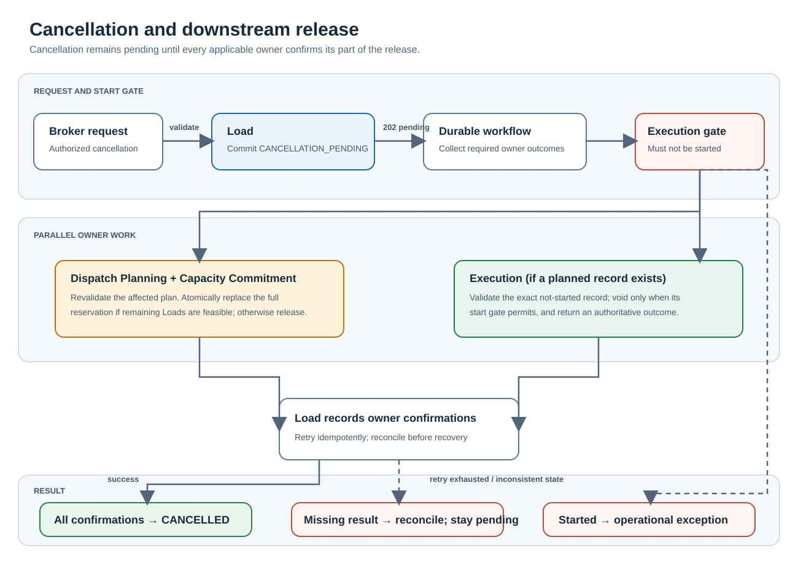
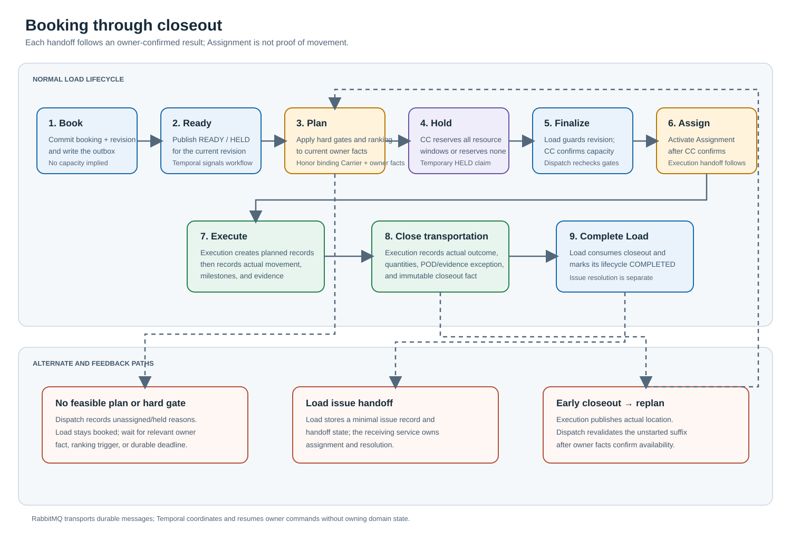
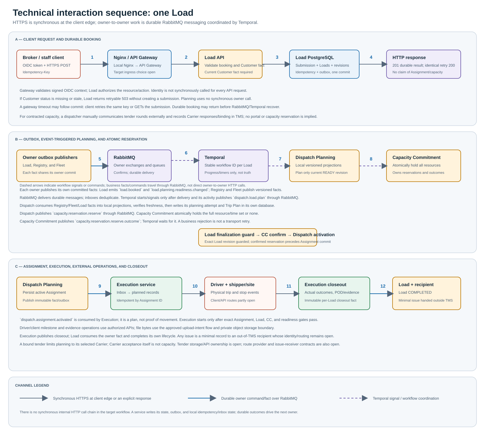
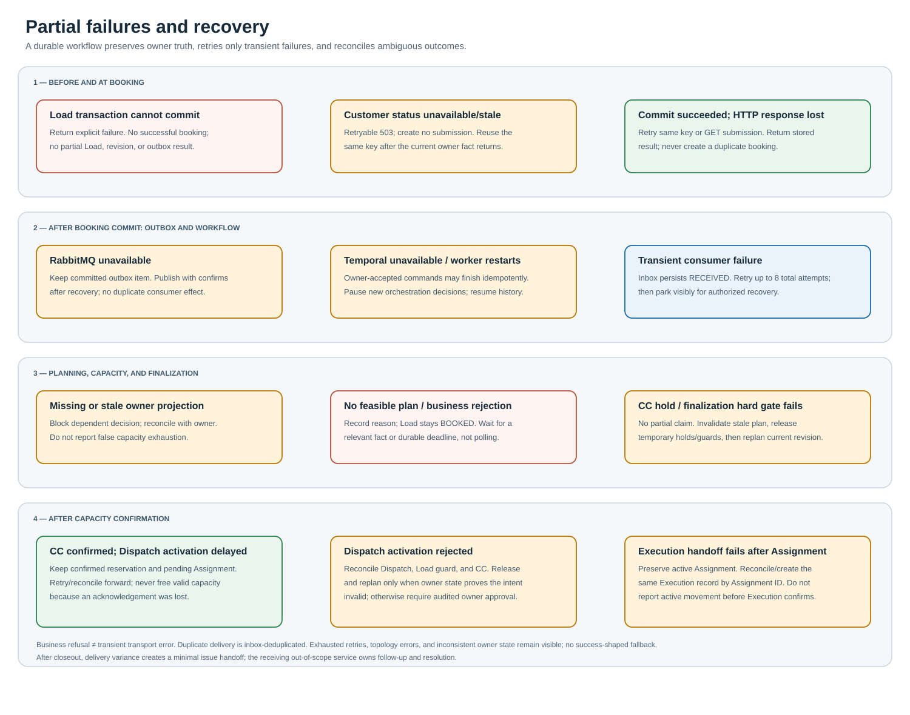

# TMS technical workflow

This page records cross-service invariants and agreed logical database
schemas for the target workflow; it is not an executable API specification,
production migration, or implementation plan. The
[system blueprint](TMS_SYSTEM_BLUEPRINT.md) owns target architecture. The
[service contracts](../contracts.md) document owns shared transport
guidance; the [TMS map catalog](../maps/README.md) indexes standalone
diagrams by concern; and [open decisions](OPEN_QUESTIONS.md) lists unresolved
protocols.

## Ownership and lifecycle

The target workflow keeps business state in its owning boundary:

1. **Load** owns commercial bookings, completeness at each required stage,
   ordered requested stops, immutable requirement revisions, and missing-
   information tasks.
2. **Counterparty Registry** owns separate Customer and Carrier master
   records, lifecycle status, external references, and organization-level
   contacts. It does not own Load terms, Carrier qualification, capacity,
   or execution.
3. **Fleet Readiness** owns driver/equipment operational records,
   manually maintained availability/readiness facts, and versioned
   planning-critical Carrier eligibility facts with their verification
   evidence. It excludes HR, payroll, maintenance, legal interpretation, and
   compliance case management.
4. **Dispatch Planning** owns planning attempts and expiring per-Load planning
   leases, versioned Trip Plans, and immutable per-Load Assignment decisions.
5. **Capacity Commitment (CC)** owns atomic reservations for the complete
   resource/time-window set of a Trip Plan revision and authoritative
   reservation expiry. It does not own Load-planning leases.
6. **Execution** owns planned and actual Trip Execution, per-Load execution,
   actual stop milestones, remarks, exceptions, evidence metadata,
   completion, and corrections.
7. **Notification** owns user-facing notification and delivery state; it
   surfaces actionable work but does not own the underlying business fact.
8. **Identity** owns authentication-focused principals, credentials,
   sessions, role grants, and signed identity context; it does not own
   operational profiles or domain permissions.
9. **Operations View** owns read-only projections for operational screens.
   It consumes versioned owner facts, reports projection freshness, and
   cannot authorize or commit business changes.

These are peer service boundaries. A shared planning identifier may
correlate related records, but each owner retains its own record identity,
database, and state transitions.

## Load lifecycle and revision model

Load keeps a mutable head record for its current lifecycle status and current
revision pointer. A successful booking creates a `BOOKED` Load. Its status
remains `BOOKED` while Dispatch Planning, Assignment, and Execution progress;
those domains retain their own authoritative states. A pre-execution
cancellation changes Load to `CANCELLATION_PENDING`, then to `CANCELLED`
only after the required downstream releases. An accepted cancellation
cannot be withdrawn. After Execution confirms closeout, Load consumes that
authoritative fact and sets its summary status to `COMPLETED`; Load does not
independently decide whether execution is complete.
`CANCELLED` and `COMPLETED` are terminal Load states and cannot transition
to each other or back to an active lifecycle state. Preserve linked issue
records independently: an issue neither delays nor reverses terminal status.
Per-Load Execution and Load become `COMPLETED` when the transportation
attempt ends, including when freight for that Load remains on the equipment.
Actual delivered and undelivered quantities and locations are preserved in
the immutable Execution closeout fact. The Load service keeps only a
minimal linked issue record and handoff status; the receiving out-of-scope
service owns issue assignment and resolution. Trip and per-Load Execution
completion records the end of movement, not customer satisfaction or
commercial settlement. Corrected reports and late evidence are appended
without silently changing terminal state.
Store the current lifecycle state on the Load head. Append a typed
`load_lifecycle_transitions` row for each accepted change in the same
transaction, recording prior/new state, timestamp, actor or source, reason
code, and correlation reference; transition rows are immutable. The booking
transaction appends an initial `NULL` to `BOOKED` transition; only this first
transition may have a null prior state.

Each immutable `load_revision` has a UUID ID and a monotonically increasing
`revisionNumber`, unique per Load. Every revision is a full snapshot.
Revision-owned stops and freight rows reference the revision ID, preserving
the exact requirements used by planning and execution. Each stop has an ID
scoped to that revision; Execution milestones and delivery evidence refer to
that exact stop. Each freight line is likewise revision-scoped, and an
amended revision receives new stop and freight-line IDs even for unchanged
rows.
Booking stop timestamps include an explicit RFC 3339 UTC offset and IANA
time zone; Load rejects a mismatch and stores normalized UTC instants ending
in `Z` plus the IANA zone in the canonical snapshot.
Current lifecycle status is not copied into planning, Assignment, or
Execution records as authoritative state; Operations View combines the
owner facts.
Every approved Load amendment submits a complete next-revision snapshot;
Load validates it before creating a new revision. Omitted optional values are
cleared in the new snapshot rather than inherited from the prior revision.
Treat `null` on an optional request field as omission unless that field is
explicitly nullable; required fields retain their normal validation.
Amendments are
permitted before actual execution starts; after active Assignment, they
require revalidation before further automated progression. Once execution
starts, changes to the Load commitment use the Execution
operational-exception workflow rather than amending its requirements.
`customerId` is immutable across Load revisions; reject an amendment that
changes it with `LOAD_CUSTOMER_IMMUTABLE` at `/customerId`. A different
Customer requires a separate booking, with the existing Load handled through
its normal lifecycle controls.
For an amendment committed with an active Assignment before Execution starts,
freeze Dispatch progression and retain the existing Assignment and confirmed
Capacity Commitment while the amended revision is replanned. Do not supersede
the Assignment or release its commitment until the replacement plan and
capacity confirmation are durable. Complete a coordinated, recoverable
handoff to the Assignment and commitment for the exact amended revision
before progression resumes. Retain the old Assignment and confirmed
commitment for at most ten minutes from amendment commit, without renewing
the deadline. If replacement planning and capacity confirmation are not both
durable by then, retire the revalidation attempt and begin coordinated
release. Keep the Load blocked until both owners confirm release, then return
it to normal planning; ignore late results from the expired attempt.
Amendments use `If-Match` with the current revision ETag; a stale ETag
returns `412 Precondition Failed`, which is retained against the amendment's
idempotency fingerprint and replayed on identical retries without creating a
revision. A missing `If-Match` returns and retains `428 Precondition
Required`; adding the ETag changes the fingerprint, so a corrected request
uses a new idempotency key. A conflict with an active Load finalization guard
returns a retryable `409 Conflict`.
Bind the amendment idempotency key to both the normalized replacement
snapshot and base-revision ETag. Check for an existing idempotency result
before evaluating the current ETag so retries replay their original outcome;
reusing the key with a different snapshot or ETag returns `409 Conflict`.
When a complete amendment snapshot fails validation, persist its ordered
issues with the idempotency result and replay the rejection on identical
retries; create no revision or revision fact. Sort issues by `fieldPath`,
then `code`, lexicographically. Corrected content requires a new
idempotency key.

Persist the customer rate as a positive USD `NUMERIC(12,2)` value; currency
conversion is not performed in the initial contract. Public API amounts
remain decimal strings; do not use binary floating-point for money. Persist
positive freight handling-unit counts as exact `NUMERIC(12,0)` values and
enforce the controlled handling-unit code at validation. When provided,
total gross weight is a positive `NUMERIC(12,3)` value with a controlled `LB`
or `KG` unit; it remains optional at booking and is required before planning.

## Counterparty record baseline

Counterparty Registry owns separate Customer and Carrier master records.
One legal organization may have both a Customer profile and a Carrier
profile under a shared Counterparty identity; each profile has its own
identifier, status, and lifecycle. A legal name is required; display name,
external business reference, and organization-level contact records are
optional. Carrier USDOT and MC identifiers may be recorded when applicable,
with verification status and source; tax identifiers are deferred until
financial/compliance scope and retention controls are approved.

Both record types use `PENDING`, `ACTIVE`, `SUSPENDED`, and `CLOSED` states.
Load booking requires an `ACTIVE` Customer. An `ACTIVE` Carrier record does
not establish qualification or capacity availability. Counterparty status
changes do not rewrite Load history; each Load revision retains its Customer
ID and a name snapshot. Cross-service references use stable IDs and
versioned facts, not foreign keys. A non-`ACTIVE` Customer blocks new
bookings. Only an `ACTIVE` Carrier may be selected for a new binding tender or
have a pending Assignment activated. If a Carrier becomes `SUSPENDED` or
`CLOSED` before activation, do not activate its pending Assignment. Retain
that pending Assignment and any existing Capacity Commitment reservation for
explicit dispatcher re-tender/reselection or coordinated release; if no
Assignment has been proposed, keep the Load unassigned pending dispatcher
action. Already active Assignments and Execution continue under their
current lifecycle until an authorized reassignment or cancellation workflow
changes them. Customer status changes do not automatically hold, amend, or
cancel existing Loads. Preserve existing Loads, reservations, Assignments,
and execution history for explicit review; status changes never auto-cancel
or delete them.
The latest applied Customer lifecycle-status fact remains valid for booking
until superseded by a newer owner revision; it has no wall-clock TTL. If Load
detects a revision gap or a required update remains unapplied for 30 seconds,
it marks the projection stale and reconciles before using the status. Target
p95 application lag is at or below five seconds. If status is missing or
known stale and Counterparty Registry is unavailable, booking fails with
retryable `503` and creates no submission.

## Fleet readiness baseline

Fleet Readiness owns the operational records needed to establish in-house
and contracted driver/equipment readiness and availability for planning,
along with versioned Carrier eligibility facts and their verification
evidence when required by planning gates.
Contracted drivers and equipment reference their Carrier profile; Identity
stores only the associated principal and authentication data. Fleet
Readiness does not own employment/HR, payroll, maintenance, or compliance
case management.
Driver profiles use `PENDING`, `ACTIVE`, `SUSPENDED`, and `CLOSED` states.
Only `ACTIVE` profiles may be considered for new Assignments, subject to
current readiness and qualification gates. Suspension or closure preserves
existing assignments and execution history for explicit review; it does not
automatically cancel or remove active work.
An in-house driver is linked to the company's fleet group. A contracted
driver must link to an `ACTIVE` Carrier profile, and the relationship must
be verified by an authorized `contract_capacity_dispatcher` before the
driver is eligible for planning. Retain the evidence source/reference,
verifier principal, and verification time with the relationship record.
Fleet Readiness stores verified, planning-critical Carrier safety and
contractual eligibility facts and enforces approved hard gates. It does not
interpret legal or regulatory requirements, provide regulatory reporting,
or manage compliance cases. Specific facts, evidence sources, verification
roles, and rules require authoritative sources and qualified review before
they become product policy.
Carrier agreements remain external legal records. When an agreement is
required by a gate, Fleet Readiness stores only the verified operational
eligibility fact and agreement reference needed for that gate; it does not
own agreement documents or their lifecycle.
Dispatch Planning evaluates each applicable eligibility fact independently;
a required missing, expired, invalid, or unverified fact blocks planning.
Do not use one aggregate Carrier qualification flag as a substitute for
current owner facts.
Initially, an authorized verifier manually reviews an approved authoritative
source and records the fact in Fleet Readiness; no live external-source
integration is assumed. Retain the evidence source/reference, verifier
principal, observation time, owner revision, and applicable validity period.
When a fact becomes invalid, expires, or is superseded, immediately notify
the responsible verifier and affected planning owner. Apply D-491's
stage-specific hold; this event does not automatically interrupt an active
Assignment or Execution. Notification channel, delivery retry, and
acknowledgement rules remain open.

Initially, fleet dispatchers maintain equipment and availability/readiness
facts in the TMS, and drivers may report their own factual status. Facts
retain source, observed time, and owner revision. The owning service defines
validity by fact type and includes expiry metadata where applicable; there is
no universal time-to-live. Missing or expired hard-gate facts are treated as
unknown/ineligible, never as approval. Driver and equipment availability is
planning-current for 15 minutes after observation. Qualification and
equipment-compatibility facts remain current until their recorded expiry, if
any, or a superseding owner revision.
Verified equipment maintenance status may act only as a readiness or
availability blocker. Fleet Readiness does not own maintenance records or
work-order management. Fleet dispatchers record and verify status for
in-house equipment; contract capacity dispatchers do so for contracted
equipment. The status is `CLEAR` or `BLOCKED`, with a reason, evidence
source/reference, verifier principal, observed time, and valid-through time.
`BLOCKED` prevents planning; `CLEAR` removes only the maintenance blocker and
does not establish overall readiness. Every status has an explicit validity
deadline, using the evidence's valid-through date when available or a finite
dispatcher-set deadline otherwise. Missing or expired status is unknown and
blocks planning. The evidence reference identifies a verified maintenance
record or inspection; attach a supporting document when one exists, but do
not require an attachment when no document exists.
Represent availability as versioned, time-bounded facts with resource ID,
`AVAILABLE`/`UNAVAILABLE` state, `validFrom`, `validTo`, `observedAt`,
source, and owner revision. Missing or expired availability is `UNKNOWN`;
do not store it as a durable `ready` boolean.

## Booking intake and response

1. The API gateway receives `POST /api/v1/booking-submissions`, applies edge
   authentication and transport-level checks, and routes it to Load. It does
   not decide whether a row is a valid booking or write Load data.
2. Brokers submit a multi-row booking through either an in-app form or a
   spreadsheet upload. Each interface validates its own input format, then
   submits the same normalized booking command to Load for authoritative
   business validation. One row represents one Load.
   The semantic request field inventory, valid value shapes, and booking-
   critical versus stage-gated validation behavior are defined in the
   [shared contract](../contracts.md). Both interfaces submit that common
   shape; Load remains authoritative for business validation.
3. A client supplies an `Idempotency-Key`; Load assigns a UUID
   `submissionId`. A well-formed attempt is durably recorded whether accepted
   or rejected. A booking-critical error in any row rejects the full batch,
   records its normalized input and all independently detectable row/field
   issues in deterministic order, and creates no Loads.
   An identical retry returns the same result; reusing the key with changed
   normalized content returns `409 Conflict`. A correction is a new
   submission linked to the rejected attempt. An accepted Load is changed
   through its amendment workflow, not resubmitted as a new booking.
   Each submission is limited to 100 rows and 5 MB of normalized JSON; an
   oversized request returns `413` and creates no submission.
   Load validates Customer activity only from a current, valid owner fact. If
   that fact is missing or expired and Counterparty Registry is unavailable,
   return retryable `503` with `CUSTOMER_STATUS_UNAVAILABLE` without creating
   a submission or Loads; retry the unchanged request with the same key
   after recovery. A known inactive Customer produces a durable business
   rejection for that new booking. A later Customer status transition does
   not automatically hold or cancel Loads already accepted; they continue
   unless separately amended or canceled through the authorized workflow.
4. When all rows pass booking-critical validation, Load atomically commits
   the accepted submission outcome, one Load and initial immutable revision
   per row, and outbox entries for subsequent planning. The first durable
   result returns `201 Created`; an identical retry returns `200 OK`. The
   gateway relays Load's immediate response with Load references and
   applicable completion tasks, including stage-blocking tasks. It does not
   claim capacity is reserved or
   work is assigned. `GET /api/v1/booking-submissions/{submissionId}`
   retrieves the same durable result.
   A Temporal outage does not block this response once Load has committed
   the submission, Load/revision records, and outbox. Planning remains
   queued for recovery; do not claim an Assignment until Dispatch Planning
   confirms it. If Load cannot durably commit, return failure rather than
   success.
   Load writes one `load.booked` fact (`schemaVersion: 1.0.0`) to its outbox
   for each accepted Load, with the complete immutable initial revision,
   explicit `BOOKED` lifecycle status, submission ID, and source row.
   `correlationId` is the shared booking submission ID; `ownerRevision`
   starts at 1 per Load. For every committed revision, Load also publishes
   `load.planning.readiness.changed` (`READY` or `HELD`) with field-addressed
   blocking issues; a `READY` fact has an empty issue array. Each amendment
   publishes `load.revision.created` with its complete snapshot. These facts
   and the corresponding state/revision writes commit atomically. Only a
   `READY` fact for the current revision permits planning.
   Start one Temporal workflow per Load from this fact; link it to the
   submission and derive its stable workflow ID from the Load ID so duplicate
   delivery cannot start a second workflow. Keep it active through
   cancellation or Execution-confirmed closeout; it coordinates saga steps
   without owning domain state. Loads from one batch progress and recover
   independently. If Temporal becomes unavailable mid-saga, owning services
   may complete durably accepted commands idempotently and publish outcomes;
   pause further orchestration decisions, then resume from durable workflow
   state and recorded owner outcomes after recovery. Do not repeat accepted
   business effects or compensate solely because Temporal was unavailable.
   Use Temporal Continue-As-New at a configurable history threshold,
   initially 10,000 history events. Carry forward current orchestration
   state, last-applied owner revisions, and active deadlines; cover
   continuation with deterministic replay tests.
5. Stage-specific completeness is evaluated independently. Missing
   planning-stage information may leave a valid booking in a planning hold.
   If booking-critical data is valid, invalid optional or later-stage input
   does not reject the booking: omit the invalid value from the canonical
   Load revision and record a field-addressed completion task with the issue
   and required correction. Hold any stage that requires that fact until
   valid data is supplied and revalidated; a field with no stage gate creates
   non-blocking work. Booking-critical invalid values and omissions continue
   to reject the full batch. Notification only surfaces the task. Load
   completeness does not imply Dispatch Planning feasibility.
6. Once a booking transaction commits, each Load proceeds independently.
   One Load's planning or execution exception does not block sibling Loads
   from the same submitted batch.

## Initial Load data contract

The following field groups are agreed for the first booking and planning
baseline. The complete semantic request inventory and result payloads are
defined in the [shared contract](../contracts.md); this workflow describes
their operational handling, not final SQL column names.

- A row requires a syntactically valid UUIDv7 `customerId` issued by
  Counterparty Registry. Reject a missing ID with `CUSTOMER_ID_REQUIRED`,
  and a malformed or non-UUIDv7 ID with `CUSTOMER_ID_INVALID` before
  Customer-status lookup. `customerReference` is optional;
  trim surrounding whitespace, preserve internal spacing and case, and allow
  at most 100 Unicode code points. An all-whitespace value is absent; a
  longer normalized value is omitted and creates a non-blocking
  `CUSTOMER_REFERENCE_TOO_LONG` completion task. The field is not unique,
  and a possible duplicate is only a broker warning, not an automatic merge.
  Each immutable Load revision snapshots
  the Customer's legal name as resolved at creation; display name is not
  substituted, and later Customer name changes do not rewrite the snapshot.
- Each Load has one positive total `customerRate`. Represent its amount as
  an exact decimal string with at most two fractional digits, persist it as
  `NUMERIC(12,2)`, and cap it at `9999999999.99` USD. An absent rate object
  uses `CUSTOMER_RATE_REQUIRED`; a missing/blank amount or malformed,
  non-positive, over-precision, or out-of-range amount uses
  `CUSTOMER_RATE_AMOUNT_INVALID`. Trim the amount; accept digits with an
  optional decimal point and one or two fractional digits only, without
  signs, grouping separators, or exponent notation. Serialize accepted
  canonical amounts with exactly two fractional digits and no redundant
  leading zeroes. The API also accepts an ISO 4217 currency code. Trim the
  currency code and normalize it to
  uppercase before validation; reject invalid codes with
  `CUSTOMER_CURRENCY_INVALID` and valid non-USD codes with
  `CUSTOMER_CURRENCY_UNSUPPORTED`. The initial
  customer-rate currency is USD only; the TMS performs no currency
  conversion. The initial model records one total rate, not billing or
  accessorial line items.
- A Load has an ordered list of one or more `PICKUP` and one or more
  `DELIVERY` stops, with at most 50 stops per Load. The first must be a
  pickup and the last a delivery; intermediate types may interleave. Reject
  an invalid endpoint order with `STOP_SEQUENCE_INVALID`. Trim stop types,
  accept either value regardless of casing, and store the value in uppercase;
  reject empty or unknown values with `STOP_TYPE_INVALID`. Dispatch Planning
  evaluates route feasibility. Each stop stores a
  structured US address snapshot:
  required address line 1, city, a two-letter USPS code for one of the 50
  states or DC, and postal code; reject territories or other USPS region
  codes with `STOP_STATE_CODE_INVALID`. A missing or blank `stateCode` uses
  `STOP_ADDRESS_FIELD_REQUIRED`. `countryCode` is optional and
  defaults to `US`; reject another supplied country with
  `STOP_COUNTRY_UNSUPPORTED`. When supplied, trim it, accept `US` regardless
  of casing, and store it as uppercase; a blank value is invalid. Trim state
  codes, accept either casing for valid codes, and store them in uppercase.
  Optional `address.coordinates` uses WGS 84 JSON numbers, with latitude
  from −90 to 90 and longitude from −180 to 180, each with at most six
  fractional digits. Omit partial, malformed, over-precision, or out-of-range
  coordinates from the canonical address and report non-blocking
  `STOP_COORDINATES_INVALID` at the exact field path.
  Trim city edges, preserve internal spacing and capitalization, and limit it
  to 1–120 Unicode code points.
  Blank cities use `STOP_ADDRESS_FIELD_REQUIRED`; overlength cities use
  `STOP_CITY_TOO_LONG`. Include row and field paths and reject the full batch.
  Treat required postal codes as strings; missing/blank values use
  `STOP_ADDRESS_FIELD_REQUIRED`. Otherwise accept five digits or hyphenated
  ZIP+4, trim surrounding whitespace, and preserve the accepted format.
  Reject any other format with `STOP_POSTAL_CODE_INVALID` at the field path,
  rejecting the full batch.
  Trim surrounding whitespace from address lines and preserve internal
  spacing; line 1 is required
  and line 2 is optional, with each limited to 200 Unicode code points.
  Omit an empty line 2; reject an empty line 1 with
  `STOP_ADDRESS_FIELD_REQUIRED` and an overlength line with
  `STOP_ADDRESS_FIELD_TOO_LONG`, identifying the row and field and rejecting
  the full batch. Each stop requires start/end appointment timestamps with
  explicit RFC 3339 offsets and an IANA time zone; start must precede end.
  Facility name, contact name/phone, and access instructions are optional and
  retained on the Load revision. Trim
  surrounding whitespace; facility/contact names are limited to 120 Unicode
  code points, phone to 32 while preserving formatting, and access
  instructions to 1,000. Empty-after-trim values are absent; a supplied
  overlength value is omitted and creates the non-blocking
  `STOP_OPTIONAL_FIELD_TOO_LONG` completion task at its field path. A contact
  phone must contain 7–15 main
  digits, optional leading `+`, common separators, and optionally a 1–6 digit
  extension introduced by `x`, `ext`, `ext.`, or `#`; preserve its trimmed
  formatting. Invalid syntax is omitted and creates the non-blocking
  `STOP_CONTACT_PHONE_INVALID` completion task rather than rejecting booking.
- Each Load has at least one and at most 500 freight lines. Each line has a
  required description trimmed to 1–500 Unicode code points; preserve
  internal spacing and store the trimmed value. An empty description rejects
  the submission with `FREIGHT_DESCRIPTION_REQUIRED`; an overlength value
  uses `FREIGHT_DESCRIPTION_TOO_LONG`. Both issues identify the row and
  field, and reject the full batch. Each freight line represents one
  homogeneous commodity and handling-unit group. Its positive integer
  `quantity` counts handling units of its `handlingUnitCode`, not the number
  of contained products. It is required; a missing count uses
  `FREIGHT_QUANTITY_REQUIRED`. Accept a decimal integer string from `1`
  through `999999999999`, trim surrounding whitespace, and reject signs,
  decimal points, grouping separators, exponent notation, zero, or values
  outside that range with `FREIGHT_QUANTITY_INVALID`. Persist as `NUMERIC(12,0)` and
  serialize as an integer decimal string without redundant leading zeroes.
  A contained-product quantity and unit are not represented yet and must not
  be overloaded into this count. Each line requires an explicit boolean
  `stackable` at booking. Missing and non-boolean values reject the batch with
  `FREIGHT_STACKABILITY_REQUIRED` and `FREIGHT_STACKABILITY_INVALID`,
  respectively. The flag applies to every handling unit in the homogeneous
  line; separate differing stackability or dimensions into separate lines.
  Each line has a controlled
  handling-unit code: `PALLET`, `SKID`, `CASE`, `CARTON`, `BOX`, `PIECE`,
  `CRATE`, `DRUM`, `BAG`, `ROLL`, `CONTAINER`, or `OTHER`. Trim handling-unit
  codes, accept recognized values regardless of casing, and store them in
  uppercase; reject empty or unknown values with `HANDLING_UNIT_INVALID`.
  For `OTHER`, require `handlingUnitDescription`, trim it, preserve internal
  spacing, and limit it to 1–120 Unicode code points. Missing/empty values use
  `OTHER_HANDLING_UNIT_DESCRIPTION_REQUIRED`; overlength values use
  `OTHER_HANDLING_UNIT_DESCRIPTION_TOO_LONG`. Both issues identify the row
  and field and reject the full batch; store the trimmed description.
  Supplying `handlingUnitDescription` for another code omits that
  inapplicable value and creates the non-blocking
  `HANDLING_UNIT_DESCRIPTION_NOT_APPLICABLE` completion task at that field path.
  `totalGrossWeight` is an optional-at-booking
  object `{value, unit}`. Trim `value`; accept digits with an optional
  decimal point and one to three fractional digits only, without signs,
  grouping separators, or exponent notation. The value must be positive and
  within `NUMERIC(12,3)`. Serialize accepted canonical values with exactly
  three fractional digits and no redundant leading zeroes. Trim and
  normalize `unit` to uppercase before validation. It is required before
  planning. If supplied at booking but invalid, omit it from the canonical
  revision and create a field-addressed `TOTAL_GROSS_WEIGHT_INVALID`
  completion task; keep the Load held from planning until valid weight is
  supplied and revalidated.
- The initial supported equipment profiles are dry van, reefer, and flatbed.
  An equipment profile is required before planning but not at booking; if
  absent, keep the Load booked and place it on a planning hold without
  defaulting to dry van. Accept the recognized but unsupported `STEP_DECK`
  and `TANKER` values but hold them from planning; omit any other supplied
  value and create a field-addressed `EQUIPMENT_PROFILE_INVALID` completion
  task, keeping the Load held from planning until corrected. Trim supplied
  values, accept recognized profiles regardless of casing, and store the
  canonical value in uppercase.
  `specialHandlingCodes` accepts only `OVERSIZE` and `HAZMAT`. These known
  values may be booked but block planning while their capabilities are
  unsupported. Trim each value, accept either code regardless of casing,
  and normalize to uppercase before deduplication. Omit each empty or unknown
  value and create a field-addressed `SPECIAL_HANDLING_CODE_INVALID`
  completion task; keep planning held until each invalid entry is corrected
  and revalidated. Keep each known code once in the canonical revision,
  preserving first-occurrence order. The field is optional; omit it from the
  canonical revision when absent or supplied as an empty array.
  `HAZMAT` is only a flag in the initial schema; defer detailed dangerous-
  goods data until a dedicated workflow exists, and keep the Load held from
  planning and Assignment.
  Reefer Loads require `temperatureRange: {minimum, maximum, unit}` before
  planning; temperatures are decimal strings with at most two fractional
  digits, stored as signed `NUMERIC(5,2)`, and use one shared `F` or `C` unit.
  Trim the unit and normalize recognized values to uppercase; an empty or
  unsupported unit invalidates the range. Trim each endpoint; accept signed
  decimal notation with an optional minus sign and at most two fractional
  digits, but no plus sign, separators, or exponent notation. Enforce the
  signed `NUMERIC(5,2)` range. Serialize valid endpoints with exactly two
  fractional digits; minimum must not exceed maximum. A malformed or
  internally invalid range is omitted from the canonical
  revision and creates a planning-blocking
  `REEFER_TEMPERATURE_RANGE_INVALID` follow-up without rejecting the booking.
  Trim `reeferMode`, accept `CONTINUOUS` or `START_STOP` regardless of
  casing, and store recognized values in uppercase. Omission defaults to
  `CONTINUOUS`, which is recorded with a non-blocking broker follow-up.
  Apply that default and follow-up only when `equipmentProfile` is
  `REEFER`; if the profile is absent, defer both until it is selected.
  For a known reefer, an invalid supplied mode is omitted and defaults to
  `CONTINUOUS` with a non-blocking `REEFER_MODE_INVALID` follow-up.
  If the profile is absent, omit an invalid mode and defer default/follow-up
  handling until profile selection.
  Reefer-only fields with an explicit non-`REEFER` profile reject the
  booking; if the profile is absent, retain those fields until selection
  determines their applicability.
  A freight line's optional
  `dimensions: {length, width, height, unit}` describes one handling unit.
  Measurements are positive decimal strings stored as `NUMERIC(10,2)` and
  share one `IN` or `CM` unit. Trim the unit and normalize recognized values
  to uppercase. Trim each measurement; accept positive decimal notation with
  an optional decimal point and one or two fractional digits, without signs,
  separators, or exponent notation. Enforce the `NUMERIC(10,2)` range and
  serialize valid measurements with exactly two fractional digits.
  Dimensions are required before planning whenever `stackable` is `true`,
  regardless of equipment profile. Flatbed Loads additionally require
  dimensions for every freight line. If dimensions are required but absent,
  return the planning-blocking `FREIGHT_LINE_DIMENSIONS_REQUIRED` follow-up;
  if required dimensions are supplied but partial or invalid, omit them from
  the canonical revision and return the planning-blocking
  `FREIGHT_LINE_DIMENSIONS_INVALID`. If supplied dimensions are invalid while
  not currently required for planning, omit them and return the non-blocking
  `FREIGHT_LINE_DIMENSIONS_INVALID_OPTIONAL` follow-up. Do not emit duplicate
  dimension follow-ups when both rules apply. These rules record basic
  geometry and stackability, not a complete trailer-space, weight-bearing,
  orientation, or stack-configuration model; those remain future planning
  capabilities. Flatbed Loads also require boolean `tarpRequired` before planning; missing or
  non-boolean values create the corresponding planning-blocking follow-up
  and are never treated as `false`.
  Missing planning facts hold a booked Load from planning.
- Step-deck and oversize capability are later-phase work; tanker and
  hazardous-material capability follow after that. A broker may still record
  a commercial booking that needs a not-yet-supported profile, but it remains
  visibly held and cannot be automatically planned, assigned, or executed
  until the required capability is approved and available.

## Planning, reservation, and Assignment

An accepted manual Carrier tender records the Carrier's response only; it
does not create a reservation or Assignment. Capacity is protected only
after the Load passes the normal Dispatch Planning and Capacity Commitment
finalization workflow.
Each tender has an explicit response deadline and expires unanswered; a
response after expiry cannot accept that tender. The default deadline is one
hour after sending and is editable per tender by the
`contract_capacity_dispatcher`. Notify the responsible
`contract_capacity_dispatcher` immediately on each Carrier counteroffer,
acceptance, rejection, or expiry; send no pre-deadline reminders. Carrier and
dispatcher may exchange any number of counteroffers. Each new offer or
counteroffer starts a response period with a one-hour default deadline,
editable per tender. The responsible dispatcher may accept a Carrier
counteroffer without blanket supervisor approval. Record each offer,
counteroffer, response, rate, currency, and deadline against its tender round;
offers and counteroffers may change only rate and currency. Load scope or
operating requirement changes use the normal Load amendment and replanning
process. If either party misses a round deadline, the entire tender expires;
a late response cannot reopen it. Before a tender is selected as binding,
the responsible dispatcher may withdraw it at any time, including after
Carrier acceptance. Record the withdrawal and preserve prior rounds and
responses; the dispatcher informs the Carrier through the existing external
channel. When multiple Carriers accept, the dispatcher explicitly selects
exactly one accepted tender as binding and closes competing open and accepted
tenders externally, recording their disposition. Dispatch Planning may
consider only the selected tender's Carrier. Only an `ACTIVE` Carrier may be
selected for a new binding tender or have a pending Assignment activated. If
the selected Carrier cannot pass readiness or capacity checks, or becomes
`SUSPENDED` or `CLOSED` before Assignment activation, hold planning. If a
pending Assignment and reservation already exist, retain them without
activation until explicit dispatcher re-tender/reselection or coordinated
release; otherwise keep the Load unassigned. The dispatcher may auditably
supersede the binding selection and select another accepted tender only
after reconfirming that Carrier's acceptance through the external channel,
or issue a replacement tender.
After Assignment activation, a Carrier change must use the Load
amendment/replanning or cancellation workflow and its coordinated Assignment
and Capacity Commitment handling. A Load amendment before Assignment
activation does not automatically clear the binding Carrier: Dispatch
revalidates the exact amended revision against that Carrier and leaves the
Load unassigned if required checks fail. The amendment does not rewrite
historical tender terms; whether changed requirements require a new rate or
renewed Carrier acceptance remains open. Carrier acceptance and binding
selection do not reserve capacity. A later transition to `SUSPENDED` or
`CLOSED` does not automatically hold, amend, or cancel an active Assignment
or its Execution; those continue until an authorized reassignment or
cancellation workflow changes them.
Load cancellation automatically cancels its open tenders, notifies the
responsible dispatcher, and preserves negotiation history. The dispatcher
communicates tenders, counteroffers, withdrawals, and Load-cancellation
notices through the existing external channel and records sent offers and
Carrier responses in the TMS; the TMS does not deliver these messages or
provide a Carrier portal. Each round may include an external message
reference or supporting attachment; do not store copied external message
bodies.
Each tender has one fixed rate basis: `FLAT_PER_LOAD`, `PER_MILE`,
`PER_KILOMETER`, `PER_HOUR`, `PER_STOP`, or `OTHER` with an explanation.
`FLAT_PER_LOAD` is the indicative total. For standard unit bases, calculate
the indicative total from the selected Trip Plan revision's planned distance,
duration, or stop count and retain the quantity and revision used. Before a
Trip Plan exists, show the unit rate for these bases without a calculated
total. A later plan revision recalculates the current estimate while
preserving prior estimates. `OTHER` has no calculated total. Tender rates
use USD only in the initial scope, with at most two decimal places; the TMS
does not perform currency conversion, and each rate must be greater than
USD 0.00. Calculated indicative totals round half up to the nearest USD cent.
Exact tender payload remains open.

1. Temporal coordinates the durable workflow. RabbitMQ carries durable
   commands and business facts. Temporal progress is orchestration state,
   not a source of business truth.
2. Dispatch Planning consumes versioned owner events into local planning
   projections. It performs an initial evaluation when a Load becomes
   planning-ready, replans on relevant Load or capacity changes signaled to
   the per-Load Temporal workflow, and uses durable timers for freshness
   expiry and approaching operational deadlines. Do not run continuous
   polling loops. Signals carry the owner resource ID and revision; the
   workflow ignores duplicate/stale revisions. Mark the inbox event processed
   only after Temporal confirms signal acceptance.
   Freshness rules belong to the owner of each fact; facts retain source,
   observed time, recorded time, and owner revision. It also consumes
   Counterparty and Fleet Readiness projections; no synchronous service call
   supplies a planning decision.
3. Dispatch Planning obtains its own persisted, expiring Load-planning lease.
   Its TTL is 10 minutes, renewed every two minutes only during an active
   automated attempt. Release it at completion and before human review;
   expiry makes the attempt stale and eligible for replanning.
   A Trip Plan groups one or more Loads and is divided into ordered resource
   segments. Each segment covers a contiguous route section and contains
   exactly one power unit, one matching trailer, and one or two drivers.
   Any segment boundary that changes the assigned resource set must be an
   explicit planned stop or handoff location. A Load may have at most one
   active Trip Plan
   Assignment at a time, while a Trip Plan may include multiple Loads. A Trip
   Plan revision is immutable; each Load's requirements and requested
   ordered stops are owned by Load in immutable revisions.
   A feasible plan must provide continuous segment coverage, avoid
   overlapping reservations for any resource, meet equipment compatibility
   requirements, allow sufficient resource repositioning time, and satisfy
   driver availability and qualification checks. Missing or stale readiness
   facts block planning; they must not be treated as evidence of eligibility.
   Apply the initial hard gates, candidate ranking, profile classification,
   and contention rules in the
   [Dispatch Planning policy](../contracts.md#initial-dispatch-planning-policy).
   Apply D-511 for dispatcher Load ranking, the rolling 14-day/five-Load
   reservation chain, the LA-local ranking cycle, preference-driven
   reallocation, and immediate tail review after cancellation or
   infeasibility. D-499's automated resource-candidate ranking does not
   replace dispatcher ranking of Loads.
   An early-ended Trip or per-Load Execution publishes an actual closeout
   location that immediately triggers suffix revalidation and replanning
   from that location. Minimize feasible deadhead, but do not treat missing
   or stale resource facts or remaining freight as evidence that the trio is
   available.
   Record the exact Load and owner-fact revisions, route-estimate provenance,
   profile/policy version, and deterministic feasibility result for each
   attempt. Route estimates use the provider-neutral provenance requirements
   in D-500 and D-509. Before enabling Dispatch Planning, approve one
   evidence-reviewed initial route source and versioned service-time
   assumptions; preserve provenance per estimate and do not silently switch
   providers. Missing route or stop-service-time estimates defer the attempt
   for visible human review; an unverified manual estimate cannot support
   automatic finalization. A strong avoid-preference or driver objection
   creates a durable review task; the responsible dispatcher must
   acknowledge within 15 minutes or the task escalates to the transportation
   executive. Acknowledgement is receipt only, and the proposal remains on
   hold until an authorized, reasoned disposition is recorded. Missing or
   stale owner projections trigger reconciliation and must not be reported
   as capacity exhaustion.
4. If a completed planning attempt finds no eligible capacity, Dispatch
   publishes one `load.planning.unassigned` fact with a UUIDv7
   `planningAttemptId` and all applicable stable, safe reason codes. The Load
   remains booked and unassigned. Dispatch starts another attempt only when
   the current Load revision becomes `READY`, an owner fact can change
   resource eligibility or capacity, or an explicit durable deadline fires;
   do not continuously poll without new information. Missing or stale owner
   projections defer planning and trigger reconciliation; they do not prove
   that capacity is unavailable. As a pickup deadline approaches or passes,
   escalate for human action. Do not automatically cancel a booked
   commitment.
5. CC atomically reserves the complete resource/time-window set across every
   segment of a Trip Plan revision or reserves none. Reservation states are
   `HELD`, `CONFIRMED`, `RELEASED`, `EXPIRED`, and `SUPERSEDED`; only `HELD`
   and `CONFIRMED` claims block capacity. CC persists and enforces expiry
   independently of Temporal. A temporary `HELD` reservation lasts five
   minutes. The request identifies the Trip Plan and revision and carries
   every ordered segment's start/end stop IDs, UTC time window, power-unit
   and trailer IDs, one or two driver IDs, and expected Fleet Readiness owner
   revisions for those resources. A successful response identifies the
   single reservation and its expiry; a rejected request leaves no partial
   claims.
   Replacing an active reservation for a
   revised plan is atomic; if replacement is rejected, retain the existing
   reservation.
6. After CC has acquired the temporary hold, Load provides a short-lived
   finalization guard for the exact Load revision. The guard lasts two
   minutes and may be renewed once. A conflicting material
   edit receives a retryable conflict. A change before finalization
   invalidates the affected planning attempt and requires planning against
   the new revision.
7. Dispatch Planning records pending Assignment decisions tied to exact Load
   and Trip Plan revisions. After Load finalization guards pass, CC changes
   the hold from `HELD` to `CONFIRMED` immediately before Dispatch commits
   the active Assignment. If finalization fails, release the hold; if
   Assignment activation is interrupted, preserve the confirmed reservation
   and pending decision and recover against that same reservation.
   Reassignment creates a new immutable Assignment decision linked to the
   one it supersedes; it does not overwrite history. The active Assignment
   identifies the Load/revision, Trip Plan/revision, assigned segment
   resources, and reservation. Execution creates planned Trip and per-Load
   records idempotently by Assignment ID. If that handoff fails, preserve
   the Assignment for visible recovery and do not report active Execution
   until Execution confirms its records.
8. If a hard gate fails for one Load in a multi-Load Trip Plan, remove that
   Load and revalidate the revised plan. Retain other Loads only if the
   revised plan remains feasible; otherwise release affected holds and
   replan. A Load material change after active Assignment preserves the last
   confirmed decision as history, marks revalidation required, and blocks
   further automated progression until revalidation or authorized
   resolution.

## Cancellation and downstream release

Before actual execution starts, a broker may request cancellation of a Load.
Load records the request as `CANCELLATION_PENDING` and immediately blocks new
planning or progression. If no active Dispatch Planning attempt/lease,
Assignment, CC reservation, or planned Execution record exists, Load may
move directly to `CANCELLED`. The Load lifecycle status and the
cancellation-request resource state are separate records.
Otherwise, a durable workflow coordinates release with Dispatch Planning
and CC, plus Execution when a planned execution record exists. Dispatch
Planning confirms that the cancelled Load's planning work and Assignment
are released. CC confirms that this Load's claims are removed, either through
atomic replacement of the remaining segment reservation or full release.
Execution confirms that the affected not-yet-started per-Load Execution is
removed or voided. If the Load belongs to a multi-Load Trip Plan, Dispatch
Planning revalidates the remaining Loads and CC atomically replaces the
segment reservation. Retain the remaining Loads only if the revised plan
remains feasible; otherwise release affected claims and replan. Load becomes
`CANCELLED` only after all applicable confirmations are recorded. A timeout,
failed command, or missing confirmation leaves cancellation pending and
visible for retry/reconciliation; it must not produce a success-shaped
cancellation result.
After Load commits `CANCELLATION_PENDING`, it sends Dispatch and Execution
release commands in parallel when both records exist. It completes
cancellation only after all required owner confirmations are durable.

Cancellation is not available after actual execution starts. Such a Load
continues through Execution's operational-exception workflow. Cancellation
preserves the booking, Assignment, reservation, and release history. The
request remains visible while parked; after repair, audited operator resume
returns it to `PENDING_RELEASE` only when current owner state permits
cancellation. The versioned route, request/response, idempotency, and HTTP
status semantics are specified in [service contracts](../contracts.md);
detailed compensation procedures remain open.

## Execution, evidence, and closeout

1. Once Assignment and the required reservation are confirmed, Execution
   creates a planned Trip Execution and per-Load execution records. Actual
   pickup/departure may start the relevant execution only when the Assignment
   is active for the exact current Load revision, its Capacity Commitment is
   confirmed, the current Load revision is `READY`, and required Fleet
   Readiness facts for assigned resources remain current and valid. Do not
   require additional dispatcher approval or driver pre-trip attestation in
   the initial workflow. Execution records the actual pickup/departure and
   changes the relevant execution to `IN_PROGRESS`; assignment alone does not
   assert movement. Trip and per-Load Execution
   use `PLANNED`, `IN_PROGRESS`, and `COMPLETED` lifecycle states, with
   `VOIDED` permitted only before start. Stop milestones/outcomes and
   exception cases are separate records, not additional lifecycle states.
   A segment with two assigned drivers records which driver is active and
   appends each driver handoff as an Execution event.
2. A Trip Execution records shared vehicle movement. Each Load execution
   records its own actual stop milestones, remarks, exceptions, and delivery
   evidence. Planned route/schedule belongs to Dispatch Planning; requested
   stops/windows belong to Load; actual movement and outcomes belong to
   Execution.
   At each planned stop, Execution appends actual `ARRIVED` and `DEPARTED`
   milestones and records a `COMPLETED`, `PARTIAL`, or `NOT_COMPLETED`
   outcome. Delivery outcomes record actual delivered quantities for the
   applicable freight lines. A `PARTIAL` or `NOT_COMPLETED` outcome records
   the actual delivery result and creates a minimal Load-linked issue for
   handoff. The issue does not block terminal closeout once the transportation
   attempt has ended.
   Driver-submitted milestones, outcomes, and incident reports require
   idempotency keys; a corrected fact is a new append-only record.
3. Trip Execution completion and per-Load delivery/closeout completion are
   independent. A Trip may complete after every planned Trip stop has its
   required arrival/departure milestones and outcome and the final planned
   stop has been departed; it does not wait for Load closeout or delivery
   exception resolution. A delivery report records a delivery milestone; it
   does not alone complete the Load. Per-Load closeout requires the
   transportation attempt to end and final actual milestones and outcomes
   for its planned stops. Each stop at which freight was unloaded requires
   clean, `AVAILABLE` POD evidence (PDF, JPEG, or PNG; at most 10 files per
   stop and 25 MB per file). A stop with no delivery requires a final actual
   outcome and linked issue, not a fabricated POD. An own-fleet POD satisfies
   the evidence gate on receipt; a contractor or outer-Carrier POD requires
   dispatcher review. If POD upload is unavailable, an authorized
   dispatcher may enter a delivery statement and closeout basis as an
   explicit evidence exception, not as a received or verified POD, and
   create a linked issue.

   Record actual delivered and undelivered quantities per freight line and
   actual delivery locations. A shortfall, overage, omitted stop, changed
   unload location, or remaining freight creates a minimal Load-linked issue
   but does not block closeout after the transportation attempt ends. A
   shared trailer may contain freight for other Loads; determine completion
   from the freight for this Load, not the physical emptiness of the trailer.
   Execution persists the authoritative immutable closeout fact; Load
   becomes `COMPLETED` after consuming it. The Load service retains the
   issue and handoff state only; the receiving out-of-scope service owns
   issue assignment and resolution. A later issue update does not reverse
   terminal status or rewrite the closeout fact. Uploads use an authorized upload
   intent, a private-object presigned URL valid for 30 minutes, and a finalize
   operation that verifies file size, type, and checksum before starting
   asynchronous malware scanning. Expired URLs cannot be extended; create a
   new upload intent. Finalization returns a
   trackable upload; create the evidence record and make the file usable only
   after a clean scan. Infected or unscanned files cannot satisfy closeout
   evidence requirements. Quarantined objects are retained for controlled
   investigation. Upload is permitted for the assigned driver, the
   responsible dispatcher (`fleet_dispatcher` or
   `contract_capacity_dispatcher`, according to the driver's assignment),
   and the Load's area supervisor or documented supervisory coverage.
   Upload permission does not grant exception-approval authority; brokers
   cannot submit delivery evidence.

4. Incident reports include a server-set `reportedAt`, reporter principal
   from authenticated identity, controlled `exceptionType`, required
   description capped at 2,000 characters, and Trip/Load Execution
   association. `occurredAt`, location, and evidence attachments are
   optional when applicable. Remarks are capped at 1,000 characters.
   Reports, remarks, evidence references, and corrections are append-only
   history. A correction is a new record that identifies the prior record
   and includes a reason; it never edits or deletes history. Store a
   shared-trip incident once against its Trip
   Execution and link it to each affected Load exception case; do not
   duplicate the report for every affected Load. A separate exception case
   tracks follow-up and resolution with `OPEN`, `IN_PROGRESS`, and
   `RESOLVED` states. Store its current state separately from append-only
   `exception_case_transitions` containing from/to state, actor, timestamp,
   and reason. Reopening a resolved case requires a reason. Case transitions do not
   rewrite the original report. The
   Load's departure-area supervisor owns case follow-up and resolution; the
   chief supervisor or transportation executive may provide documented
   coverage while the transportation attempt is active. At terminal
   closeout, unresolved post-delivery or delivery-variance follow-up is
   recorded as a minimal Load-linked issue and handed to the receiving
   out-of-scope service under D-512. Initial `exceptionType` values are
   `ACCIDENT`, `BREAKDOWN`,
   `DELAY`, `CARGO_DAMAGE`, `CARGO_SHORTAGE`, `PICKUP_ISSUE`,
   `DELIVERY_ISSUE`, `DOCUMENTATION_ISSUE`, and `OTHER`; `OTHER` requires an
   explanation. Store evidence files in object storage; Execution owns their
   metadata, integrity information, access policy, and lifecycle.
   Customer charge proposals and Carrier cost proposals are separate
   Load-linked workflows; neither authorizes invoicing, payment, or settlement.
   Customer charge proposals use the Carrier accessorial type catalogue as
   distinct Customer-charge types and link only to the Load. Only the broker
   responsible for handling the Load may submit; the standard broker role
   includes this permission. The area supervisor
   reviews unless they submitted the proposal; an authorized alternate
   supervisor reviews in that case, with chief-supervisor or
   transportation-executive coverage. On submission, notify the designated
   reviewer and place the proposal in their work queue; do not send automatic
   reminders while it awaits review. Outcomes are
   `SUPPORTED`, `NOT_SUPPORTED`, or `NEEDS_INFORMATION`; notify the submitter
   whenever one is recorded. The latter returns the proposal
   to the broker for added information and resubmission as a new immutable
   revision under the same proposal ID, preserving prior revisions and review
   history. Customer amounts use USD only, are greater than USD 0.00,
   and use two decimal places; no currency conversion occurs. A proposal
   requires an evidence source/reference; attach a supporting file when one
   exists, but an attachment is not mandatory. Further review rules remain
   open. The workflow ends at internal
   review; the TMS records no Customer notice or response and does not track
   invoicing or payment.
   Carrier cost proposals link to the Load and Carrier profile, not to a
   tender round, and record type, reason, amount and currency, supporting
   evidence, requester, and internal review outcome. The standard Carrier
   cost proposal submission permission is granted to
   `contract_capacity_dispatcher` and the broker responsible for handling the
   Load; submission also requires access to that Load. The
   Load's area supervisor reviews each proposal unless they submitted it; an
   authorized alternate supervisor reviews in that case, with chief-supervisor
   or transportation-executive coverage. On submission, notify the designated
   reviewer and place the proposal in their work queue; do not send automatic
   reminders while it awaits review. Outcomes are
   `SUPPORTED`, `NOT_SUPPORTED`, or `NEEDS_INFORMATION`; notify the submitter
   whenever one is recorded. The latter returns the proposal
   to its requester for added information and resubmission as a new immutable
   revision under the same proposal ID, preserving prior revisions and review
   history. Carrier cost proposal types are `DETENTION`, `LAYOVER`,
   `LUMPER`, `DRIVER_ASSIST`, `REDELIVERY`, `TRUCK_ORDERED_NOT_USED`,
   `FUEL_SURCHARGE`, `TOLL`, `EQUIPMENT_SURCHARGE`, `HANDLING`, and `OTHER`;
   `OTHER` requires an explanation. Amounts use USD only, are greater than
   USD 0.00, and use two decimal places; no currency conversion occurs.
   Additional review rules remain open. A proposal requires an
   evidence source/reference; attach a supporting file when one exists, but
   an attachment is not mandatory.
   Post-delivery and delivery-variance issues are minimal Load-linked records
   handed to the responsible out-of-scope service. TMS stores the issue
   identity and handoff status only; the receiving service owns assignment,
   ongoing status, and resolution. TMS does not operate a post-delivery
   claim-case lifecycle or send the detailed Load record as the handoff.
   Issue types, type-specific minimum data, and recipient services remain to
   be defined. Formal insurance handling, legal adjudication, and financial
   settlement remain outside the TMS.
5. If Execution cannot create its record after Assignment is confirmed,
   preserve the Assignment and recover the handoff. Do not falsely report
   active Execution until its owner confirms the record and applicable
   start milestone.

## End-to-end sequence

The diagram shows the agreed logical order. Message names shown as exact
contracts have been settled; other command/event names remain subject to the
contract register. Each service commits only its own state and outbox;
cross-service workflow steps are coordinated through Temporal and RabbitMQ,
not synchronous service-to-service HTTP calls.

The interaction-level sequence below distinguishes the synchronous client
request from RabbitMQ owner messages and Temporal workflow coordination. It
also marks external actors and integrations whose exact TMS contract remains
open.

## Saga recovery boundaries

D-510 governs these boundaries: preserve confirmed owner state and recover
forward; use an authoritative snapshot to reconcile before compensation;
keep retries idempotent and bounded; and require owning-domain approval for
business-state replay.

- Before CC confirms a reservation, a failed or stale attempt cancels its
  pending Assignment decisions and releases the affected temporary
  reservations and Dispatch planning leases. A failed Load finalization
  guard or changed Load revision returns planning to a fresh attempt.
- For a multi-Load Trip Plan, remove a Load that fails finalization and
  revalidate the revised plan. Preserve other Loads only if the resulting
  plan remains feasible; otherwise release the affected holds and replan.
- Once CC confirms the reservation, recover Dispatch activation forward.
  Preserve confirmed capacity and pending Assignment records while retries
  or reconciliation complete; do not blindly compensate a valid reservation
  because a downstream response was delayed.
- If Dispatch returns a business rejection for Assignment activation,
  reconcile Dispatch, the Load finalization guard, and CC rather than
  retrying the rejected command or releasing capacity blindly. Explicitly
  release and replan only if reconciliation proves the activation is no
  longer valid; a still-valid intent requires an audited, owner-approved new
  command.
- If Execution creation or activation fails after Assignment, preserve the
  Assignment and recover the handoff. Do not report Execution as active until
  the Execution owner confirms its record and the actual start milestone.
- A business rejection is an explicit workflow outcome. Retry only transient
  technical failures, using bounded backoff. Exhausted work is visible for
  authorized inspection and reconciliation; permanently invalid messages
  are quarantined with a reason.
- A `tms_operations_administrator` may inspect technical failures and prepare
  replay/reconciliation. A replay that changes business state requires an
  owning-domain approver distinct from the operations administrator. Replay
  the original work unchanged and audit the request, operator, approver,
  reason, and result. This grant does not provide Identity or transportation
  authority.
- If a response is lost, the same booking submission reference and unchanged
  content returns the stored result. Changed content requires a new
  submission reference.

## Recovery acceptance scenarios

Verify these scenarios with automated integration tests using disposable
real PostgreSQL, RabbitMQ, and Temporal dependencies. Inject failures
deterministically and assert persisted owner records, idempotency state,
outbox/inbox effects, and workflow outcomes. Verify disaster-recovery RPO/RTO
separately through backup and restore drills.

Inject the following failures and verify durable, owner-correct recovery:

| Injected failure                                                                       | Required acceptance result                                                                                                                                                                                               |
| -------------------------------------------------------------------------------------- | ------------------------------------------------------------------------------------------------------------------------------------------------------------------------------------------------------------------------ |
| Load transaction fails before commit                                                   | Return no booking success and create no partial submission, Load, revision, or outbox result.                                                                                                                            |
| Booking commits but its HTTP response is lost                                          | Same-key retry returns the same submission/Load references; create no duplicate submission result, Load, revision, or outbox.                                                                                            |
| RabbitMQ is unavailable after booking commits                                          | Return durable booking success; retain the outbox item and publish after recovery without duplicate downstream effects.                                                                                                  |
| Temporal is unavailable after booking commits                                          | Return durable booking success; retain the planning trigger and resume workflow after recovery without asserting Assignment.                                                                                             |
| Temporal becomes unavailable after a saga starts                                       | Let owner services complete durably accepted commands idempotently and publish outcomes; pause orchestration, then resume from durable workflow state without duplicating effects or compensating solely for the outage. |
| A consumer commits an effect but its broker acknowledgement is lost                    | Redelivery is recognized by the local inbox; apply the business effect once only.                                                                                                                                        |
| CC reservation command commits but its response is lost                                | Retry/reconcile to the same complete reservation; create no duplicate or partial resource claims.                                                                                                                        |
| CC confirms but Dispatch Assignment activation is delayed or lost                      | Preserve the reservation and pending decision; recover forward to one active Assignment, never compensate valid capacity.                                                                                                |
| Dispatch rejects Assignment activation after CC confirmation                           | Reconcile Dispatch, Load guard, and CC; release and replan only if the activation is invalid, otherwise require audited approval.                                                                                        |
| Execution creates its record but the response is lost                                  | Reconcile the same Execution record; preserve Assignment and do not report active Execution before owner confirmation.                                                                                                   |
| One of Dispatch Planning, CC, or applicable Execution release confirmations is missing | Keep Load `CANCELLATION_PENDING`; after retries exhaust, expose `REQUIRES_RECONCILIATION`; require audited operator recovery to resume as `PENDING_RELEASE`, and cancel only after all confirmations.                    |
| A Load is cancelled from a multi-Load Trip Plan                                        | Revalidate the remaining plan; keep other Loads only after atomic replacement succeeds. If infeasible, fully release the old reservation and return the remaining Loads to planning without active claims.               |
| A hard-gate projection does not apply a required owner update within 30 seconds        | Mark it stale, block the dependent decision, reconcile with the owner, and proceed only after the current required revision is applied.                                                                                  |
| A committed booking is restored after a declared disaster                              | Demonstrate RPO 0 for acknowledged booking/result/Load/revision/outbox and RTO of at most four hours for critical services.                                                                                              |

Retries use eight total delivery attempts including the initial attempt.
After a transient failure, wait one second and then exponentially double the
delay with full jitter, capped at five minutes. Exhausted work must be visible
and replayable by authorized operators; replay must preserve the same
idempotent business result.

## Outcome classes

| Situation                                                   | Required outcome                                                                                                                                                                 |
| ----------------------------------------------------------- | -------------------------------------------------------------------------------------------------------------------------------------------------------------------------------- |
| Any booking-critical row is invalid                         | Reject the entire batch with row/field reasons; create no Loads; retain the submission outcome for identical retries.                                                            |
| Booking transaction cannot commit                           | Do not return booking success. Return an explicit retryable technical error where appropriate; same-reference retry must not duplicate a committed result.                       |
| Booking commits but RabbitMQ is unavailable                 | Confirm the durable booking; retain the outbox item and retry publication. Planning remains pending.                                                                             |
| Planning information is incomplete                          | Keep the Load booked, record the missing-field task, and hold planning until correction.                                                                                         |
| No eligible capacity is found                               | Publish the per-Load unassigned fact with attempt identity and safe reasons; keep the Load booked and unassigned; retry only on relevant facts or an explicit durable deadline.  |
| Load changes during planning/finalization                   | Invalidate the stale attempt; return retryable conflict for edits during the finalization guard; replan against the new revision.                                                |
| CC hold or finalization hard gate fails before confirmation | Cancel pending Assignment decisions and release affected holds/leases; revalidate surviving Loads before retaining a multi-Load plan.                                            |
| CC confirms but Dispatch activation is delayed              | Preserve confirmed reservation and pending Assignment; retry/reconcile forward. Do not expose an active Assignment before Dispatch confirms activation.                          |
| Execution handoff fails after Assignment                    | Preserve Assignment; retry/reconcile the Execution creation handoff. Do not claim Execution is active without the Execution owner's record and actual start milestone.           |
| Accident or other operational incident occurs               | Append the report and evidence, create/update the owned exception lifecycle, make required human action visible, and preserve prior history while work continues or is resolved. |
| A delivery stop lacks required proof                        | Record delivery-reported, but keep Load closeout incomplete until each delivery stop has proof or an authorized, reasoned exception.                                             |

## Logical record families by owner

These are agreed logical record families, not finalized SQL schemas.
Logical schemas for Load/booking, Dispatch Planning/CC, Execution/evidence,
Counterparty Registry, Fleet Readiness, Load completion/cancellation and
service-local inbox/outbox/idempotency, Identity, Notification, and Operations
View are defined below. They establish field-level logical schemas, not
production migrations or ORM mappings. Production migrations, approved
retention schedules, measured query plans, and capability-specific operations
remain implementation work for each service.
For CC, `reservation_claims` uses `resource_type`, `resource_id`, and
PostgreSQL half-open `[start, end)` `tstzrange` windows with a GiST
exclusion constraint to prevent overlapping active claims for the same
resource. Model repositioning time by extending the affected resource's
reserved interval; a claim ending exactly when another begins does not
overlap.
Execution stores milestones, outcomes, handoffs, reports, and corrections in
typed append-only relational tables, not a generic JSONB event table.
Dispatch Planning attempts retain immutable route-estimate inputs and
provenance, evaluated owner revisions and policy versions, preference
outcomes, and any human-review task and disposition needed to reproduce or
explain the result. Route estimates follow D-500 and D-509; do not persist a
vendor's unbounded response as the authoritative planning record.
The Operations View projects all in-scope operational records and workflows
for read-only access and links actions to the owning service; it never writes
authoritative business records. The transportation executive and chief
supervisor may query it company-wide; other users are restricted by assigned
area or, without an area grant, by existing resource and relationship
authority.

| Owner                 | Logical record families                                                                                                                                                                                                                                                                                                                                                                                                                                                                                                                                                                                                                                                                                                                                    |
| --------------------- | ---------------------------------------------------------------------------------------------------------------------------------------------------------------------------------------------------------------------------------------------------------------------------------------------------------------------------------------------------------------------------------------------------------------------------------------------------------------------------------------------------------------------------------------------------------------------------------------------------------------------------------------------------------------------------------------------------------------------------------------------------------- |
| Load                  | Defined in the Load/booking and Load operational schemas below: `booking_submissions`, mutable `loads` lifecycle heads, append-only `load_lifecycle_transitions`, immutable `load_revisions` and typed children, stage issues and follow-up tasks, cancellation requests/release confirmations, charge/cost proposal revisions and reviews, minimal Load-linked issue records and handoff history, and service-local coordination records.                                                                                                                                                                                                                                                                                                                 |
| Counterparty Registry | Defined in the Counterparty Registry schema below: distinct Customer and Carrier profiles under shared Counterparty identity; status transitions; optional verified external business/regulatory references; organization-level contacts; service-local coordination records.                                                                                                                                                                                                                                                                                                                                                                                                                                                                              |
| Fleet Readiness       | Defined in the Fleet Readiness schema below: in-house and contracted driver/equipment profiles; verified driver-Carrier relationships; Carrier eligibility facts and agreement references; availability, readiness, and equipment maintenance-status facts; service-local coordination records.                                                                                                                                                                                                                                                                                                                                                                                                                                                            |
| Dispatch Planning     | Defined in the Dispatch Planning/CC schema below: expiring Load-planning leases; planning attempts with immutable route-estimate inputs/provenance, evaluated owner revisions, policy versions, preference outcomes, and durable human-review tasks/dispositions; immutable Trip Plans, revisions, ordered resource segments, and segment assignments; Trip Plan-to-Load membership; pending and active immutable Assignments with supersession links; planning projections and business history. Service-specific message routing and deployment configuration remain to be specified.                                                                                                                                                                    |
| Capacity Commitment   | Defined in the Dispatch Planning/CC schema below: reservations and reservation revisions; `reservation_claims` with resource type/ID and PostgreSQL `tstzrange` windows; GiST exclusion constraints preventing overlapping active claims; expiry and transition history. Service-specific message routing and deployment configuration remain to be specified.                                                                                                                                                                                                                                                                                                                                                                                             |
| Execution             | Defined in the Execution/evidence schema below: Trip and per-Load Executions; append-only lifecycle transitions; typed Trip/Load stop milestones and outcomes, delivered-quantity rows, driver handoffs, incident reports and corrections; Trip-report-to-Load-exception links; separate exception cases and transitions; upload intents, scan events, clean evidence records, immutable Load closeout facts, and scoped idempotency records. Service-specific message routing and deployment configuration remain to be specified.                                                                                                                                                                                                                        |
| Notification          | Defined in the Notification logical schema below: durable inbox records; recipients and primary acknowledgement ownership; versioned templates; preferences; channel delivery state and attempts; audited recovery actions; service-local coordination records. Notification does not own the underlying task or Load completeness.                                                                                                                                                                                                                                                                                                                                                                                                                        |
| Operations View       | Defined in the Operations View logical schema below: typed read projections for Loads, Assignments, Executions, exceptions, and resource availability; owner-revision/freshness watermarks; reconciliation and rebuild records. It also supports the selected stop-level on-time and resource-utilization measures in the company-wide `America/Los_Angeles` reporting timezone, with weeks starting Monday at 00:00. The transportation executive owns KPI definitions and review; access remains company-wide for the executive and chief supervisor, area-scoped for area supervisors, and denied by default to other roles. Corrected Fleet Readiness intervals trigger historical recalculation. This database is not authoritative business storage. |
| Identity              | Defined in the Identity logical schema below: human principals, verified identifiers, credentials and MFA factors, invitations, driver links, sessions, role grants, privileged-grant approvals, time-bounded delegations, account-level authentication throttles, security audit, and service-local coordination records. Business-resource authorization remains with each owning domain.                                                                                                                                                                                                                                                                                                                                                                |     |

### Load and booking-submission relational schema

The following is the selected logical schema for the first implementation
slice. It defines business columns and integrity rules without prescribing
ORM syntax or a migration tool. The field-level normalization and validation
rules remain those in the [booking contract](../contracts.md#booking-request-field-inventory).
All identifiers are UUIDv7 values generated by Load unless explicitly
identified as a stable ID owned by another service. `created_at` and all
other instants are `timestamptz`; amount and measurement values use exact
PostgreSQL `NUMERIC` types, never binary floating point.

| Table                                  | Columns and types                                                                                                                                                                                                                                                                                                                                                                                                                                                                                                                                                                                                                                  | Ownership and purpose                                                                                                                                                                                                                  |
| -------------------------------------- | -------------------------------------------------------------------------------------------------------------------------------------------------------------------------------------------------------------------------------------------------------------------------------------------------------------------------------------------------------------------------------------------------------------------------------------------------------------------------------------------------------------------------------------------------------------------------------------------------------------------------------------------------- | -------------------------------------------------------------------------------------------------------------------------------------------------------------------------------------------------------------------------------------- |
| `booking_submissions`                  | `submission_id UUID PK`; `initiating_principal_id UUID NOT NULL`; `idempotency_key TEXT NOT NULL`; `normalized_content_hash BYTEA NOT NULL`; `correction_of_submission_id UUID NULL`; `outcome TEXT NOT NULL`; `input_schema_version TEXT NOT NULL`; `normalized_input JSONB NOT NULL`; `result_schema_version TEXT NOT NULL`; `result_snapshot JSONB NOT NULL`; `created_at TIMESTAMPTZ NOT NULL`                                                                                                                                                                                                                                                 | One durable POST attempt, whether accepted or business-rejected. Stores the normalized input and exact versioned result for replay. Principal ID is from Identity and has no cross-database FK.                                        |
| `loads`                                | `load_id UUID PK`; `load_reference TEXT NOT NULL UNIQUE`; `booking_submission_id UUID NOT NULL FK`; `source_row_number INTEGER NOT NULL`; `current_revision_id UUID NOT NULL`; `lifecycle_status TEXT NOT NULL`; `owner_revision BIGINT NOT NULL`; `created_at TIMESTAMPTZ NOT NULL`; `updated_at TIMESTAMPTZ NOT NULL`                                                                                                                                                                                                                                                                                                                            | Mutable lifecycle/head projection and current Load-fact sequence. One row per accepted source row; never created for a rejected submission.                                                                                            |
| `load_lifecycle_transitions`           | `transition_id UUID PK`; `load_id UUID NOT NULL FK`; `transition_number BIGINT NOT NULL`; `from_status TEXT NULL`; `to_status TEXT NOT NULL`; `reason_code TEXT NOT NULL`; `actor_principal_id UUID NULL`; `source TEXT NOT NULL`; `correlation_id UUID NOT NULL`; `occurred_at TIMESTAMPTZ NOT NULL`                                                                                                                                                                                                                                                                                                                                              | Append-only record for every accepted Load lifecycle transition. The initial booking transition is the only transition with null `from_status`.                                                                                        |
| `load_revisions`                       | `revision_id UUID PK`; `load_id UUID NOT NULL FK`; `revision_number INTEGER NOT NULL`; `construction_state TEXT NOT NULL`; `customer_id UUID NOT NULL`; `customer_name_snapshot TEXT NOT NULL`; `customer_reference TEXT NULL`; `customer_rate_amount NUMERIC(12,2) NOT NULL`; `customer_rate_currency TEXT NOT NULL`; `equipment_profile TEXT NULL`; `total_gross_weight_value NUMERIC(12,3) NULL`; `total_gross_weight_unit TEXT NULL`; `temperature_minimum NUMERIC(5,2) NULL`; `temperature_maximum NUMERIC(5,2) NULL`; `temperature_unit TEXT NULL`; `reefer_mode TEXT NULL`; `tarp_required BOOLEAN NULL`; `created_at TIMESTAMPTZ NOT NULL` | Complete immutable snapshot of the accepted Load requirements at this revision. `customer_id` is a stable Counterparty Registry ID with no cross-service FK; `customer_name_snapshot` is the legal name resolved at revision creation. |
| `load_revision_stops`                  | `stop_id UUID PK`; `revision_id UUID NOT NULL FK`; `sequence_number INTEGER NOT NULL`; `stop_type TEXT NOT NULL`; `address_line1 TEXT NOT NULL`; `address_line2 TEXT NULL`; `city TEXT NOT NULL`; `state_code TEXT NOT NULL`; `postal_code TEXT NOT NULL`; `country_code TEXT NOT NULL`; `latitude NUMERIC(9,6) NULL`; `longitude NUMERIC(9,6) NULL`; `appointment_start_at TIMESTAMPTZ NOT NULL`; `appointment_end_at TIMESTAMPTZ NOT NULL`; `time_zone TEXT NOT NULL`; `facility_name TEXT NULL`; `contact_name TEXT NULL`; `contact_phone TEXT NULL`; `access_instructions TEXT NULL`                                                           | Ordered, revision-owned stop and address snapshots. The stop identity is scoped to that immutable revision; an amendment creates new stop IDs.                                                                                         |
| `load_revision_freight_lines`          | `freight_line_id UUID PK`; `revision_id UUID NOT NULL FK`; `sequence_number INTEGER NOT NULL`; `description TEXT NOT NULL`; `quantity NUMERIC(12,0) NOT NULL`; `handling_unit_code TEXT NOT NULL`; `handling_unit_description TEXT NULL`; `stackable BOOLEAN NOT NULL`; `length NUMERIC(10,2) NULL`; `width NUMERIC(10,2) NULL`; `height NUMERIC(10,2) NULL`; `dimension_unit TEXT NULL`                                                                                                                                                                                                                                                           | Ordered, revision-owned homogeneous freight/handling-unit groups. Dimensions describe one handling unit; the group owns its quantity and stackability.                                                                                 |
| `load_revision_special_handling_codes` | `revision_id UUID NOT NULL FK`; `sequence_number INTEGER NOT NULL`; `code TEXT NOT NULL`; primary key `(revision_id, code)`                                                                                                                                                                                                                                                                                                                                                                                                                                                                                                                        | Optional normalized code list for a revision. Preserve first-occurrence order and constrain each code to `OVERSIZE` or `HAZMAT`.                                                                                                       |

`booking_submissions` enforces unique
`(initiating_principal_id, idempotency_key)` for this operation, stores the
32-byte SHA-256 hash of normalized content, and links
`correction_of_submission_id` to another submission only when that
submission's outcome is `rejected`. Enforce the self-reference with an
`ON DELETE RESTRICT` FK; validate the target outcome in the same transaction
that inserts the correction (a cross-row outcome rule is not a row-local
`CHECK`). Reusing the same key and hash returns the stored result; a changed
hash returns `409 Conflict`. The versioned JSONB snapshots preserve rejected
input/issues and accepted results/follow-ups; accepted values are not
duplicated in the result as an alternative authority to `load_revisions`.
Enforce `outcome IN ('accepted', 'rejected')`; the submission transaction
creates no `loads` for a rejected result and creates exactly one Load for
each accepted input row. Enforce these batch cardinality rules in the
transactional Load application boundary, not with a misleading row-local
constraint.

Enforce unique `(booking_submission_id, source_row_number)` on `loads`,
positive `source_row_number`, and a foreign key to `booking_submissions`.
Allocate `load_reference` from the company-wide sequence in the successful
booking transaction; it is immutable and never reused, and sequence gaps are
permitted. Enforce the lifecycle status set
`BOOKED`, `CANCELLATION_PENDING`, `CANCELLED`, and `COMPLETED` with a named
`CHECK`. Enforce unique `(load_id, transition_number)` and monotonic,
transactional transitions; protect transition records from update/delete.
`CANCELLED` and `COMPLETED` are terminal.
`owner_revision` is a positive `BIGINT` sequence independent of
`revision_number` and `transition_number`. Increment it for every published
Load fact and persist the fact in the transactional outbox in the same
transaction. The initial `load.booked` fact uses revision 1; the next Load
fact uses revision 2, even if both are committed in the initial booking
transaction. Never derive the fact sequence from the Load revision number.

Enforce unique `(load_id, revision_number)` and unique
`(load_id, revision_id)` in `load_revisions`. The `loads` current-revision
pointer uses a deferrable composite FK
`(loads.load_id, loads.current_revision_id)` to that same-Load key. The
booking transaction creates the Load and its revision 1 atomically; defer the
circular references until commit. Revision numbers start at 1 and advance
consecutively under a lock on the Load head. A revision is `BUILDING` only
inside its creation transaction and becomes `COMMITTED` before commit.
Permit revision-child inserts only while the parent is `BUILDING`. Runtime
roles have no general revision/child `UPDATE` or `DELETE` privileges;
database triggers reject mutation after commit and prevent reversing the
construction-state transition. Enforce that `customer_id` is identical to
the prior committed revision for the same Load. Persist
`customer_name_snapshot` from the Customer's legal name resolved by
Counterparty Registry at revision creation; later name changes do not rewrite
historical snapshots.

For each revision, enforce unique positive `sequence_number` on stops and
freight lines and special-handling codes and validate contiguous sequences
from 1 through each row count before commit. Stop types are `PICKUP` or
`DELIVERY`; appointment end must be later than appointment start;
`time_zone` is an IANA identifier and the stored instants are normalized to
UTC. Country is `US`; state is one of the 50 states or DC; postal code
remains text to preserve leading zeroes. Coordinates are both null or both
present, with latitude in −90..90 and longitude in −180..180. Freight
quantity is a positive integer count of handling units. A handling-unit
description is present only for `OTHER`. Stackability is always present;
dimensions are either all null or all present, positive, with one shared
`IN` or `CM` unit. Apply named checks for these fixed value/range rules and
retain the complete field-level rejection and salvage semantics in the Load
validator. The Load validator also enforces the immutable `customer_id`
across every revision of one Load.

Revision top-level measurement checks are pair/group checks: customer rate
is positive USD; gross-weight value and unit are both null or both present
with positive value and `LB`/`KG`; reefer endpoints and unit are either all
null or all present, with minimum no greater than maximum and unit `F`/`C`.
Special-handling codes are typed child rows rather than an array or generic
metadata. Enforce unique `(revision_id, code)` and
`(revision_id, sequence_number)`; Load removes duplicates while preserving
first-occurrence order before persistence. Enums use `TEXT` plus named
`CHECK` constraints. The application validator
continues to enforce conditional applicability and booking salvage rules
(for example, omit invalid later-stage values and create follow-up work);
database constraints protect only canonical facts and must not turn such
values into booking-wide persistence failures.

The initial index set is limited to integrity and established query paths:
primary/unique keys above; unique booking idempotency scope; the correction
submission FK; `loads(booking_submission_id, source_row_number)`; the
same-Load revision key; child `(revision_id, sequence_number)` keys; the
special-handling primary key `(revision_id, code)` and unique
`(revision_id, sequence_number)` key; and
`load_lifecycle_transitions(load_id, transition_number)`. Add an index on
`loads(lifecycle_status, created_at DESC, load_id)` for ordered lifecycle
queues. Add any further indexes only for a measured query or an explicitly
documented access path. PostgreSQL does not automatically index every
referencing FK, so verify each FK's leading index coverage in schema review.

This Load/booking schema slice is extended by the Load completion,
cancellation, and service-local coordination schema below. It does not
finalize exact retention periods, production migration SQL, or
implementation-specific index refinements. Retain submission snapshots,
revisions, and lifecycle history until the reviewed data-class retention
schedule is approved; automated deletion stays disabled.

Customer-charge and Carrier-cost proposals remain distinct Load-owned
workflows. Post-delivery and delivery-variance issues are minimal Load-linked
records for capture and handoff only; their receiving out-of-scope services
own follow-up. No issue record grants authority for invoicing, payment,
settlement, insurance adjudication, or legal claims handling.

| Load operational table               | Columns and types                                                                                                                                                                                                                                                                                                                                                                             | Ownership and purpose                                                                                                                                                             |
| ------------------------------------ | --------------------------------------------------------------------------------------------------------------------------------------------------------------------------------------------------------------------------------------------------------------------------------------------------------------------------------------------------------------------------------------------- | --------------------------------------------------------------------------------------------------------------------------------------------------------------------------------- |
| `customer_charge_proposals`          | `proposal_id UUID PK`; `load_id UUID NOT NULL FK`; `submitted_by_principal_id UUID NOT NULL`; `current_revision_number INTEGER NOT NULL`; `current_state TEXT NOT NULL`; `created_at TIMESTAMPTZ NOT NULL`; `updated_at TIMESTAMPTZ NOT NULL`; unique `(load_id, proposal_id)`                                                                                                                | Customer-charge proposal lifecycle, linked only to its Load.                                                                                                                      |
| `customer_charge_proposal_revisions` | `proposal_id UUID NOT NULL FK`; `revision_number INTEGER NOT NULL`; `charge_type TEXT NOT NULL`; `description TEXT NOT NULL`; `amount NUMERIC(12,2) NOT NULL`; `currency TEXT NOT NULL`; `evidence_reference TEXT NOT NULL`; `attachment_evidence_id UUID NULL`; `submitted_by_principal_id UUID NOT NULL`; `submitted_at TIMESTAMPTZ NOT NULL`; primary key `(proposal_id, revision_number)` | Immutable revision; optional attachment does not replace the required evidence reference.                                                                                         |
| `customer_charge_proposal_reviews`   | `review_id UUID PK`; `proposal_id UUID NOT NULL FK`; `revision_number INTEGER NOT NULL`; `reviewer_principal_id UUID NOT NULL`; `outcome TEXT NOT NULL`; `reason TEXT NOT NULL`; `reviewed_at TIMESTAMPTZ NOT NULL`                                                                                                                                                                           | Append-only `SUPPORTED`, `NOT_SUPPORTED`, or `NEEDS_INFORMATION` disposition for one immutable revision.                                                                          |
| `carrier_cost_proposals`             | `proposal_id UUID PK`; `load_id UUID NOT NULL FK`; `carrier_id UUID NOT NULL`; `submitted_by_principal_id UUID NOT NULL`; `current_revision_number INTEGER NOT NULL`; `current_state TEXT NOT NULL`; `created_at TIMESTAMPTZ NOT NULL`; `updated_at TIMESTAMPTZ NOT NULL`                                                                                                                     | Carrier-cost proposal lifecycle; Carrier ID is a Registry reference without a cross-service FK.                                                                                   |
| `carrier_cost_proposal_revisions`    | `proposal_id UUID NOT NULL FK`; `revision_number INTEGER NOT NULL`; `cost_type TEXT NOT NULL`; `description TEXT NOT NULL`; `amount NUMERIC(12,2) NOT NULL`; `currency TEXT NOT NULL`; `evidence_reference TEXT NOT NULL`; `attachment_evidence_id UUID NULL`; `submitted_by_principal_id UUID NOT NULL`; `submitted_at TIMESTAMPTZ NOT NULL`; primary key `(proposal_id, revision_number)`   | Immutable revision, not associated with a tender negotiation round.                                                                                                               |
| `carrier_cost_proposal_reviews`      | `review_id UUID PK`; `proposal_id UUID NOT NULL FK`; `revision_number INTEGER NOT NULL`; `reviewer_principal_id UUID NOT NULL`; `outcome TEXT NOT NULL`; `reason TEXT NOT NULL`; `reviewed_at TIMESTAMPTZ NOT NULL`                                                                                                                                                                           | Append-only review outcome; reviewer must satisfy the selected independent-supervisor rule.                                                                                       |
| `load_issue_records`                 | `issue_id UUID PK`; `load_id UUID NOT NULL FK`; `issue_type TEXT NOT NULL`; `summary TEXT NULL`; `reported_at TIMESTAMPTZ NOT NULL`; `reported_by_principal_id UUID NULL`; `handoff_state TEXT NOT NULL`; `receiving_service TEXT NULL`; `external_reference TEXT NULL`; `updated_at TIMESTAMPTZ NOT NULL`                                                                                    | Minimal Load-linked issue facts and handoff state; type-specific fields are defined separately with the receiving service. Do not copy the detailed Load record into the handoff. |
| `load_issue_handoff_transitions`     | `transition_id UUID PK`; `issue_id UUID NOT NULL FK`; `sequence_number BIGINT NOT NULL`; `from_state TEXT NULL`; `to_state TEXT NOT NULL`; `receiving_service TEXT NULL`; `external_reference TEXT NULL`; `occurred_at TIMESTAMPTZ NOT NULL`; unique `(issue_id, sequence_number)`                                                                                                            | Append-only delivery/acceptance/failure handoff history, not the external issue lifecycle.                                                                                        |

Proposal revisions are immutable and contiguous; requesting more information
returns the proposal to its submitter, who appends a new revision under the
same proposal ID. Amounts are positive USD with at most two decimal places.
Proposal outcomes and their finite state values use named `CHECK`
constraints. A review must reference the current submitted revision and may
not be made by a prohibited self-reviewer. A `SUPPORTED` proposal remains
an internal operational decision and creates no invoice, payable, or
settlement record.

The Load issue record stores a minimal issue type/summary, Load reference,
reporting provenance, and handoff status; any type-specific fields are
defined with the receiving service and issue catalogue. Track delivery,
acceptance, and failure of the handoff, not external issue status or
resolution. Never include a full Load snapshot in an issue handoff. Index
issues by Load and handoff state; issue and handoff records commit with the
Load owner revision and corresponding outbox fact. Proposal revisions and
reviews retain their own immutable history.

### Dispatch Planning and Capacity Commitment relational schemas

Dispatch Planning and Capacity Commitment are peer services with separate
PostgreSQL clusters. IDs owned by Load, Fleet Readiness, and the other peer
are stored as opaque references; do not create cross-service foreign keys.
The fields below preserve the selected workflow contracts and make plan
reproduction and atomic capacity claims database-verifiable.

| Dispatch Planning table                   | Columns and types                                                                                                                                                                                                                                                                                                                                                                                                                                                                                                            | Ownership and purpose                                                                                                                                                                                                                                                         |
| ----------------------------------------- | ---------------------------------------------------------------------------------------------------------------------------------------------------------------------------------------------------------------------------------------------------------------------------------------------------------------------------------------------------------------------------------------------------------------------------------------------------------------------------------------------------------------------------- | ----------------------------------------------------------------------------------------------------------------------------------------------------------------------------------------------------------------------------------------------------------------------------- |
| `planning_leases`                         | `planning_lease_id UUID PK`; `load_id UUID NOT NULL UNIQUE`; `load_revision_id UUID NOT NULL`; `load_revision_number INTEGER NOT NULL`; `expires_at TIMESTAMPTZ NOT NULL`; `last_renewed_at TIMESTAMPTZ NOT NULL`; `planning_attempt_id UUID NULL FK`                                                                                                                                                                                                                                                                        | One persisted lease per Load. The exact Load revision is a cross-service reference; expiry is enforced by Dispatch independently of Temporal.                                                                                                                                 |
| `planning_attempts`                       | `planning_attempt_id UUID PK`; `load_id UUID NOT NULL`; `load_revision_id UUID NOT NULL`; `load_revision_number INTEGER NOT NULL`; `based_on_load_owner_revision BIGINT NOT NULL`; `trigger_command_id UUID NOT NULL UNIQUE`; `policy_version TEXT NOT NULL`; `outcome TEXT NULL`; `started_at TIMESTAMPTZ NOT NULL`; `completed_at TIMESTAMPTZ NULL`                                                                                                                                                                        | One immutable-input evaluation of one exact Load revision. Load references are cross-service IDs. Persist final outcome once; a transient running lease is a separate record.                                                                                                 |
| `planning_attempt_owner_revisions`        | `planning_attempt_id UUID NOT NULL FK`; `owner_service TEXT NOT NULL`; `subject_type TEXT NOT NULL`; `subject_id UUID NOT NULL`; `fact_type TEXT NOT NULL`; `owner_revision BIGINT NOT NULL`; `observed_at TIMESTAMPTZ NOT NULL`; `valid_through TIMESTAMPTZ NULL`; primary key `(planning_attempt_id, owner_service, subject_type, subject_id, fact_type)`                                                                                                                                                                  | Exact owner-fact versions consulted for feasibility, preferences, and other policy inputs. Does not copy or own the source facts.                                                                                                                                             |
| `planning_attempt_preference_evaluations` | `planning_attempt_id UUID NOT NULL FK`; `preference_id UUID NOT NULL`; `resource_type TEXT NOT NULL`; `resource_id UUID NOT NULL`; `owner_revision BIGINT NOT NULL`; `scope TEXT NOT NULL`; `strength TEXT NOT NULL`; `preference_value TEXT NOT NULL`; `evaluation_outcome TEXT NOT NULL`; `evaluated_at TIMESTAMPTZ NOT NULL`; primary key `(planning_attempt_id, preference_id)`                                                                                                                                          | Reproducible result for each explicit current preference considered. Preference identity and authoritative value remain owned by Fleet Readiness or the relevant preference owner.                                                                                            |
| `planning_route_estimates`                | `route_estimate_id UUID PK`; `planning_attempt_id UUID NOT NULL FK`; `sequence_number INTEGER NOT NULL`; `from_endpoint_type TEXT NOT NULL`; `from_endpoint_id UUID NOT NULL`; `to_endpoint_type TEXT NOT NULL`; `to_endpoint_id UUID NOT NULL`; `distance_meters BIGINT NOT NULL`; `travel_duration_seconds BIGINT NOT NULL`; `vehicle_route_constraints JSONB NOT NULL`; `constraints_schema_version TEXT NOT NULL`; `calculated_at TIMESTAMPTZ NOT NULL`; `source_reference TEXT NOT NULL`; `model_version TEXT NOT NULL` | Provider-neutral estimate for a defined route leg, including repositioning. Endpoints reference a Load stop or the exact resource-location fact captured by the attempt. Stores normalized values and constraint inputs, not an unbounded provider response.                  |
| `planning_stop_service_estimates`         | `planning_attempt_id UUID NOT NULL FK`; `load_id UUID NOT NULL`; `stop_id UUID NOT NULL`; `service_duration_seconds BIGINT NOT NULL`; `source_reference TEXT NOT NULL`; `policy_version TEXT NOT NULL`; `calculated_at TIMESTAMPTZ NOT NULL`; primary key `(planning_attempt_id, load_id, stop_id)`                                                                                                                                                                                                                          | Explicit estimate for service time at a stop, tied to the attempt and its inputs.                                                                                                                                                                                             |
| `planning_attempt_reasons`                | `planning_attempt_id UUID NOT NULL FK`; `sequence_number INTEGER NOT NULL`; `code TEXT NOT NULL`; `safe_message TEXT NOT NULL`; `details JSONB NULL`; primary key `(planning_attempt_id, sequence_number)`                                                                                                                                                                                                                                                                                                                   | Stable, deterministically ordered outcome reasons. Candidate identities and internal ranking scores are not exposed in safe reason details.                                                                                                                                   |
| `planning_review_tasks`                   | `review_task_id UUID PK`; `planning_attempt_id UUID NOT NULL FK`; `load_id UUID NOT NULL`; `reason_code TEXT NOT NULL`; `state TEXT NOT NULL`; `opened_at TIMESTAMPTZ NOT NULL`; `acknowledgement_due_at TIMESTAMPTZ NOT NULL`; `acknowledged_by UUID NULL`; `acknowledged_at TIMESTAMPTZ NULL`; `escalated_at TIMESTAMPTZ NULL`; `disposition_code TEXT NULL`; `disposition_reason TEXT NULL`; `disposed_by UUID NULL`; `disposed_at TIMESTAMPTZ NULL`                                                                      | Durable Dispatch-owned hold for a strong avoid-preference, driver objection, or missing required estimate. Acknowledgement is receipt only; an authorized reasoned disposition resolves the hold. Notification delivery/acknowledgement transport remains Notification-owned. |
| `planning_review_task_events`             | `review_task_event_id UUID PK`; `review_task_id UUID NOT NULL FK`; `sequence_number BIGINT NOT NULL`; `from_state TEXT NULL`; `to_state TEXT NOT NULL`; `actor_principal_id UUID NULL`; `reason_code TEXT NOT NULL`; `occurred_at TIMESTAMPTZ NOT NULL`                                                                                                                                                                                                                                                                      | Append-only review-task state history.                                                                                                                                                                                                                                        |
| `trip_plans`                              | `trip_plan_id UUID PK`; `current_revision_id UUID NOT NULL`; `created_at TIMESTAMPTZ NOT NULL`                                                                                                                                                                                                                                                                                                                                                                                                                               | Mutable head for one logical plan and its current immutable revision.                                                                                                                                                                                                         |
| `trip_plan_revisions`                     | `trip_plan_revision_id UUID PK`; `trip_plan_id UUID NOT NULL FK`; `revision_number INTEGER NOT NULL`; `planning_attempt_id UUID NOT NULL FK`; `policy_version TEXT NOT NULL`; `created_at TIMESTAMPTZ NOT NULL`; unique `(trip_plan_id, trip_plan_revision_id)`                                                                                                                                                                                                                                                              | Immutable plan arrangement. Enforce unique `(trip_plan_id, revision_number)` and a deferrable same-plan composite FK from the head to its current revision.                                                                                                                   |
| `trip_plan_revision_loads`                | `trip_plan_revision_id UUID NOT NULL FK`; `load_id UUID NOT NULL`; `load_revision_id UUID NOT NULL`; `load_revision_number INTEGER NOT NULL`; `sequence_number INTEGER NOT NULL`; primary key `(trip_plan_revision_id, load_id)`; unique `(trip_plan_revision_id, sequence_number)`                                                                                                                                                                                                                                          | The exact Load snapshots consolidated into this plan revision. IDs and revision numbers are references to Load-owned facts, not cross-service FKs.                                                                                                                            |
| `trip_plan_segments`                      | `trip_plan_segment_id UUID PK`; `trip_plan_revision_id UUID NOT NULL FK`; `sequence_number INTEGER NOT NULL`; `start_at TIMESTAMPTZ NOT NULL`; `end_at TIMESTAMPTZ NOT NULL`; `created_at TIMESTAMPTZ NOT NULL`                                                                                                                                                                                                                                                                                                              | Ordered contiguous resource segments with non-empty UTC coverage windows.                                                                                                                                                                                                     |
| `trip_plan_segment_stops`                 | `trip_plan_segment_id UUID NOT NULL FK`; `sequence_number INTEGER NOT NULL`; `load_id UUID NOT NULL`; `stop_id UUID NOT NULL`; primary key `(trip_plan_segment_id, sequence_number)`                                                                                                                                                                                                                                                                                                                                         | Ordered references to the Load stops covered by each segment, including explicit segment boundaries/handoffs.                                                                                                                                                                 |
| `trip_plan_segment_resources`             | `trip_plan_segment_id UUID NOT NULL FK`; `sequence_number INTEGER NOT NULL`; `resource_type TEXT NOT NULL`; `resource_id UUID NOT NULL`; `readiness_owner_revision BIGINT NOT NULL`; primary key `(trip_plan_segment_id, sequence_number)`; unique `(trip_plan_segment_id, resource_type, resource_id)`                                                                                                                                                                                                                      | Exact assigned power unit, trailer, and one or two drivers with Fleet Readiness revisions validated for this plan.                                                                                                                                                            |
| `assignments`                             | `assignment_id UUID PK`; `planning_attempt_id UUID NOT NULL FK`; `load_id UUID NOT NULL`; `load_revision_id UUID NOT NULL`; `load_revision_number INTEGER NOT NULL`; `trip_plan_id UUID NOT NULL`; `trip_plan_revision_id UUID NOT NULL`; `reservation_id UUID NOT NULL`; `reservation_revision BIGINT NOT NULL`; `load_finalization_guard_reference TEXT NOT NULL`; `supersedes_assignment_id UUID NULL FK`; `created_at TIMESTAMPTZ NOT NULL`                                                                              | Immutable per-Load decision snapshot. Plan, Load, guard, and reservation references are validated against owner outcomes; only the Dispatch-owned attempt reference is a same-service FK.                                                                                     |
| `assignment_lifecycle`                    | `assignment_id UUID PK FK`; `load_id UUID NOT NULL`; `state TEXT NOT NULL`; `updated_at TIMESTAMPTZ NOT NULL`                                                                                                                                                                                                                                                                                                                                                                                                                | Current status projection for a pending, active, superseded, or released immutable Assignment decision. Enforce at most one `ACTIVE` row per Load with a partial unique index.                                                                                                |
| `assignment_transitions`                  | `transition_id UUID PK`; `assignment_id UUID NOT NULL FK`; `transition_number BIGINT NOT NULL`; `from_state TEXT NULL`; `to_state TEXT NOT NULL`; `reason_code TEXT NOT NULL`; `occurred_at TIMESTAMPTZ NOT NULL`; `actor_principal_id UUID NULL`; unique `(assignment_id, transition_number)`                                                                                                                                                                                                                               | Append-only decision lifecycle history; activation and supersession never rewrite the Assignment snapshot.                                                                                                                                                                    |

`planning_attempts.outcome` is null while the attempt is in progress and is
set exactly once to `FEASIBLE`, `UNASSIGNED`, `REVIEW_REQUIRED`, `DEFERRED`,
or `STALE` on completion; `completed_at` is null if and only if outcome is
null. Technical workflow failures are not business outcomes; they remain
visible in the workflow/recovery system. A completed attempt's input records,
estimate rows, owner-revision set, reasons, and policy version are immutable.
The planning lease is keyed by `load_id`, records its exact Load revision,
`expires_at`, and last renewal; only one unexpired lease may exist per Load.
Its 10-minute TTL and two-minute renewals are enforced from durable time, and
the lease is released before a human-review hold.
An attempt's `based_on_load_owner_revision` equals the Load readiness fact
used to start it; its owner-revision child rows contain the exact current
Fleet Readiness, Counterparty, preference, and other planning inputs, with
their validity as evaluated. Route estimates and stop-service estimates
must share the attempt's recorded model/policy versions. Distances use
integer meters and durations integer seconds to avoid unit ambiguity.
Preference-evaluation rows record whether a preference was honored, not met,
required human review, or could not be used because it was stale; a missing
or stale preference is never recorded as consent. Constrain preference
values to `PREFER` or `AVOID`, strength to `WEAK` or `STRONG`, and evaluation
outcome to `HONORED`, `NOT_MET`, `REVIEW_REQUIRED`, or `STALE_IGNORED` with
named checks.

Use named checks for positive IDs/revisions/sequences, non-negative route
distance, positive travel/service durations, `end_at > start_at`, and the
finite state/type vocabularies. Enforce contiguous sequences and cross-row
segment composition in the Dispatch transaction boundary or deferred
constraint triggers: one power unit and one trailer per segment, one or two
drivers, complete continuous stop coverage, and valid resource-role
combinations. A review task has one unresolved disposition; an acknowledgement
does not resolve it. If no acknowledgement is recorded by
`acknowledgement_due_at`, the task is escalated; expiry must not automatically
assign or reject a proposal. A task may close only with an authorized
reasoned disposition or an explicitly recorded superseding attempt.

Constrain review-task state to `OPEN`, `ACKNOWLEDGED`, `ESCALATED`,
`DISPOSED`, or `SUPERSEDED`; acknowledgement actor/time must be both null or
both present, disposition fields are complete only for `DISPOSED`, and
`escalated_at` is present only for `ESCALATED`, `DISPOSED`, or `SUPERSEDED`.
Set `acknowledgement_due_at` to 15 minutes after opening. Store each
task transition in append-only `planning_review_task_events` with task ID,
sequence, prior/new state, actor, reason, and time. Commit task state and its
event together. Notification owns delivery attempts and acknowledgement
receipt; Dispatch consumes that durable receipt before moving the task to
`ACKNOWLEDGED`.

Use a deferrable composite FK from
`(trip_plans.trip_plan_id, trip_plans.current_revision_id)` to
`(trip_plan_revisions.trip_plan_id, trip_plan_revisions.trip_plan_revision_id)`.
Trip Plan revisions and all segment children are immutable after commit.
Enforce unique `(trip_plan_id, revision_number)` and contiguous one-based
plan, segment, stop, and resource order. Within a segment, partial unique
indexes on `trip_plan_segment_resources(trip_plan_segment_id)` with
predicates `resource_type = 'POWER_UNIT'` and `resource_type = 'TRAILER'`
permit only one of each; deferred or
transaction-boundary validation requires one or two distinct `DRIVER`
resources. Resource role and readiness revision are mandatory. Cross-row
route continuity and Load stop membership are checked against the Dispatch
projection of the exact Load revisions; they cannot be protected by
cross-service foreign keys.

Assignment snapshots are immutable. Enforce unique
`(planning_attempt_id, load_id)` so a planning attempt cannot create multiple
decisions for the same Load. Constrain assignment lifecycle states
to `PENDING`, `ACTIVE`, `SUPERSEDED`, and `RELEASED`; append every transition
to `assignment_transitions`. A partial unique index on
`assignment_lifecycle(load_id) WHERE state = 'ACTIVE'` enforces at most one
active Assignment per Load. During reassignment, the new Assignment links
to the superseded ID and the old transition plus new active state commit
together. An Assignment remains pending until both the confirmed
reservation and Load finalization guard have been validated.

| Capacity Commitment table | Columns and types                                                                                                                                                                                                                                                                                      | Ownership and purpose                                                                                                                                                                     |
| ------------------------- | ------------------------------------------------------------------------------------------------------------------------------------------------------------------------------------------------------------------------------------------------------------------------------------------------------ | ----------------------------------------------------------------------------------------------------------------------------------------------------------------------------------------- |
| `reservations`            | `reservation_id UUID PK`; `reservation_revision BIGINT NOT NULL`; `planning_attempt_id UUID NOT NULL`; `trip_plan_id UUID NOT NULL`; `trip_plan_revision INTEGER NOT NULL`; `state TEXT NOT NULL`; `expires_at TIMESTAMPTZ NULL`; `created_at TIMESTAMPTZ NOT NULL`; `updated_at TIMESTAMPTZ NOT NULL` | Mutable CC-owned head for one complete claim set. Planning/Trip Plan IDs are cross-service references with no Dispatch FK.                                                                |
| `reservation_transitions` | `transition_id UUID PK`; `reservation_id UUID NOT NULL FK`; `reservation_revision BIGINT NOT NULL`; `from_state TEXT NULL`; `to_state TEXT NOT NULL`; `reason_code TEXT NOT NULL`; `command_id UUID NOT NULL`; `occurred_at TIMESTAMPTZ NOT NULL`; unique `(reservation_id, reservation_revision)`     | Append-only state history. Revision begins at 1 and advances once per committed transition. A replacement creates a new reservation identity; the prior reservation becomes `SUPERSEDED`. |
| `reservation_claims`      | `claim_id UUID PK`; `reservation_id UUID NOT NULL FK`; `segment_sequence_number INTEGER NOT NULL`; `resource_type TEXT NOT NULL`; `resource_id UUID NOT NULL`; `resource_window TSTZRANGE NOT NULL`; `claim_state TEXT NOT NULL`; `created_at TIMESTAMPTZ NOT NULL`                                    | One claim per assigned resource per segment, including repositioning time in the reserved window. Resource IDs are Fleet Readiness references and have no cross-service FK.               |

Constrain reservation states to `HELD`, `CONFIRMED`, `RELEASED`, `EXPIRED`,
and `SUPERSEDED`; only `HELD` and `CONFIRMED` claims block capacity. A `HELD`
reservation has a finite `expires_at` five minutes after creation; all other
states have no temporary expiry. Enforce this with a named check requiring
`expires_at = created_at + INTERVAL '5 minutes'` for `HELD` and null for
every other state. Persist and enforce expiry independently of Temporal.
Enforce `reservation_revision >= 1`, unique
`(reservation_id, reservation_revision)`, and exactly one transition per
revision. All claims for one reservation must have the same active/terminal
state as its head; transition and claim-state updates occur atomically.
Permit only `NULL -> HELD`, `HELD -> CONFIRMED | RELEASED | EXPIRED |
SUPERSEDED`, and `CONFIRMED -> RELEASED | SUPERSEDED`; terminal states have
no outgoing transitions. Enforce these transitions in the CC transaction
boundary and append-only transition record.
Enforce unique
`(reservation_id, segment_sequence_number, resource_type, resource_id)` on
claims. Claim state is a synchronized capacity-blocking projection of the
reservation head; database triggers or an equivalent owner-only transaction
guard reject partial state changes or claim rows that disagree with their
reservation. Every reservation transition and outbox result commits
atomically with its head and all claim-state changes.

`resource_window` is a finite, non-empty, half-open `[start, end)`
`tstzrange`. Enforce `NOT isempty(resource_window)`,
`lower_inc(resource_window)`, `NOT upper_inc(resource_window)`, and finite
lower/upper bounds. Enforce a GiST exclusion constraint on
`(resource_type WITH =, resource_id WITH =, resource_window WITH &&)` for
claims whose `claim_state` is `HELD` or `CONFIRMED`. This requires the
`btree_gist` PostgreSQL extension for equality operators. Make the exclusion
constraint deferrable so a complete replacement can deactivate old claims
and insert the replacement set in one transaction, then validate exclusivity
at commit. A failed transaction leaves the old claim set intact; rejected
reservation, release, or replacement commands create no partial claims.
Replacement preserves the prior commitment state: `HELD` becomes a new
five-minute `HELD` reservation; `CONFIRMED` becomes a new `CONFIRMED`
reservation with no expiry.

Dispatch indexes support lease lookup by Load and expiry; attempt history by
Load and completion time; review queues by state/deadline; plan revision
lookup by plan/number; segment/stop/resource order; active Assignment lookup
by Load; and transition history by owner/sequence. CC indexes support a
partial reservation recovery index on `(expires_at, reservation_id)` for
`HELD`, transition lookup by reservation/revision, and claim lookup by
reservation/segment; the GiST exclusion index supplies resource-window
conflict lookup. Do not add speculative candidate-search indexes before
query plans and workload are measured. Reservation and
Assignment owner references, notification records, and resource projections
remain independently owned; no cross-database foreign keys are introduced.

### Execution and evidence relational schema

Execution owns actual movement, stop outcomes, incident reports, evidence
metadata, exception cases, and closeout facts. Assignment, Load, Load
revision, Load stop, freight-line, and principal identifiers are stable
references owned by other domains; do not create cross-service foreign
keys. Execution records the exact source revisions used to create its
records. All generated identifiers are UUIDv7; times are `timestamptz`;
delivered quantities use exact integer `NUMERIC(12,0)` counts of the
handling units in the referenced Load freight line.

| Execution table                 | Columns and types                                                                                                                                                                                                                                                                                                                                                                                                                                                                                                                                                                                                                          | Ownership and purpose                                                                                                                                                                    |
| ------------------------------- | ------------------------------------------------------------------------------------------------------------------------------------------------------------------------------------------------------------------------------------------------------------------------------------------------------------------------------------------------------------------------------------------------------------------------------------------------------------------------------------------------------------------------------------------------------------------------------------------------------------------------------------------ | ---------------------------------------------------------------------------------------------------------------------------------------------------------------------------------------- |
| `trip_executions`               | `trip_execution_id UUID PK`; `assignment_id UUID NOT NULL UNIQUE`; `trip_plan_id UUID NOT NULL`; `trip_plan_revision_id UUID NOT NULL`; `lifecycle_state TEXT NOT NULL`; `started_at TIMESTAMPTZ NULL`; `completed_at TIMESTAMPTZ NULL`; `created_at TIMESTAMPTZ NOT NULL`; `updated_at TIMESTAMPTZ NOT NULL`                                                                                                                                                                                                                                                                                                                              | Shared movement record created idempotently from one activated Assignment. Dispatch references have no cross-service FK.                                                                 |
| `load_executions`               | `load_execution_id UUID PK`; `trip_execution_id UUID NOT NULL FK`; `assignment_id UUID NOT NULL`; `load_id UUID NOT NULL`; `load_revision_id UUID NOT NULL`; `load_revision_number INTEGER NOT NULL`; `lifecycle_state TEXT NOT NULL`; `started_at TIMESTAMPTZ NULL`; `completed_at TIMESTAMPTZ NULL`; `created_at TIMESTAMPTZ NOT NULL`; `updated_at TIMESTAMPTZ NOT NULL`; unique `(trip_execution_id, load_id)`                                                                                                                                                                                                                         | Per-Load movement/closeout record tied to the exact committed Load revision. Load and Dispatch IDs are cross-service references.                                                         |
| `trip_execution_transitions`    | `transition_id UUID PK`; `trip_execution_id UUID NOT NULL FK`; `sequence_number BIGINT NOT NULL`; `from_state TEXT NULL`; `to_state TEXT NOT NULL`; `reason_code TEXT NOT NULL`; `occurred_at TIMESTAMPTZ NOT NULL`; unique `(trip_execution_id, sequence_number)`                                                                                                                                                                                                                                                                                                                                                                         | Append-only Trip Execution lifecycle history.                                                                                                                                            |
| `load_execution_transitions`    | `transition_id UUID PK`; `load_execution_id UUID NOT NULL FK`; `sequence_number BIGINT NOT NULL`; `from_state TEXT NULL`; `to_state TEXT NOT NULL`; `reason_code TEXT NOT NULL`; `occurred_at TIMESTAMPTZ NOT NULL`; unique `(load_execution_id, sequence_number)`                                                                                                                                                                                                                                                                                                                                                                         | Append-only Load Execution lifecycle history, including the closeout transition.                                                                                                         |
| `trip_stop_milestones`          | `trip_stop_milestone_id UUID PK`; `trip_execution_id UUID NOT NULL FK`; `sequence_number INTEGER NOT NULL`; `load_id UUID NOT NULL`; `stop_id UUID NOT NULL`; `milestone_type TEXT NOT NULL`; `occurred_at TIMESTAMPTZ NOT NULL`; `recorded_at TIMESTAMPTZ NOT NULL`; `principal_id UUID NULL`; `source TEXT NOT NULL`; `corrects_milestone_id UUID NULL FK`; `correction_reason TEXT NULL`                                                                                                                                                                                                                                                | Append-only shared Trip movement milestone. The referenced stop is from a Load revision; correction adds a new record.                                                                   |
| `trip_stop_outcomes`            | `trip_stop_outcome_id UUID PK`; `trip_execution_id UUID NOT NULL FK`; `sequence_number INTEGER NOT NULL`; `load_id UUID NOT NULL`; `stop_id UUID NOT NULL`; `outcome TEXT NOT NULL`; `occurred_at TIMESTAMPTZ NOT NULL`; `recorded_at TIMESTAMPTZ NOT NULL`; `principal_id UUID NULL`; `source TEXT NOT NULL`; `corrects_outcome_id UUID NULL FK`; `correction_reason TEXT NULL`                                                                                                                                                                                                                                                           | Append-only `COMPLETED`, `PARTIAL`, or `NOT_COMPLETED` result for a planned Trip stop.                                                                                                   |
| `load_stop_milestones`          | `load_stop_milestone_id UUID PK`; `load_execution_id UUID NOT NULL FK`; `sequence_number INTEGER NOT NULL`; `stop_id UUID NOT NULL`; `trip_stop_milestone_id UUID NULL FK`; `milestone_type TEXT NOT NULL`; `occurred_at TIMESTAMPTZ NOT NULL`; `recorded_at TIMESTAMPTZ NOT NULL`; `principal_id UUID NULL`; `source TEXT NOT NULL`; `corrects_milestone_id UUID NULL FK`; `correction_reason TEXT NULL`                                                                                                                                                                                                                                  | Append-only Load-specific arrival/departure facts. Link to the shared Trip milestone when the same physical movement supports both records.                                              |
| `load_stop_outcomes`            | `load_stop_outcome_id UUID PK`; `load_execution_id UUID NOT NULL FK`; `sequence_number INTEGER NOT NULL`; `stop_id UUID NOT NULL`; `outcome TEXT NOT NULL`; `occurred_at TIMESTAMPTZ NOT NULL`; `recorded_at TIMESTAMPTZ NOT NULL`; `principal_id UUID NULL`; `source TEXT NOT NULL`; `corrects_outcome_id UUID NULL FK`; `correction_reason TEXT NULL`                                                                                                                                                                                                                                                                                    | Append-only delivery/pickup outcome (`COMPLETED`, `PARTIAL`, `NOT_COMPLETED`) for the exact Load stop.                                                                                   |
| `load_stop_outcome_lines`       | `load_stop_outcome_id UUID NOT NULL FK`; `freight_line_id UUID NOT NULL`; `delivered_quantity NUMERIC(12,0) NOT NULL`; `unit_code TEXT NOT NULL`; primary key `(load_stop_outcome_id, freight_line_id)`                                                                                                                                                                                                                                                                                                                                                                                                                                    | Actual delivered handling-unit count per applicable freight line at each delivery stop. Freight-line ID and committed quantity are validated against the exact Load revision projection. |
| `driver_handoffs`               | `driver_handoff_id UUID PK`; `trip_execution_id UUID NOT NULL FK`; `sequence_number INTEGER NOT NULL`; `from_driver_id UUID NOT NULL`; `to_driver_id UUID NOT NULL`; `occurred_at TIMESTAMPTZ NOT NULL`; `recorded_at TIMESTAMPTZ NOT NULL`; `principal_id UUID NOT NULL`; `reason TEXT NULL`                                                                                                                                                                                                                                                                                                                                              | Append-only record of the active driver change during shared Trip execution. Driver profiles are Fleet Readiness references.                                                             |
| `incident_reports`              | `incident_report_id UUID PK`; `trip_execution_id UUID NOT NULL FK`; `reported_by_principal_id UUID NOT NULL`; `reported_at TIMESTAMPTZ NOT NULL`; `occurred_at TIMESTAMPTZ NULL`; `exception_type TEXT NOT NULL`; `description TEXT NOT NULL`; `location JSONB NULL`; `corrects_report_id UUID NULL FK`; `correction_reason TEXT NULL`                                                                                                                                                                                                                                                                                                     | Append-only Trip-level report, stored once for a shared incident. A correction is a new report that identifies the prior report and reason.                                              |
| `incident_report_evidence`      | `incident_report_id UUID NOT NULL FK`; `evidence_id UUID NOT NULL FK`; primary key `(incident_report_id, evidence_id)`                                                                                                                                                                                                                                                                                                                                                                                                                                                                                                                     | Associates available Execution evidence with an incident report.                                                                                                                         |
| `exception_cases`               | `exception_case_id UUID PK`; `trip_execution_id UUID NULL FK`; `load_execution_id UUID NULL FK`; `owning_supervisor_principal_id UUID NOT NULL`; `current_state TEXT NOT NULL`; `requires_attention BOOLEAN NOT NULL`; `opened_at TIMESTAMPTZ NOT NULL`; `updated_at TIMESTAMPTZ NOT NULL`; check exactly one of Trip or Load execution is non-null                                                                                                                                                                                                                                                                                        | Operational follow-up for movement incidents. Cases do not block terminal closeout; any post-delivery follow-up is handed off as a minimal Load-linked issue under D-512.                |
| `exception_case_reports`        | `exception_case_id UUID NOT NULL FK`; `incident_report_id UUID NOT NULL FK`; primary key `(exception_case_id, incident_report_id)`                                                                                                                                                                                                                                                                                                                                                                                                                                                                                                         | Links one shared Trip incident to each affected Load exception case without duplicating the report.                                                                                      |
| `exception_case_transitions`    | `exception_case_transition_id UUID PK`; `exception_case_id UUID NOT NULL FK`; `sequence_number BIGINT NOT NULL`; `from_state TEXT NULL`; `to_state TEXT NOT NULL`; `actor_principal_id UUID NOT NULL`; `reason TEXT NOT NULL`; `occurred_at TIMESTAMPTZ NOT NULL`; unique `(exception_case_id, sequence_number)`                                                                                                                                                                                                                                                                                                                           | Append-only case history, including reasoned reopening after resolution.                                                                                                                 |
| `evidence_upload_intents`       | `upload_id UUID PK`; `load_execution_id UUID NOT NULL FK`; `stop_id UUID NOT NULL`; `requested_by_principal_id UUID NOT NULL`; `idempotency_key TEXT NOT NULL`; `normalized_content_hash BYTEA NOT NULL`; `file_name TEXT NOT NULL`; `declared_content_type TEXT NOT NULL`; `declared_size_bytes BIGINT NOT NULL`; `declared_sha256 BYTEA NOT NULL`; `object_key TEXT NOT NULL UNIQUE`; `state TEXT NOT NULL`; `expires_at TIMESTAMPTZ NOT NULL`; `created_at TIMESTAMPTZ NOT NULL`; `finalized_at TIMESTAMPTZ NULL`; `updated_at TIMESTAMPTZ NOT NULL`; unique `(requested_by_principal_id, load_execution_id, stop_id, idempotency_key)` | Durable private upload intent. Internal states include `ISSUED` before finalization; never persist or expose the presigned URL as an authoritative record.                               |
| `evidence_upload_events`        | `upload_event_id UUID PK`; `upload_id UUID NOT NULL FK`; `sequence_number BIGINT NOT NULL`; `from_state TEXT NULL`; `to_state TEXT NOT NULL`; `reason_code TEXT NULL`; `occurred_at TIMESTAMPTZ NOT NULL`; unique `(upload_id, sequence_number)`                                                                                                                                                                                                                                                                                                                                                                                           | Append-only intent, verification, scan, expiry, and rejection state history.                                                                                                             |
| `evidence_records`              | `evidence_id UUID PK`; `upload_id UUID NOT NULL UNIQUE FK`; `load_execution_id UUID NOT NULL FK`; `stop_id UUID NOT NULL`; `storage_object_key TEXT NOT NULL UNIQUE`; `file_name TEXT NOT NULL`; `content_type TEXT NOT NULL`; `size_bytes BIGINT NOT NULL`; `sha256 BYTEA NOT NULL`; `uploaded_by_principal_id UUID NOT NULL`; `available_at TIMESTAMPTZ NOT NULL`; `created_at TIMESTAMPTZ NOT NULL`                                                                                                                                                                                                                                     | Clean-scan-only evidence metadata. Object bytes reside in private object storage; this row becomes available only after verification and a clean asynchronous malware scan.              |
| `load_closeouts`                | `load_closeout_id UUID PK`; `load_execution_id UUID NOT NULL UNIQUE FK`; `load_id UUID NOT NULL`; `load_revision_id UUID NOT NULL`; `load_revision_number INTEGER NOT NULL`; `trip_execution_id UUID NOT NULL FK`; `confirmed_at TIMESTAMPTZ NOT NULL`; `confirmed_by_service TEXT NOT NULL`; `fact_owner_revision BIGINT NOT NULL`                                                                                                                                                                                                                                                                                                        | Immutable Execution-owned closeout fact. Written only after all per-Load closeout gates pass and published through the same transaction's outbox.                                        |
| `load_closeout_stops`           | `load_closeout_id UUID NOT NULL FK`; `stop_id UUID NOT NULL`; `delivery_outcome TEXT NOT NULL`; `evidence_exception_reason_code TEXT NULL`; `evidence_exception_reason TEXT NULL`; `evidence_exception_recorded_by UUID NULL`; `evidence_exception_recorded_at TIMESTAMPTZ NULL`; primary key `(load_closeout_id, stop_id)`                                                                                                                                                                                                                                                                                                                | Snapshot of actual delivery outcome and any authorized, reasoned evidence exception used by the closeout decision.                                                                       |
| `load_closeout_evidence`        | `load_closeout_id UUID NOT NULL FK`; `stop_id UUID NOT NULL`; `evidence_id UUID NOT NULL FK`; primary key `(load_closeout_id, stop_id, evidence_id)`                                                                                                                                                                                                                                                                                                                                                                                                                                                                                       | Exact clean evidence records relied on for each delivery stop at closeout.                                                                                                               |
| `load_closeout_freight_totals`  | `load_closeout_id UUID NOT NULL FK`; `freight_line_id UUID NOT NULL`; `committed_quantity NUMERIC(12,0) NOT NULL`; `delivered_quantity NUMERIC(12,0) NOT NULL`; `undelivered_quantity NUMERIC(12,0) NOT NULL`; `over_delivery_quantity NUMERIC(12,0) NOT NULL`; `unit_code TEXT NOT NULL`; primary key `(load_closeout_id, freight_line_id)`                                                                                                                                                                                                                                                                                               | Immutable committed-versus-actual quantity snapshot. Preserve shortfall or over-delivery as factual variance; neither requires a blocking resolution before terminal closeout.           |
| `execution_idempotency_records` | `principal_id UUID NOT NULL`; `operation TEXT NOT NULL`; `target_type TEXT NOT NULL`; `target_id UUID NOT NULL`; `idempotency_key TEXT NOT NULL`; `normalized_content_hash BYTEA NOT NULL`; `result_schema_version TEXT NOT NULL`; `result_snapshot JSONB NOT NULL`; `created_at TIMESTAMPTZ NOT NULL`; primary key `(principal_id, operation, target_type, target_id, idempotency_key)`                                                                                                                                                                                                                                                   | Execution-local replay result for idempotent HTTP facts and upload-intent creation. Persist atomically with the business record; no shared idempotency database.                         |

Enforce Execution lifecycle values `PLANNED`, `IN_PROGRESS`, `COMPLETED`,
and `VOIDED`; `VOIDED` is allowed only before start. Start/completion
timestamps must agree with the state: `PLANNED` has neither, `IN_PROGRESS`
has `started_at` only, and `COMPLETED` has both with completion not before
start. Trip completion requires all planned Trip stops' effective milestones
and outcomes and departure from the final stop. A Load Execution may complete
only through its unique closeout fact; ordinary stop outcome submission does
not set it to `COMPLETED`.

Milestone type is `ARRIVED` or `DEPARTED`; stop outcome is `COMPLETED`,
`PARTIAL`, or `NOT_COMPLETED`; exception type is from the selected finite
catalogue and `OTHER` requires an explanation. All stop and incident
corrections are append-only, identify the corrected record, and carry a
non-empty reason. Correction ID and reason must be both null or both
present. Delivered quantities are `NUMERIC(12,0)`, non-negative, and use the
same controlled handling-unit code as the referenced Load freight line.
Use a named `CHECK` constraint to limit upload-intent state to `ISSUED`,
`SCANNING`, `AVAILABLE`, `REJECTED`, or `EXPIRED`.
In `load_closeout_stops`, evidence-exception code, reason, recording actor,
and timestamp must be either all null or all present, with a non-empty
reason. An authorized dispatcher may record the exception when POD upload is
unavailable; this does not assert that a POD was received or verified.
Exception cases use `OPEN`, `IN_PROGRESS`, and `RESOLVED`; reopening a
resolved case requires an authorized actor and a reason. Preserve every case
transition, and never derive Execution lifecycle state from case state.
Use unique `(trip_execution_id, sequence_number)` indexes for Trip milestones,
outcomes, handoffs, and lifecycle transitions; unique
`(load_execution_id, sequence_number)` indexes for Load milestones, outcomes,
and lifecycle transitions; and unique `(exception_case_id, sequence_number)`
and `(upload_id, sequence_number)` indexes for case and upload history.
Additional indexes support stop history, open cases by owning supervisor,
incident-to-case links, upload intents by state/expiry, idempotency lookup by
scope, and evidence by Load execution/stop. Foreign keys to same-service
parent records use `ON DELETE RESTRICT`; evidence/case/history rows are not
cascade-deleted.

Each `load_stop_outcome_lines.delivered_quantity` is a non-negative integer
count in the freight line's handling-unit code. Record zero for a line with
no delivery at that stop when the outcome payload identifies it. Preserve
actual over-delivery rather than clamping it to the committed amount.
Reconcile sums across all delivery stops per freight line against the
committed quantity in the exact Load revision and persist both the
undelivered and over-delivery quantities. A variance creates a minimal
Load-linked issue for handoff but does not block terminal closeout. Enforce
`undelivered_quantity = max(committed_quantity - delivered_quantity, 0)` and
`over_delivery_quantity = max(delivered_quantity - committed_quantity, 0)`;
both cannot be positive for the same freight line. Enforce the numeric
scale/range in PostgreSQL and these cross-record comparisons in the
Execution owner transaction against its versioned Load projection, not by
cross-database FK or a local constraint pretending to own Load values.

For each upload intent, scope idempotency by authenticated principal,
operation, and target Load Execution/stop. Same normalized metadata returns
the existing intent; changed metadata with the same scoped key returns
`409 Conflict`. Enforce 1–10 evidence files per delivery stop and each file
size from 1 byte through 25,000,000 bytes (25 MB, decimal); allowed declared
and verified media types are PDF, JPEG, and PNG. `declared_sha256` is exactly
32 bytes. The intent expires 30 minutes after issuance and cannot be
extended. Its internal lifecycle starts at `ISSUED`; finalization records
verification and advances it to `SCANNING`, followed by `AVAILABLE`,
`REJECTED`, or `EXPIRED`. The public poll contract exposes only the selected
poll states; an unfinalized, unexpired intent returns `409 Conflict` from
the poll endpoint rather than introducing a public `ISSUED` state. Create
`evidence_records` only after stored
object size, type, and checksum match and malware scanning is clean. An
infected object remains private and quarantined for controlled
investigation. Storage bucket policy, required signed headers, exact object
lock/versioning controls, and retention/deletion timelines remain production
security and legal-review gates; automated deletion stays disabled until
approval.

The Load closeout fact is written once, for exactly one Load Execution and
exact Load revision, after the transportation attempt ends and every planned
stop has a final actual outcome. Each stop with an actual unload requires
clean POD or an authorized evidence exception; a stop with no delivery
requires an outcome and linked issue, not a fabricated POD. Contractor and
outer-Carrier POD requires dispatcher review; own-fleet POD may close on
receipt. Record delivered and undelivered quantities and actual locations
without requiring the committed quantity to have been fully delivered. A
variance or remaining freight creates a minimal Load-linked issue and does
not block closeout. The fact's evidence, stop, and quantity children form an
immutable explanation of the result. Late evidence and report corrections
append new records; they do not mutate or retract the closeout fact or
reopen the Load/Execution lifecycle. Publish closeout through a
transactional outbox with an independent monotonically increasing Execution
fact revision.

This logical schema does not finalize service-owned message payloads, exact
presigned upload headers, scanner/vendor selection, object-storage
deployment controls, or retention periods. The semantic upload behavior is
in the [Execution evidence contract](../contracts.md#execution-evidence-upload-http-contract);
item 22 of the [open-question register](OPEN_QUESTIONS.md) retains those
remaining production gates.

### Counterparty Registry logical schema

The Registry owns legal-organization identity and separate Customer and
Carrier profiles. Fleet Readiness, Load, and other services retain stable
Registry IDs and consume versioned owner facts; they do not use cross-service
foreign keys.

| Counterparty Registry table        | Columns and types                                                                                                                                                                                                                                                                                                                                 | Ownership and purpose                                                                                                                         |
| ---------------------------------- | ------------------------------------------------------------------------------------------------------------------------------------------------------------------------------------------------------------------------------------------------------------------------------------------------------------------------------------------------- | --------------------------------------------------------------------------------------------------------------------------------------------- |
| `counterparties`                   | `counterparty_id UUID PK`; `legal_name TEXT NOT NULL`; `display_name TEXT NULL`; `created_at TIMESTAMPTZ NOT NULL`; `updated_at TIMESTAMPTZ NOT NULL`; `owner_revision BIGINT NOT NULL`                                                                                                                                                           | Shared legal-organization identity; one organization may have a Customer profile, a Carrier profile, or both.                                 |
| `customer_profiles`                | `customer_id UUID PK`; `counterparty_id UUID NOT NULL UNIQUE FK`; `status TEXT NOT NULL`; `created_at TIMESTAMPTZ NOT NULL`; `updated_at TIMESTAMPTZ NOT NULL`; `owner_revision BIGINT NOT NULL`                                                                                                                                                  | Customer-specific identity and lifecycle.                                                                                                     |
| `carrier_profiles`                 | `carrier_id UUID PK`; `counterparty_id UUID NOT NULL UNIQUE FK`; `status TEXT NOT NULL`; `created_at TIMESTAMPTZ NOT NULL`; `updated_at TIMESTAMPTZ NOT NULL`; `owner_revision BIGINT NOT NULL`                                                                                                                                                   | Carrier identity and lifecycle; `ACTIVE` status does not imply operational eligibility or capacity.                                           |
| `counterparty_external_references` | `external_reference_id UUID PK`; `counterparty_id UUID NOT NULL FK`; `reference_type TEXT NOT NULL`; `reference_value TEXT NOT NULL`; `verification_state TEXT NOT NULL`; `source_reference TEXT NULL`; `verified_by_principal_id UUID NULL`; `observed_at TIMESTAMPTZ NULL`; `valid_through TIMESTAMPTZ NULL`; `created_at TIMESTAMPTZ NOT NULL` | Optional external business or regulatory identifiers with their verification provenance. Tax identifiers are excluded from the current scope. |
| `counterparty_contacts`            | `contact_id UUID PK`; `counterparty_id UUID NOT NULL FK`; `contact_type TEXT NOT NULL`; `display_name TEXT NULL`; `email TEXT NULL`; `phone TEXT NULL`; `is_primary BOOLEAN NOT NULL`; `created_at TIMESTAMPTZ NOT NULL`; `updated_at TIMESTAMPTZ NOT NULL`                                                                                       | Optional organization-level contact references; not user accounts or authentication identities.                                               |
| `customer_profile_transitions`     | `transition_id UUID PK`; `customer_id UUID NOT NULL FK`; `sequence_number BIGINT NOT NULL`; `from_status TEXT NULL`; `to_status TEXT NOT NULL`; `actor_principal_id UUID NOT NULL`; `reason TEXT NOT NULL`; `occurred_at TIMESTAMPTZ NOT NULL`; unique `(customer_id, sequence_number)`                                                           | Append-only Customer profile status history with an enforceable same-service foreign key.                                                     |
| `carrier_profile_transitions`      | `transition_id UUID PK`; `carrier_id UUID NOT NULL FK`; `sequence_number BIGINT NOT NULL`; `from_status TEXT NULL`; `to_status TEXT NOT NULL`; `actor_principal_id UUID NOT NULL`; `reason TEXT NOT NULL`; `occurred_at TIMESTAMPTZ NOT NULL`; unique `(carrier_id, sequence_number)`                                                             | Append-only Carrier profile status history with an enforceable same-service foreign key.                                                      |

Constrain Customer and Carrier statuses to `PENDING`, `ACTIVE`,
`SUSPENDED`, and `CLOSED`. Constrain external-reference verification state
to a finite reviewed catalogue; a reference's verification fields are either
all absent or include source, verifier, and observation time. Do not place
Carrier eligibility facts or agreement documents in this service. Enforce
unique `(reference_type, reference_value)` where the identifier's owning
authority guarantees global uniqueness; otherwise scope uniqueness by its
issuing authority. Index profile lookup by `counterparty_id` and status,
contacts by organization, external references by type/value, and profile
history by profile/sequence. Status change, owner revision, history, and
outbox fact commit atomically.

### Fleet Readiness logical schema

Fleet Readiness owns operational driver/equipment profiles, contracted
relationships, readiness and availability facts, and verified
planning-critical Carrier eligibility facts. It does not own Identity
credentials, HR/payroll, maintenance work orders, legal interpretation, or
compliance case management.

| Fleet Readiness table                | Columns and types                                                                                                                                                                                                                                                                                                                                                                                                                                | Ownership and purpose                                                                                                                                                                                                                      |
| ------------------------------------ | ------------------------------------------------------------------------------------------------------------------------------------------------------------------------------------------------------------------------------------------------------------------------------------------------------------------------------------------------------------------------------------------------------------------------------------------------ | ------------------------------------------------------------------------------------------------------------------------------------------------------------------------------------------------------------------------------------------ |
| `drivers`                            | `driver_id UUID PK`; `employment_type TEXT NOT NULL`; `carrier_id UUID NULL`; `fleet_group_id UUID NULL`; `profile_state TEXT NOT NULL`; `created_at TIMESTAMPTZ NOT NULL`; `updated_at TIMESTAMPTZ NOT NULL`; `owner_revision BIGINT NOT NULL`                                                                                                                                                                                                  | Operational driver profile. `carrier_id` is a Registry reference with no cross-service FK; in-house drivers link to the company fleet group.                                                                                               |
| `equipment`                          | `equipment_id UUID PK`; `equipment_type TEXT NOT NULL`; `ownership_type TEXT NOT NULL`; `carrier_id UUID NULL`; `fleet_group_id UUID NULL`; `profile_state TEXT NOT NULL`; `created_at TIMESTAMPTZ NOT NULL`; `updated_at TIMESTAMPTZ NOT NULL`; `owner_revision BIGINT NOT NULL`                                                                                                                                                                | Power unit, trailer, or other approved planning resource profile; Registry references are external IDs.                                                                                                                                    |
| `driver_carrier_relationships`       | `relationship_id UUID PK`; `driver_id UUID NOT NULL FK`; `carrier_id UUID NOT NULL`; `state TEXT NOT NULL`; `evidence_reference TEXT NOT NULL`; `verified_by_principal_id UUID NOT NULL`; `verified_at TIMESTAMPTZ NOT NULL`; `valid_through TIMESTAMPTZ NULL`; `created_at TIMESTAMPTZ NOT NULL`; `owner_revision BIGINT NOT NULL`                                                                                                              | Verified contracted-driver relationship; `carrier_id` references Registry without a cross-service FK. Preserve superseded relationship records.                                                                                            |
| `driver_readiness_facts`             | `driver_readiness_fact_id UUID PK`; `driver_id UUID NOT NULL FK`; `fact_type TEXT NOT NULL`; `fact_schema_version TEXT NOT NULL`; `fact_value JSONB NOT NULL`; `state TEXT NOT NULL`; `source_reference TEXT NOT NULL`; `verified_by_principal_id UUID NOT NULL`; `observed_at TIMESTAMPTZ NOT NULL`; `valid_from TIMESTAMPTZ NULL`; `valid_through TIMESTAMPTZ NULL`; `owner_revision BIGINT NOT NULL`; `created_at TIMESTAMPTZ NOT NULL`       | Append-only verified driver qualification facts. `fact_type` is a controlled catalogue; each `(fact_type, fact_schema_version)` has a validation schema. JSONB stores only that validated, versioned fact payload, not arbitrary metadata. |
| `equipment_readiness_facts`          | `equipment_readiness_fact_id UUID PK`; `equipment_id UUID NOT NULL FK`; `fact_type TEXT NOT NULL`; `fact_schema_version TEXT NOT NULL`; `fact_value JSONB NOT NULL`; `state TEXT NOT NULL`; `source_reference TEXT NOT NULL`; `verified_by_principal_id UUID NOT NULL`; `observed_at TIMESTAMPTZ NOT NULL`; `valid_from TIMESTAMPTZ NULL`; `valid_through TIMESTAMPTZ NULL`; `owner_revision BIGINT NOT NULL`; `created_at TIMESTAMPTZ NOT NULL` | Append-only verified equipment-compatibility facts using the same controlled, versioned payload-schema convention as driver facts.                                                                                                         |
| `driver_availability_facts`          | `driver_availability_fact_id UUID PK`; `driver_id UUID NOT NULL FK`; `availability_state TEXT NOT NULL`; `valid_from TIMESTAMPTZ NOT NULL`; `valid_to TIMESTAMPTZ NOT NULL`; `observed_at TIMESTAMPTZ NOT NULL`; `source TEXT NOT NULL`; `owner_revision BIGINT NOT NULL`; `created_at TIMESTAMPTZ NOT NULL`                                                                                                                                     | Append-only time-bounded driver `AVAILABLE`/`UNAVAILABLE` intervals. Missing or expired coverage projects as `UNKNOWN`, not a stored readiness boolean.                                                                                    |
| `equipment_availability_facts`       | `equipment_availability_fact_id UUID PK`; `equipment_id UUID NOT NULL FK`; `availability_state TEXT NOT NULL`; `valid_from TIMESTAMPTZ NOT NULL`; `valid_to TIMESTAMPTZ NOT NULL`; `observed_at TIMESTAMPTZ NOT NULL`; `source TEXT NOT NULL`; `owner_revision BIGINT NOT NULL`; `created_at TIMESTAMPTZ NOT NULL`                                                                                                                               | Append-only time-bounded equipment `AVAILABLE`/`UNAVAILABLE` intervals with the same freshness and overlap rules as driver availability.                                                                                                   |
| `carrier_eligibility_facts`          | `eligibility_fact_id UUID PK`; `carrier_id UUID NOT NULL`; `fact_type TEXT NOT NULL`; `fact_state TEXT NOT NULL`; `source_reference TEXT NOT NULL`; `agreement_reference TEXT NULL`; `verified_by_principal_id UUID NOT NULL`; `observed_at TIMESTAMPTZ NOT NULL`; `valid_through TIMESTAMPTZ NULL`; `owner_revision BIGINT NOT NULL`; `created_at TIMESTAMPTZ NOT NULL`                                                                         | Append-only manual verification of one Carrier eligibility fact; `carrier_id` references Registry without a cross-service FK. No aggregate qualification flag substitutes for individual facts.                                            |
| `equipment_maintenance_status_facts` | `maintenance_status_fact_id UUID PK`; `equipment_id UUID NOT NULL FK`; `status TEXT NOT NULL`; `reason TEXT NOT NULL`; `evidence_reference TEXT NOT NULL`; `verified_by_principal_id UUID NOT NULL`; `observed_at TIMESTAMPTZ NOT NULL`; `valid_through TIMESTAMPTZ NOT NULL`; `owner_revision BIGINT NOT NULL`; `created_at TIMESTAMPTZ NOT NULL`                                                                                               | Append-only `CLEAR`/`BLOCKED` planning blocker; does not represent work orders or overall equipment readiness.                                                                                                                             |

Constrain driver and equipment profile states to the selected finite
catalogues; driver states are `PENDING`, `ACTIVE`, `SUSPENDED`, and `CLOSED`.
Constrain availability to `AVAILABLE` or `UNAVAILABLE`, require
`valid_to > valid_from`, and prevent contradictory overlapping current
availability intervals for each driver and each equipment item through an
owner transaction and an exclusion constraint where the chosen PostgreSQL
range projection is materialized. Constrain maintenance status to `CLEAR` or
`BLOCKED`.
Required evidence, verifier, and observation fields are non-empty and
present; validity bounds must be ordered. Eligibility fact types and their
payload schemas are version-controlled, evidence-backed, and require
authoritative-source review before a gate is enabled. New owner revisions
append facts; corrections supersede rather than rewrite prior facts.

Index current driver/equipment profiles by state and operational group,
relationships by driver and Carrier/state, readiness and eligibility facts
by resource or Carrier/type/revision, availability by resource and interval,
and maintenance facts by equipment/validity. Availability, profile or fact
change, owner revision, history, and outbox publication commit atomically.
Send required invalidation/expiry notifications from durable owner facts;
delivery acknowledgement mechanics remain part of the Notification contract.

### Load completion and cancellation logical schema

Load retains authoritative completion-task and cancellation-request state.
Dispatch, CC, and Execution own and confirm their respective release
decisions; Load records their responses but never writes their state.

| Load operational table                    | Columns and types                                                                                                                                                                                                                                                                                                                                           | Ownership and purpose                                                                                                                                |
| ----------------------------------------- | ----------------------------------------------------------------------------------------------------------------------------------------------------------------------------------------------------------------------------------------------------------------------------------------------------------------------------------------------------------- | ---------------------------------------------------------------------------------------------------------------------------------------------------- |
| `load_stage_issues`                       | `issue_id UUID PK`; `load_id UUID NOT NULL FK`; `load_revision_id UUID NOT NULL`; `stage TEXT NOT NULL`; `field_path TEXT NOT NULL`; `issue_code TEXT NOT NULL`; `description TEXT NOT NULL`; `required BOOLEAN NOT NULL`; `issue_state TEXT NOT NULL`; `created_at TIMESTAMPTZ NOT NULL`; `resolved_at TIMESTAMPTZ NULL`; `owner_revision BIGINT NOT NULL` | Identifies a missing, invalid, or deferred field and the workflow stage it blocks; revision reference is validated against the Load owner.           |
| `load_follow_up_tasks`                    | `task_id UUID PK`; `load_id UUID NOT NULL FK`; `issue_id UUID NULL FK`; `task_type TEXT NOT NULL`; `assigned_principal_id UUID NULL`; `current_state TEXT NOT NULL`; `created_at TIMESTAMPTZ NOT NULL`; `updated_at TIMESTAMPTZ NOT NULL`; `owner_revision BIGINT NOT NULL`                                                                                 | Actionable Load-linked completion or correction work; it does not replace the underlying issue or authorize changing the Load.                       |
| `load_follow_up_task_transitions`         | `transition_id UUID PK`; `task_id UUID NOT NULL FK`; `sequence_number BIGINT NOT NULL`; `from_state TEXT NULL`; `to_state TEXT NOT NULL`; `actor_principal_id UUID NOT NULL`; `reason TEXT NOT NULL`; `occurred_at TIMESTAMPTZ NOT NULL`; unique `(task_id, sequence_number)`                                                                               | Append-only assignment and state history for follow-up work.                                                                                         |
| `load_cancellation_requests`              | `cancellation_request_id UUID PK`; `load_id UUID NOT NULL FK`; `requesting_principal_id UUID NOT NULL`; `reason TEXT NOT NULL`; `current_state TEXT NOT NULL`; `created_at TIMESTAMPTZ NOT NULL`; `updated_at TIMESTAMPTZ NOT NULL`; `owner_revision BIGINT NOT NULL`; unique `(load_id)`                                                                   | One durable cancellation coordination head for a Load. Load enters `CANCELLATION_PENDING` when accepted; request state remains separately auditable. |
| `load_cancellation_transitions`           | `transition_id UUID PK`; `cancellation_request_id UUID NOT NULL FK`; `sequence_number BIGINT NOT NULL`; `from_state TEXT NULL`; `to_state TEXT NOT NULL`; `actor_principal_id UUID NULL`; `reason TEXT NOT NULL`; `occurred_at TIMESTAMPTZ NOT NULL`; unique `(cancellation_request_id, sequence_number)`                                                   | Append-only cancellation workflow history, including parked reconciliation and authorized resume.                                                    |
| `load_cancellation_release_confirmations` | `confirmation_id UUID PK`; `cancellation_request_id UUID NOT NULL FK`; `owner_service TEXT NOT NULL`; `command_id UUID NOT NULL`; `outcome TEXT NOT NULL`; `owner_revision BIGINT NULL`; `reason_code TEXT NULL`; `received_at TIMESTAMPTZ NOT NULL`; unique `(cancellation_request_id, owner_service, command_id)`                                         | Durable record of each required Dispatch, CC, or Execution release outcome; does not assert unconfirmed release.                                     |

Each stage issue references a valid Load and revision and identifies a
controlled stage, field path, and stable issue code. Stage-readiness is
computed from active required issues for that stage and revision; resolving a
later-stage issue does not invalidate an otherwise valid earlier stage.
Follow-up task and cancellation state values use named finite `CHECK`
constraints and append-only transitions. A cancellation request has one
current workflow head; repeated same-key requests replay the stored outcome,
while a conflicting request returns the Load's documented conflict result.
Only record the exact owner-service confirmation and revision received.
Transition the Load to `CANCELLED` only after every applicable release
confirmation is durable and the Execution start gate remains clear.

Index issues by Load/revision/stage/state, follow-up tasks by assignee/state
and Load/state, cancellation requests by Load/state/update time, transitions
by owner sequence, and release confirmations by request/owner. Load-state
changes, issue/task/cancellation history, idempotency result, and outbox fact
commit atomically.

### Service-local inbox, outbox, and idempotency schema

Each service that publishes, consumes, or exposes idempotent writes owns
these records in its own PostgreSQL cluster. They are coordination metadata,
not shared business truth; do not create a global messaging or idempotency
database.

| Service-local table         | Columns and types                                                                                                                                                                                                                                                                                                                                                                                                                                                                                           | Ownership and purpose                                                                                                                                 |
| --------------------------- | ----------------------------------------------------------------------------------------------------------------------------------------------------------------------------------------------------------------------------------------------------------------------------------------------------------------------------------------------------------------------------------------------------------------------------------------------------------------------------------------------------------- | ----------------------------------------------------------------------------------------------------------------------------------------------------- |
| `outbox_messages`           | `outbox_id UUID PK`; `message_id UUID NOT NULL UNIQUE`; `owner_revision BIGINT NULL`; `message_type TEXT NOT NULL`; `schema_version TEXT NOT NULL`; `correlation_id UUID NOT NULL`; `causation_id UUID NULL`; `payload JSONB NOT NULL`; `payload_hash BYTEA NOT NULL`; `created_at TIMESTAMPTZ NOT NULL`; `published_at TIMESTAMPTZ NULL`; `attempt_count INTEGER NOT NULL`; `next_attempt_at TIMESTAMPTZ NULL`; `parked_at TIMESTAMPTZ NULL`; `failure_code TEXT NULL`                                     | Owner fact/command envelope committed atomically with the owning business state; payload is immutable after commit, delivery metadata is operational. |
| `inbox_messages`            | `inbox_id UUID PK`; `sender_service TEXT NOT NULL`; `message_id UUID NOT NULL`; `command_id UUID NULL`; `message_type TEXT NOT NULL`; `schema_version TEXT NOT NULL`; `correlation_id UUID NOT NULL`; `payload JSONB NOT NULL`; `payload_hash BYTEA NOT NULL`; `received_at TIMESTAMPTZ NOT NULL`; `processing_state TEXT NOT NULL`; `attempt_count INTEGER NOT NULL`; `next_attempt_at TIMESTAMPTZ NULL`; `processed_at TIMESTAMPTZ NULL`; `failure_code TEXT NULL`; unique `(sender_service, message_id)` | Durable received-message record written before broker acknowledgement; validates duplicate identity and supports inspectable processing/recovery.     |
| `idempotency_records`       | `idempotency_record_id UUID PK`; `principal_or_service_id UUID NOT NULL`; `operation TEXT NOT NULL`; `target_type TEXT NOT NULL`; `target_id UUID NOT NULL`; `idempotency_key TEXT NOT NULL`; `normalized_content_hash BYTEA NOT NULL`; `result_schema_version TEXT NOT NULL`; `result_snapshot JSONB NOT NULL`; `created_at TIMESTAMPTZ NOT NULL`; unique `(principal_or_service_id, operation, target_type, target_id, idempotency_key)`                                                                  | Service-owned replay result committed with the corresponding accepted or rejected business outcome.                                                   |
| `message_delivery_attempts` | `attempt_id UUID PK`; `message_id UUID NOT NULL`; `direction TEXT NOT NULL`; `attempt_number INTEGER NOT NULL`; `attempted_at TIMESTAMPTZ NOT NULL`; `result TEXT NOT NULL`; `failure_code TEXT NULL`; `next_attempt_at TIMESTAMPTZ NULL`; unique `(message_id, direction, attempt_number)`                                                                                                                                                                                                                 | Append-only delivery/processing attempt evidence for diagnosis and bounded recovery.                                                                  |

Enforce valid finite states and attempt counts with named checks. A duplicate
message ID and matching payload hash returns the persisted result without
repeating its effect; reuse with changed content is quarantined as a contract
violation. The consumer's inbox result and business write commit in one local
transaction; acknowledging the broker happens only after durable receipt.
The outbox publisher uses publisher confirms and mandatory routing; an
unroutable confirmed message is parked, alerted, and replayed unchanged only
after topology repair. Transient failures use the selected bounded retry
policy; exhausted records remain inspectable and do not become success.
Index unpublished outbox work by state/next-attempt/creation time, inbox
work by processing state/next-attempt/received time, deduplication by sender
and message identity, idempotency by its unique scope, and attempts by
message/direction/attempt number. Retain metadata until related workflows
are terminal and for one year afterward, subject to approved legal holds;
do not replay expired records as new business commands without owner
authorization.

Use UUIDv7 identifiers generated by the owning service for internal records.
Keep these as opaque record identifiers and use separate human-readable
business references for users. The Load service formats each committed
Load's company-wide, monotonically increasing `LD-` reference from a
PostgreSQL sequence and stores it in the successful booking transaction.
Gaps are acceptable; a reference is immutable and never reused. Store
instants and deadlines in PostgreSQL
`timestamptz` and exchange RFC 3339 UTC timestamps; store an IANA timezone
identifier separately when local schedule meaning matters. Each service owns
its PostgreSQL cluster and schema. Enforce same-service relational
invariants with PostgreSQL foreign-key, `UNIQUE`, and `CHECK` constraints;
default foreign-key deletion behavior to `ON DELETE RESTRICT`. Allow
cascading only for explicitly disposable subordinate data, with approved
retention jobs handling intentional deletion.
Cross-service relationships use stable IDs and versioned contracts, never
foreign keys across service databases. The initial TMS supports one company;
multi-company tenant partitioning is deferred. Current-state relational
records coexist with append-only history; full event sourcing is not the
selected approach. Store finite lifecycle and status values in `TEXT`
columns with named PostgreSQL `CHECK` constraints. Index foreign-key
columns and documented operational query paths in addition to primary and
unique constraints; avoid speculative indexes until workload measurement
justifies them. Require reviewed, data-class-specific business, audit, and
evidence retention schedules before production; keep automated deletion
disabled until those schedules are approved.
Each service owns ordered SQL migration files and an applied-migration
ledger with checksum verification; execute them only in the lock-protected
deployment migration job, never at application startup. Run each migration
transactionally by default; isolate non-transactional operations explicitly
with recovery steps and deployment gates.
Each service persists required idempotency scopes, normalized content hashes,
and result references transactionally with its business writes; idempotency
state is not shared across service databases.
Command inbox deduplication is scoped by issuing service and `commandId`;
persist the normalized content hash and outcome transactionally. Matching
redelivery returns the stored outcome. Changed content under the same
`commandId` is quarantined as a contract violation and applies no business
effect.

### Identity logical schema

Identity owns human principals, authentication credentials and factors,
sessions, role grants, delegations, invitation state, and its security audit.
Driver profile IDs are opaque Fleet Readiness references; Identity does not
own driver or employee data. Workload credentials and signing private keys
are managed by the approved identity/key-management infrastructure and are
never stored as plaintext database values.

| Identity table             | Columns and types                                                                                                                                                                                                                                                                                                                                                                                                                                     | Ownership and purpose                                                                                                                                                                                     |
| -------------------------- | ----------------------------------------------------------------------------------------------------------------------------------------------------------------------------------------------------------------------------------------------------------------------------------------------------------------------------------------------------------------------------------------------------------------------------------------------------- | --------------------------------------------------------------------------------------------------------------------------------------------------------------------------------------------------------- |
| `principals`               | `principal_id UUID PK`; `account_state TEXT NOT NULL`; `created_at TIMESTAMPTZ NOT NULL`; `updated_at TIMESTAMPTZ NOT NULL`; `state_changed_at TIMESTAMPTZ NOT NULL`; `state_change_reason TEXT NULL`; `grant_version BIGINT NOT NULL`                                                                                                                                                                                                                | One human sign-in principal. States are `INVITED`, `ACTIVE`, `SUSPENDED`, and `DEACTIVATED`; increment `grant_version` whenever effective grants change so issued identity context can be refreshed.      |
| `principal_identifiers`    | `identifier_id UUID PK`; `principal_id UUID NOT NULL FK`; `identifier_type TEXT NOT NULL`; `normalized_value TEXT NOT NULL`; `verification_state TEXT NOT NULL`; `verified_at TIMESTAMPTZ NULL`; `is_sign_in_identifier BOOLEAN NOT NULL`; `is_recovery_identifier BOOLEAN NOT NULL`; `created_at TIMESTAMPTZ NOT NULL`; `retired_at TIMESTAMPTZ NULL`                                                                                                | Email/phone sign-in and recovery identifiers. Pending verification is allowed for invitation delivery; verified values are uniquely reserved by identifier type.                                          |
| `password_credentials`     | `principal_id UUID PK/FK`; `encoded_hash TEXT NOT NULL`; `changed_at TIMESTAMPTZ NOT NULL`; `last_rehashed_at TIMESTAMPTZ NULL`                                                                                                                                                                                                                                                                                                                       | One current Argon2id credential per password-authenticated principal; persist the encoded algorithm parameters and salt, never a raw password.                                                            |
| `mfa_factors`              | `factor_id UUID PK`; `principal_id UUID NOT NULL FK`; `factor_type TEXT NOT NULL`; `credential_id BYTEA NULL UNIQUE`; `public_key BYTEA NULL`; `encrypted_secret BYTEA NULL`; `encryption_key_version TEXT NULL`; `created_at TIMESTAMPTZ NOT NULL`; `last_used_at TIMESTAMPTZ NULL`; `revoked_at TIMESTAMPTZ NULL`                                                                                                                                   | Passkey or TOTP factor. Passkey fields and encrypted TOTP secret are mutually exclusive and validated by a named `CHECK`; secret decryption keys remain outside the database.                             |
| `invitations`              | `invitation_id UUID PK`; `principal_id UUID NOT NULL FK`; `identifier_id UUID NOT NULL FK`; `token_digest BYTEA NOT NULL UNIQUE`; `invited_by_principal_id UUID NOT NULL`; `created_at TIMESTAMPTZ NOT NULL`; `expires_at TIMESTAMPTZ NOT NULL`; `redeemed_at TIMESTAMPTZ NULL`; `revoked_at TIMESTAMPTZ NULL`; `correction_of_invitation_id UUID NULL FK`                                                                                            | Single-use invitation, valid for 72 hours. Store only a digest of the redemption token. A correction/reissue does not make an earlier token reusable.                                                     |
| `identity_driver_links`    | `link_id UUID PK`; `principal_id UUID NOT NULL UNIQUE FK`; `driver_profile_id UUID NOT NULL UNIQUE`; `linked_at TIMESTAMPTZ NOT NULL`; `linked_by_principal_id UUID NOT NULL`; `state TEXT NOT NULL`; `owner_revision BIGINT NOT NULL`                                                                                                                                                                                                                | One-to-one link to the exact Fleet Readiness driver profile, using an opaque cross-service ID and no cross-database FK. Link correction is an approved, audited workflow; users cannot relink themselves. |
| `auth_sessions`            | `session_id UUID PK`; `principal_id UUID NOT NULL FK`; `session_class TEXT NOT NULL`; `refresh_token_digest BYTEA NOT NULL UNIQUE`; `refresh_family_id UUID NOT NULL`; `created_at TIMESTAMPTZ NOT NULL`; `last_activity_at TIMESTAMPTZ NOT NULL`; `absolute_expires_at TIMESTAMPTZ NOT NULL`; `revoked_at TIMESTAMPTZ NULL`; `revocation_reason TEXT NULL`; `auth_time TIMESTAMPTZ NOT NULL`; `amr TEXT[] NOT NULL`; `grant_version BIGINT NOT NULL` | Refresh-session lifecycle, rotation family, and immediate revocation state. Access tokens are short-lived signed values and are not persisted.                                                            |
| `role_grants`              | `role_grant_id UUID PK`; `principal_id UUID NOT NULL FK`; `role TEXT NOT NULL`; `scope_type TEXT NOT NULL`; `scope_id TEXT NULL`; `grant_state TEXT NOT NULL`; `granted_by_principal_id UUID NOT NULL`; `granted_at TIMESTAMPTZ NOT NULL`; `effective_at TIMESTAMPTZ NOT NULL`; `expires_at TIMESTAMPTZ NULL`; `revoked_at TIMESTAMPTZ NULL`; `approval_request_id UUID NULL FK`; `created_at TIMESTAMPTZ NOT NULL`                                   | Identity-owned role grant and scope; owning services interpret the grant and authorize their own records and transitions.                                                                                 |
| `grant_approval_requests`  | `approval_request_id UUID PK`; `requested_by_principal_id UUID NOT NULL`; `principal_id UUID NOT NULL FK`; `role TEXT NOT NULL`; `scope_type TEXT NOT NULL`; `scope_id TEXT NULL`; `requested_at TIMESTAMPTZ NOT NULL`; `effective_at TIMESTAMPTZ NOT NULL`; `request_reason TEXT NOT NULL`; `request_state TEXT NOT NULL`; `decided_at TIMESTAMPTZ NULL`                                                                                             | Durable request for a privileged grant or change; preserves the requested authority separately from its eventual grant.                                                                                   |
| `grant_approvals`          | `approval_id UUID PK`; `approval_request_id UUID NOT NULL FK`; `approver_principal_id UUID NOT NULL`; `decision TEXT NOT NULL`; `reason TEXT NOT NULL`; `decided_at TIMESTAMPTZ NOT NULL`; unique `(approval_request_id, approver_principal_id)`                                                                                                                                                                                                      | Append-only approval/denial evidence. Initiator and approver must be distinct; enforce two-person approval for privileged grants and prohibit self-approval where required.                               |
| `grant_delegations`        | `delegation_id UUID PK`; `source_role_grant_id UUID NOT NULL FK`; `grantor_principal_id UUID NOT NULL`; `delegate_principal_id UUID NOT NULL FK`; `scope_type TEXT NOT NULL`; `scope_id TEXT NULL`; `starts_at TIMESTAMPTZ NOT NULL`; `expires_at TIMESTAMPTZ NOT NULL`; `created_at TIMESTAMPTZ NOT NULL`; `revoked_at TIMESTAMPTZ NULL`; `reason TEXT NOT NULL`                                                                                     | Explicit, time-bounded delegation tied to an existing grant. Effective authority cannot exceed the grantor's role or scope.                                                                               |
| `authentication_throttles` | `principal_id UUID PK/FK`; `failure_window_started_at TIMESTAMPTZ NOT NULL`; `failure_count INTEGER NOT NULL`; `next_allowed_at TIMESTAMPTZ NULL`; `updated_at TIMESTAMPTZ NOT NULL`                                                                                                                                                                                                                                                                  | Account-level failed-login throttle state. Network-level controls are outside this relational record.                                                                                                     |
| `identity_audit_events`    | `audit_event_id UUID PK`; `actor_principal_id UUID NULL`; `subject_principal_id UUID NULL`; `event_type TEXT NOT NULL`; `outcome TEXT NOT NULL`; `reason TEXT NULL`; `correlation_id UUID NOT NULL`; `occurred_at TIMESTAMPTZ NOT NULL`; `safe_details JSONB NOT NULL`                                                                                                                                                                                | Append-only account, authentication/MFA, recovery, session, link, and grant/approval evidence. Details exclude credentials, secrets, token contents, and unnecessary PII.                                 |

Account-state, factor, invitation, grant, approval, and delegation values use
finite named `CHECK` constraints. Enforce one active verified sign-in
identifier per normalized value and type; retired identifiers remain subject
to the approved reuse policy. Require `expires_at > effective_at` for
time-bounded grants and `expires_at > starts_at` for delegations. A principal
suspension/deactivation revokes all refresh sessions in the same Identity
transaction and emits the revocation/audit facts required by consumers.
Increment `grant_version` when effective grants change. A high-impact
revocation check reads current session state and fails closed when unavailable.

Index active identifiers by `(identifier_type, normalized_value)`, sessions
by principal/state/expiry and refresh-family ID, grants by principal/state
and role/scope, invitations by digest/expiry, delegations by delegate/expiry,
and audit events by subject/time and correlation ID. Apply the selected
one-year searchable Identity audit retention, except documented legal or
incident holds. Network throttling, detailed privacy controls, and production
alert/retention operations remain qualification work; they do not alter this
logical ownership model.

### Notification logical schema

Notification owns durable in-app notification records, recipient and
acknowledgement state, external-channel delivery attempts, preferences, and
versioned templates. It never owns the task or business state that triggered
a notification. Persist safe summaries and opaque resource links only; the
resource-owning service rechecks authorization when the recipient follows a
link.

| Notification table              | Columns and types                                                                                                                                                                                                                                                                                                                                                                                                                                                                                                                                     | Ownership and purpose                                                                                                                                                                  |
| ------------------------------- | ----------------------------------------------------------------------------------------------------------------------------------------------------------------------------------------------------------------------------------------------------------------------------------------------------------------------------------------------------------------------------------------------------------------------------------------------------------------------------------------------------------------------------------------------------- | -------------------------------------------------------------------------------------------------------------------------------------------------------------------------------------- |
| `notifications`                 | `notification_id UUID PK`; `source_service TEXT NOT NULL`; `source_message_id UUID NOT NULL`; `event_class TEXT NOT NULL`; `template_key TEXT NOT NULL`; `template_version TEXT NOT NULL`; `urgency TEXT NOT NULL`; `safe_summary TEXT NOT NULL`; `resource_type TEXT NOT NULL`; `resource_id UUID NOT NULL`; `deep_link TEXT NOT NULL`; `action_deadline TIMESTAMPTZ NULL`; `acknowledgement_required BOOLEAN NOT NULL`; `created_at TIMESTAMPTZ NOT NULL`; `expires_at TIMESTAMPTZ NULL`; unique `(source_service, source_message_id, event_class)` | Durable notification head and idempotent source-fact reference. No sensitive owner payload is copied.                                                                                  |
| `notification_recipients`       | `notification_recipient_id UUID PK`; `notification_id UUID NOT NULL FK`; `principal_id UUID NOT NULL`; `recipient_role TEXT NOT NULL`; `is_primary_acknowledger BOOLEAN NOT NULL`; `in_app_state TEXT NOT NULL`; `acknowledgement_state TEXT NOT NULL`; `created_at TIMESTAMPTZ NOT NULL`; `viewed_at TIMESTAMPTZ NULL`; unique `(notification_id, principal_id)`                                                                                                                                                                                     | In-app inbox item and recipient-specific receipt. At most one primary acknowledger per urgent notification; only that principal's acknowledgement satisfies the acknowledgement timer. |
| `notification_acknowledgements` | `acknowledgement_id UUID PK`; `notification_recipient_id UUID NOT NULL UNIQUE FK`; `acknowledging_principal_id UUID NOT NULL`; `acknowledged_at TIMESTAMPTZ NOT NULL`; `acknowledgement_channel TEXT NOT NULL`                                                                                                                                                                                                                                                                                                                                        | Durable receipt-only acknowledgement; does not resolve the source business task.                                                                                                       |
| `notification_templates`        | `template_id UUID PK`; `template_key TEXT NOT NULL`; `template_version TEXT NOT NULL`; `locale TEXT NOT NULL`; `channel TEXT NOT NULL`; `safe_summary_template TEXT NOT NULL`; `deep_link_template TEXT NOT NULL`; `action_label TEXT NULL`; `created_at TIMESTAMPTZ NOT NULL`; `retired_at TIMESTAMPTZ NULL`; unique `(template_key, template_version, locale, channel)`                                                                                                                                                                             | Immutable, versioned rendering instructions. The event-to-template catalogue and exact copy remain a Notification capability deliverable.                                              |
| `notification_preferences`      | `preference_id UUID PK`; `principal_id UUID NOT NULL`; `event_class TEXT NOT NULL`; `channel TEXT NOT NULL`; `is_enabled BOOLEAN NOT NULL`; `updated_at TIMESTAMPTZ NOT NULL`; `updated_by_principal_id UUID NOT NULL`; unique `(principal_id, event_class, channel)`                                                                                                                                                                                                                                                                                 | User-controlled suppression for optional non-urgent external delivery. In-app delivery is always retained; urgent acknowledgement-required alerts cannot be suppressed.                |
| `channel_deliveries`            | `channel_delivery_id UUID PK`; `notification_recipient_id UUID NOT NULL FK`; `channel TEXT NOT NULL`; `delivery_state TEXT NOT NULL`; `attempt_count INTEGER NOT NULL`; `next_attempt_at TIMESTAMPTZ NULL`; `last_attempt_at TIMESTAMPTZ NULL`; `completed_at TIMESTAMPTZ NULL`; `failed_at TIMESTAMPTZ NULL`; `failure_code TEXT NULL`; unique `(notification_recipient_id, channel)`                                                                                                                                                                | Current delivery state for email or push; in-app is represented by the durable recipient record. SMS is not in the selected initial channels.                                          |
| `delivery_attempts`             | `delivery_attempt_id UUID PK`; `channel_delivery_id UUID NOT NULL FK`; `attempt_number INTEGER NOT NULL`; `attempted_at TIMESTAMPTZ NOT NULL`; `outcome TEXT NOT NULL`; `provider_reference TEXT NULL`; `sanitized_error_code TEXT NULL`; unique `(channel_delivery_id, attempt_number)`                                                                                                                                                                                                                                                              | Append-only attempt evidence. Do not store rendered email/push bodies or provider secrets.                                                                                             |
| `notification_recovery_actions` | `recovery_action_id UUID PK`; `channel_delivery_id UUID NOT NULL FK`; `operator_principal_id UUID NOT NULL`; `reason TEXT NOT NULL`; `result TEXT NOT NULL`; `occurred_at TIMESTAMPTZ NOT NULL`                                                                                                                                                                                                                                                                                                                                                       | Audited manual requeue after automatic retries; reuses the existing notification and does not create another inbox item.                                                               |

Constrain urgency, event class, channel, delivery state, recipient role, and
inbox state to reviewed finite catalogues. An acknowledgement records
receipt only; it never resolves the owner task. Urgent incidents, imminent
or missed pickup escalations, parked workflow failures, and expired
Assignment-revalidation releases require a primary acknowledgement owner
and the selected 15-minute resend/escalation behavior. Email and push use
eight total attempts with full-jitter exponential backoff from a one-second
base capped at five minutes. After exhaustion, retain the in-app record and
expose the failed channel for authorized recovery.

Enforce a unique primary acknowledger per notification with a partial unique
index, and require one for every urgent notification that requires an
acknowledgement. Acknowledgement events are append-only and unique per
recipient; derive the recipient's current acknowledged state from that event
inside the same transaction.

Index inbox rows by principal/state/creation time and urgent pending
acknowledgements by deadline/primary recipient; index due channel work by
state/next attempt and attempts by channel delivery/attempt number. Retain
delivery-attempt rows for one year from attempt time and in-app notifications
for one year from creation. Urgent acknowledgement records remain until
acknowledged and for one year thereafter, subject to legal holds. Detailed
template catalogue and delivery recovery runbooks remain capability gates.

### Operations View logical schema

Operations View owns only read-side projections. It consumes versioned owner
facts, tracks per-record owner revisions and freshness, and links users to
the owning service for every action. It cannot authorize a business
operation or write an authoritative record. Use typed projections for the
selected operational concepts rather than a generic entity/attribute store;
retain stable cross-service IDs without cross-database foreign keys.

| Operations View table                    | Columns and types                                                                                                                                                                                                                                                                                                                                                                                                                                                                                                                             | Ownership and purpose                                                                                                                               |
| ---------------------------------------- | --------------------------------------------------------------------------------------------------------------------------------------------------------------------------------------------------------------------------------------------------------------------------------------------------------------------------------------------------------------------------------------------------------------------------------------------------------------------------------------------------------------------------------------------- | --------------------------------------------------------------------------------------------------------------------------------------------------- |
| `projection_record_versions`             | `owner_service TEXT NOT NULL`; `owner_record_type TEXT NOT NULL`; `owner_record_id UUID NOT NULL`; `last_owner_revision BIGINT NOT NULL`; `last_message_id UUID NOT NULL`; `projection_state TEXT NOT NULL`; `last_applied_at TIMESTAMPTZ NOT NULL`; `stale_since TIMESTAMPTZ NULL`; `last_error_code TEXT NULL`; primary key `(owner_service, owner_record_type, owner_record_id)`                                                                                                                                                           | Applied owner-fact watermark, duplicate/gap detection, and per-record freshness state.                                                              |
| `load_operational_projections`           | `load_id UUID PK`; `load_reference TEXT NOT NULL`; `lifecycle_status TEXT NOT NULL`; `customer_id UUID NOT NULL`; `customer_name_snapshot TEXT NOT NULL`; `current_load_revision BIGINT NOT NULL`; `planning_readiness TEXT NOT NULL`; `area_id TEXT NULL`; `primary_owner_principal_id UUID NULL`; `pickup_window_start TIMESTAMPTZ NULL`; `pickup_window_end TIMESTAMPTZ NULL`; `delivery_window_end TIMESTAMPTZ NULL`; `next_action_deadline TIMESTAMPTZ NULL`; `last_owner_revision BIGINT NOT NULL`; `projected_at TIMESTAMPTZ NOT NULL` | Read-only Load summary with booking/revision facts and safe dispatch-facing context; no editable owner fields.                                      |
| `load_stop_operational_projections`      | `load_id UUID NOT NULL`; `load_revision_id UUID NOT NULL`; `load_revision_number INTEGER NOT NULL`; `stop_id UUID NOT NULL`; `stop_sequence INTEGER NOT NULL`; `stop_type TEXT NOT NULL`; `appointment_start TIMESTAMPTZ NULL`; `appointment_end TIMESTAMPTZ NULL`; `appointment_timezone TEXT NULL`; `actual_arrival_at TIMESTAMPTZ NULL`; `load_owner_revision BIGINT NOT NULL`; `execution_owner_revision BIGINT NULL`; `projected_at TIMESTAMPTZ NOT NULL`; primary key `(load_id, load_revision_id, stop_id)`                            | Read-side per-stop appointment and arrival facts for operational screens and the selected on-time calculation, preserving the Load revision used.   |
| `assignment_operational_projections`     | `assignment_id UUID PK`; `load_id UUID NOT NULL`; `trip_plan_id UUID NOT NULL`; `assignment_state TEXT NOT NULL`; `carrier_id UUID NULL`; `power_unit_id UUID NULL`; `trailer_id UUID NULL`; `segment_start_at TIMESTAMPTZ NOT NULL`; `segment_end_at TIMESTAMPTZ NOT NULL`; `area_id TEXT NULL`; `last_owner_revision BIGINT NOT NULL`; `projected_at TIMESTAMPTZ NOT NULL`                                                                                                                                                                  | Read-only current/pending Assignment and resource-time summary; source remains Dispatch Planning/CC.                                                |
| `assignment_driver_projections`          | `assignment_id UUID NOT NULL`; `driver_id UUID NOT NULL`; `last_owner_revision BIGINT NOT NULL`; `projected_at TIMESTAMPTZ NOT NULL`; primary key `(assignment_id, driver_id)`                                                                                                                                                                                                                                                                                                                                                                | Normalized driver membership for an Assignment; no array-encoded relationship.                                                                      |
| `execution_operational_projections`      | `execution_id UUID PK`; `load_id UUID NOT NULL`; `trip_id UUID NOT NULL`; `execution_state TEXT NOT NULL`; `current_stop_id UUID NULL`; `current_stop_sequence INTEGER NULL`; `last_milestone_at TIMESTAMPTZ NULL`; `closeout_state TEXT NOT NULL`; `last_owner_revision BIGINT NOT NULL`; `projected_at TIMESTAMPTZ NOT NULL`                                                                                                                                                                                                                | Read-only Trip/per-Load progress and closeout summary; source remains Execution.                                                                    |
| `execution_milestone_fact_projections`   | `milestone_fact_id UUID PK`; `execution_id UUID NOT NULL`; `load_id UUID NOT NULL`; `stop_id UUID NOT NULL`; `milestone_type TEXT NOT NULL`; `occurred_at TIMESTAMPTZ NOT NULL`; `recorded_at TIMESTAMPTZ NOT NULL`; `corrects_milestone_fact_id UUID NULL FK`; `execution_owner_revision BIGINT NOT NULL`; `projected_at TIMESTAMPTZ NOT NULL`                                                                                                                                                                                               | Append-only projected Execution milestone/correction facts. Preserve source identity and correction links for reproducible on-time calculations.    |
| `exception_operational_projections`      | `exception_id UUID PK`; `owner_service TEXT NOT NULL`; `load_id UUID NOT NULL`; `exception_type TEXT NOT NULL`; `current_state TEXT NOT NULL`; `requires_attention BOOLEAN NOT NULL`; `primary_owner_principal_id UUID NULL`; `area_id TEXT NULL`; `opened_at TIMESTAMPTZ NOT NULL`; `last_changed_at TIMESTAMPTZ NOT NULL`; `action_deadline TIMESTAMPTZ NULL`; `last_owner_revision BIGINT NOT NULL`; `projected_at TIMESTAMPTZ NOT NULL`                                                                                                   | Read-only actionable movement-exception summary; owner retains active case state, evidence, and transitions.                                        |
| `planning_review_projections`            | `review_task_id UUID PK`; `load_id UUID NOT NULL`; `planning_attempt_id UUID NOT NULL`; `review_type TEXT NOT NULL`; `review_state TEXT NOT NULL`; `primary_owner_principal_id UUID NOT NULL`; `created_at TIMESTAMPTZ NOT NULL`; `acknowledgement_deadline TIMESTAMPTZ NOT NULL`; `dispatch_owner_revision BIGINT NOT NULL`; `projected_at TIMESTAMPTZ NOT NULL`                                                                                                                                                                             | Actionable Dispatch Planning review summary; Notification delivery/acknowledgement remains separate.                                                |
| `load_follow_up_projections`             | `task_id UUID PK`; `load_id UUID NOT NULL`; `task_type TEXT NOT NULL`; `task_state TEXT NOT NULL`; `assigned_principal_id UUID NULL`; `action_deadline TIMESTAMPTZ NULL`; `load_owner_revision BIGINT NOT NULL`; `projected_at TIMESTAMPTZ NOT NULL`                                                                                                                                                                                                                                                                                          | Read-only Load completeness and other Load-owned follow-up summary.                                                                                 |
| `capacity_claim_projections`             | `reservation_claim_id UUID PK`; `reservation_id UUID NOT NULL`; `resource_type TEXT NOT NULL`; `resource_id UUID NOT NULL`; `claim_state TEXT NOT NULL`; `reserved_from TIMESTAMPTZ NOT NULL`; `reserved_to TIMESTAMPTZ NOT NULL`; `cc_owner_revision BIGINT NOT NULL`; `projected_at TIMESTAMPTZ NOT NULL`                                                                                                                                                                                                                                   | Read-side confirmed reservation/resource intervals for utilization and capacity views; CC remains authoritative.                                    |
| `resource_availability_projections`      | `resource_type TEXT NOT NULL`; `resource_id UUID NOT NULL`; `availability_state TEXT NOT NULL`; `valid_from TIMESTAMPTZ NULL`; `valid_to TIMESTAMPTZ NULL`; `observed_at TIMESTAMPTZ NULL`; `last_owner_revision BIGINT NOT NULL`; `projected_at TIMESTAMPTZ NOT NULL`; `projection_state TEXT NOT NULL`; primary key `(resource_type, resource_id)`                                                                                                                                                                                          | Read-only resource availability. Missing, expired, or stale owner facts are surfaced as `UNKNOWN`, not inferred as available.                       |
| `resource_availability_fact_projections` | `source_fact_id UUID PK`; `resource_type TEXT NOT NULL`; `resource_id UUID NOT NULL`; `availability_state TEXT NOT NULL`; `valid_from TIMESTAMPTZ NOT NULL`; `valid_to TIMESTAMPTZ NOT NULL`; `observed_at TIMESTAMPTZ NOT NULL`; `fleet_owner_revision BIGINT NOT NULL`; `supersedes_fact_id UUID NULL FK`; `projected_at TIMESTAMPTZ NOT NULL`                                                                                                                                                                                              | Version-preserving history of Fleet Readiness availability facts used to recompute historical utilization after corrections.                        |
| `projection_reconciliation_jobs`         | `reconciliation_job_id UUID PK`; `owner_service TEXT NOT NULL`; `owner_record_type TEXT NOT NULL`; `owner_record_id UUID NOT NULL`; `expected_revision BIGINT NULL`; `observed_revision BIGINT NULL`; `job_state TEXT NOT NULL`; `attempt_count INTEGER NOT NULL`; `requested_at TIMESTAMPTZ NOT NULL`; `next_attempt_at TIMESTAMPTZ NULL`; `completed_at TIMESTAMPTZ NULL`; `failure_code TEXT NULL`                                                                                                                                         | Durable snapshot reconciliation and inspectable recovery for gaps or stale projections.                                                             |
| `projection_rebuild_runs`                | `rebuild_run_id UUID PK`; `projection_name TEXT NOT NULL`; `requested_by_principal_id UUID NULL`; `run_state TEXT NOT NULL`; `started_at TIMESTAMPTZ NOT NULL`; `completed_at TIMESTAMPTZ NULL`; `failure_code TEXT NULL`                                                                                                                                                                                                                                                                                                                     | Operational evidence for controlled projection rebuilds. Rebuild policy, isolation, and authorization remain to be finalized before production use. |

Projection updates apply monotonically by owner revision. A duplicate message
with matching identity is a no-op; a revision gap marks that record stale and
queues snapshot reconciliation. The selected freshness objective is p95
application lag at or below five seconds, with staleness at 30 seconds for a
required unapplied update. Stale availability is displayed separately and
excluded from KPI denominators.

Use finite named `CHECK` constraints for projected states and milestone
types; require valid interval ordering for reservations and availability.
Enforce uniqueness of active projection reconciliation work per owner record
with a partial unique index. Source-fact history and correction links are
append-only; read-side current rows may be rebuilt from authoritative owner
snapshots.

The selected on-time measure compares actual arrival with confirmed
appointment windows per stop, reports pickup and delivery separately, and
excludes unappointed stops. The selected resource-utilization measure
compares confirmed Assignment/reservation time with declared operational
availability for in-house and contracted equipment and drivers. End an
Assignment interval at cancellation or supersession; exclude unknown/stale
availability from the denominator and report it separately. Use company-wide
`America/Los_Angeles` calendar boundaries, with weeks starting Monday at
00:00, for daily, weekly, and monthly views. A corrected Fleet Readiness
availability interval triggers recalculation of every affected historical
period while preserving the source fact/revision used. Initially derive the
selected measures from typed projections using read-only queries; do not
persist materialized KPI results for unapproved measures or until their
calculation controls are approved. The executive's broader KPI catalogue
remains open.

Index Load, stop, Assignment/driver, reservation/resource, exception, review,
follow-up, and availability views by their documented area/owner/state/time
access paths; index stale watermarks and due reconciliation work. Do not
persist derived KPI aggregates until the
transportation executive approves the complete KPI definitions and the
projection/rebuild implementation has been specified. Exact screens,
additional projections, detailed grant mappings, and rebuild controls remain
Operations View capability gates.

Load revisions are complete immutable snapshots. Store revision stops and
freight items in typed relational child tables, not embedded JSON or a
generic key/value metadata table. The freight-line record owns its integer
handling-unit count, handling-unit code, required stackability flag, and
nullable per-unit dimension measurements/unit; these are not separate
metadata entities. A rejected
booking attempt retains its versioned normalized row input and issues in
JSONB but has no Load records. Each submission retains its exact outcome
result in versioned JSONB, including rejection issues or accepted
follow-ups, plus the normalized content hash. Accepted field values are
authoritative in relational Load revisions rather than duplicated in the
submission result snapshot. The semantic booking request and result
contracts are in [service contracts](../contracts.md). Partial machine-readable
specifications are listed in the [API specification index](../api/README.md);
remaining route and message inventories are tracked in open items 17 and 18.
Each accepted Load references its `booking_submissions` record and 1-based
source row number; enforce uniqueness of
`(booking_submission_id, source_row_number)`.
Enforce unique `(load_id, revision_number)`, unique 1-based
`sequence_number` for stops and freight lines within each revision, and
require positive sequence numbers with a database `CHECK`. Ensure a Load
head references a revision owned by that same Load using a
composite foreign key from `(loads.id, loads.current_revision_id)` to the
unique `(load_revisions.load_id, load_revisions.revision_id)` key. Defer the
circular Load/revision references until the booking transaction commits so
the Load and initial revision are created atomically with a non-null head.
Load validates that accepted revisions have contiguous stop and freight-line
sequences from 1 through each row count. Start at revision 1 and increment
by one for each committed revision: lock the Load head, create its next
revision, and advance the head in one transaction. A rolled-back transaction
consumes no revision number. The runtime database role has `SELECT`/`INSERT`,
but no general `UPDATE`/`DELETE`, privileges on revision and revision-child
tables. It has column-scoped `UPDATE` only for the revision construction
state. Database triggers reject revision/child mutations except the one-way
`BUILDING` to `COMMITTED` transition. Only separate migration and approved
retention roles may otherwise alter or delete these rows. Create each
revision as `BUILDING` within its transaction, allow stop and freight
inserts only while it is `BUILDING`, then finalize it before commit.
Triggers reject child inserts after finalization and prevent reversing the
state; no other transaction can observe a `BUILDING` revision.

## API, security, and operational baseline

- Both manual intake channels use the versioned routes
  `POST /api/v1/booking-submissions` and
  `GET /api/v1/booking-submissions/{submissionId}`. The outcome, idempotency,
  response, and HTTP error semantics are specified in
  [service contracts](../contracts.md). The service-owned OpenAPI 3.1
  specification is authoritative, validates requests at runtime, and is
  compatibility-checked in CI; generate types and clients where practical.
  The semantic booking request inventory is defined in the shared contract.
  The executable OpenAPI request/response schema has not yet been published;
  see item 17 of [open decisions](OPEN_QUESTIONS.md).
- The synchronous booking deadline is 10 seconds. A `504` may represent an
  unknown commit outcome; retry with the same idempotency key. The submission
  limit is 100 rows and 5 MB of normalized JSON.
- Authorization is default-deny for protected business operations. Identity
  authenticates principals and issues role grants; each record-owning service
  authorizes the requested action and transition by combining role with
  applicable area, resource, relationship, Assignment, and lifecycle scope.
  A role claim alone never grants unrestricted domain access. Delegation and
  supervisory coverage must be explicit, time-bounded, auditable, and no
  broader than the grantor's authority. Enforce selected separation of duties
  and prohibit self-approval for designated decisions. Complete each
  service's action-to-role/resource matrix before implementing its protected
  writes; see D-506 and item 7 of [open decisions](OPEN_QUESTIONS.md).
- Identity owns authentication-focused principals, account/session lifecycle,
  MFA factors, and role grants. Initial authenticated human users include
  employees and in-house and contracted drivers; customer and carrier office
  accounts are deferred. Invitations are single-use for 72 hours. Accounts
  have `INVITED`, `ACTIVE`, `SUSPENDED`, and `DEACTIVATED` states.
- Driver onboarding starts from an existing Fleet Readiness driver profile.
  The invitation is bound to that profile and its verified contact; redeeming
  it links the principal to that exact driver. The Identity-to-driver link is
  one-to-one. A link correction requires approval from both an Identity
  administrator and the Fleet Readiness owner, with an audit record; users
  cannot relink themselves.
- In-house and contracted driver grants are execution-only and scoped to
  the linked profile and active Assignments. Drivers may report actual
  milestones, handoffs, incidents, and proof of delivery; they cannot book,
  amend, or cancel Loads, change plans, or approve closeout exceptions.
- OIDC Authorization Code with PKCE is the client sign-in flow. Identity
  signs access tokens with `RS256`; services reject `none` and any
  unconfigured algorithm. Signed access tokens last at most 15 minutes and
  carry `iss`, `aud`, `sub`, `iat`,
  `exp`, `jti`, `sid`, `auth_time`, `amr`, `grantVersion`, and grants shaped
  as `{role, scopeType, scopeId}`. Tokens contain no email, phone, or profile
  PII. Refresh sessions rotate on use; privileged
  sessions expire after 30 minutes idle or 12 hours absolute, and
  workforce/driver sessions after 12 hours idle or 30 days absolute.
  Suspension/deactivation revokes refresh sessions immediately; role changes
  may remain in routine tokens for at most 15 minutes. Routine authorization
  may rely on an already-issued token until its 15-minute expiry; high-impact
  actions verify current session revocation immediately.
- Identity signing private keys are managed and rotate every 90 days. Publish
  the next public key before using its private key and retain the previous
  public key for at least 24 hours after rotation.
- Services validate token signature, issuer, audience, time claims, and
  allowed algorithm locally. Cache issuer JWKS for at most five minutes;
  refresh once when an unknown key ID is encountered and reject if it remains
  unresolved. High-impact actions require a live session-revocation check
  and fail closed if that check is unavailable.
- MFA is required for Identity administrators, transportation executives,
  chief and area supervisors, brokers, and dispatchers. It is not required
  for drivers; driver access instead uses a password and app-level
  protections on any device, with secure credential storage and revocable
  sessions. Passkeys are preferred and TOTP is allowed; SMS and email are
  not MFA factors. Fresh MFA step-up is required only for account and role
  changes and must have completed within the preceding five minutes.
- Passwords require at least eight characters and all four character
  classes: uppercase, lowercase, number, and symbol. Common or compromised
  passwords are blocked, and passwords do not expire on a fixed schedule.
  Use Argon2id with 19 MiB memory, two iterations, one lane, and a
  cryptographically random 16-byte salt. Store encoded parameters and rehash
  after successful login when policy is raised. Authentication throttle
  begins after five failed attempts for one account within 15 minutes and
  applies progressive delays from one minute up to 15 minutes rather than a
  permanent lockout. Network-level limits, plus detailed identity audit and
  retention implementation, remain to be specified. The owner accepts the risk of
  password-only driver accounts with this minimum policy; reassess it before
  production.
- Identity stores principal/authentication data, verified sign-in and
  recovery identifiers, account state, sessions, role grants, and security
  audit; it does not own employee/driver or customer/carrier operational
  profiles. A separate `identity_administrator` role manages accounts and
  grants, with two-person approval for privileged grants; initiator and
  approver must be distinct people. Audit the requested grant, decision, and
  effective time. Domain owners map grants to actions and enforce their own
  record and transition rules. The authorization model is selected in D-506;
  operation-level action matrices remain a prerequisite for their respective
  protected business writes.
- Identity audit is append-only and covers invitation/account-state changes,
  authentication/MFA outcomes, recovery, session creation/revocation, and
  role grants/approvals. Each event records actor, subject, time, outcome,
  reason, and correlation ID. Never log credentials, secrets, or token
  contents. Retain events in searchable storage for one year, then securely
  delete unless a documented legal or incident hold applies. Limit review
  access to designated Identity/security administrators.
- Workload identities are separate from human accounts. Use 15-minute,
  audience-bound OIDC client-credential tokens for service APIs and unique
  TLS-authenticated RabbitMQ identities with least-privilege permissions.
  Rotate service workload credentials at least every 90 days with a
  24-hour planned-rotation overlap; revoke them immediately if compromise is
  suspected.
- Every workflow should expose correlation-linked state, queue/hold age,
  retry count, and failure reason. Provide authorized inspection, replay, and
  reconciliation. Transient command failures receive eight total delivery
  attempts, including the initial attempt, with exponential backoff capped at
  five minutes; exhausted work remains
  durably visible for authorized review and replay. Permanently invalid
  messages are quarantined with a reason.
- Event-fed projections target p95 owner-fact application lag at or below
  five seconds and become stale when a required update remains unapplied for
  30 seconds. This applies to Operations View and service projections used
  for hard-gate decisions; stale projections block those decisions until
  update/reconciliation.
- Initial thresholds are a 10-minute Dispatch Planning lease, renewed every
  two minutes only during active planning; a five-minute CC temporary hold;
  and a two-minute Load finalization guard with at most one renewal.
- For an unassigned Load, notify the broker as the primary owner 24 hours
  before pickup, with the departure-area supervisor informed. At four hours
  or less before pickup and at/after the pickup window, the departure-area
  supervisor becomes the primary acknowledgement owner; escalate immediately
  once the window is reached or missed. Do not auto-cancel the booking.
- Persist notifications in the in-app inbox; push is secondary for drivers
  and email secondary for staff. Defer SMS. Notify on booking outcomes and
  follow-up holds, unassigned-load escalations, Assignment/schedule changes,
  and completed release after an active-Assignment amendment revalidation
  expires. For that release, immediately notify the responsible dispatcher
  as primary and inform the broker; require dispatcher acknowledgement and
  apply the urgent-notification resend and 15-minute escalation protocol.
  incidents/missed milestones/closeout exceptions, Carrier tender
  acceptance/rejection/expiry to the responsible
  `contract_capacity_dispatcher`, and parked workflow failures. Require
  acknowledgement for urgent incidents,
  imminent/missed-pickup escalations, and parked workflow failures; resend
  and escalate after 15 minutes without acknowledgement. Each urgent
  notification has one primary acknowledgement owner; other recipients are
  informed but need not acknowledge. Only the primary owner's acknowledgement
  satisfies the timer. Acknowledgement is receipt only and never closes the
  source business task.
  For an urgent Trip/Load incident, the affected Load's departure-area
  supervisor is primary and the chief supervisor is informed. If no
  acknowledgement is received within 15 minutes, escalate to the
  transportation executive.
  For a parked technical workflow failure, the
  `tms_operations_administrator` is primary and the owning business-domain
  owner is informed. Acknowledgement does not authorize replay; replay that
  changes business state still requires the owning domain's approval.
- Users may suppress optional external delivery for non-urgent classes.
  Durable in-app inbox records remain available, and urgent alerts requiring
  acknowledgement cannot be suppressed by user preferences.
- Retry transient outbound email and push delivery failures for eight total
  attempts, including the initial attempt, using exponential backoff with
  full jitter from a one-second base and a five-minute cap. After exhaustion,
  mark that channel delivery failed but keep the in-app notification.
  Retain per-attempt channel, attempt number and timestamps, outcome, provider
  reference, and sanitized error code for one year; do not retain rendered
  email or push bodies in attempt logs. Retain each delivery-attempt record
  for one year from its attempt timestamp and in-app notification records
  for one year from creation, except that urgent acknowledgement records
  remain until acknowledged and are retained for one year thereafter.
  After automatic retries are exhausted, the
  `tms_operations_administrator` may requeue the failed channel delivery for
  the existing notification without creating a duplicate inbox record;
  audit the operator, reason, and result.
- Use versioned event-specific notification templates with a concise, safe
  summary, an opaque resource deep link, and the required action or deadline.
  Do not duplicate sensitive business payloads; the owning service rechecks
  authorization when the user opens the linked resource.
- Test backup and restore for each service database and evidence storage.
  The first operational release has an internal target of 99.5% monthly
  availability for critical TMS APIs and workflows; it is not a
  customer-facing SLA. It also targets RPO 0 for acknowledged bookings,
  including their durable submission result, Load/revision records, and
  outbox facts, with RTO at most four hours for critical TMS service
  restoration. Run the Load service's booking-critical PostgreSQL cluster as
  a single-region HA deployment with synchronous standby replication and
  automatic failover, plus continuous point-in-time backups and tested
  restore drills. Provider-specific implementation, RPO/RTO for other data,
  exact retention periods, availability measurement boundaries (including
  planned-maintenance treatment), and remaining service objectives remain
  open.

## Cross-service invariants

- A nomination is not a capacity claim. CC owns capacity-window conflict
  handling; Dispatch Planning owns Load-planning leases and Assignment
  decisions.
- Current authoritative revisions, passing hard gates, and no unresolved
  strong avoid-preference or driver objection are required for finalization.
- Releasing a Load-planning lease does not establish that any capacity is
  available; expiring a capacity reservation does not itself alter a Load.
- No service writes another service's database. Do not use distributed
  transactions or synchronous HTTP service-to-service chains to coordinate
  business workflows.
- RabbitMQ uses one durable topic exchange per domain-owning service.
  Commands route to the receiver's durable queue; facts publish on the
  authoritative owner's exchange and consumers bind their own durable
  queues to required fact routes. Routing keys are lower-case
  dot-separated domain/type/action names suffixed by MAJOR schema version;
  MINOR/PATCH versions remain in the envelope.
  Durable commands and facts have no default broker TTL; domain deadlines
  are validated by the owning service and delayed messages remain recoverable.
- Services that publish or consume durable messages use transactional
  outboxes and idempotent inbox/deduplication. Retry transient technical
  failures with bounded backoff; expose exhausted work for recovery and
  quarantine permanently invalid or unsupported-version messages unchanged
  with an explicit reason. Alert the `tms_operations_administrator` and
  owning service; allow audited replay only after the consumer or contract is
  repaired. Business-state changes still require owning-domain approval.
  Business rejections are workflow outcomes, not transient technical failures.
- Retry transient Temporal activity failures for eight total attempts,
  including the initial attempt, using exponential full jitter from a
  one-second base capped at five minutes. On exhaustion, park the workflow
  for authorized inspection and recovery; do not change business state.
- Require deterministic history-replay compatibility tests for Temporal
  workflow code changes. Use workflow version markers for incompatible
  behavior changes and retain old worker versions until affected executions
  have drained.
- Publish with RabbitMQ `mandatory` routing and publisher confirms. Park a
  confirmed but unroutable outbox record immediately with a topology error,
  alert the publisher owner and `tms_operations_administrator`, then requeue
  with an audit record of the operator, reason, and result after bindings
  are repaired, preserving the original message ID.
- Give each service a unique TLS-authenticated RabbitMQ identity. It may
  publish facts only to its own exchange, commands only to approved receiver
  exchanges, and consume only from its own queues. Runtime identities cannot
  manage topology; a separate deployment identity applies version-controlled
  topology declarations before rollout and verifies them in release checks.
- A consumer persists the received message and `RECEIVED` inbox record before
  acknowledging RabbitMQ. Its worker schedules transient processing retries
  from the durable inbox using the shared eight-attempt jittered schedule;
  exhaustion parks the record with its failure reason. Broker redelivery is
  not the processing retry scheduler.
- Retain cross-service business-message outbox/inbox metadata and consumer
  deduplication records
  until the related workflow is terminal and for one year afterward.
  Notification provider delivery-attempt logs follow their Notification-
  specific retention. Do not replay after expiry unless the owning domain
  authorizes a new command.
- Consumers validate inbound data at runtime and handle duplicate, delayed,
  and out-of-order delivery. Service-owned AsyncAPI 3.0 documents are
  authoritative for durable message channels and versioned payload schemas;
  validate messages at runtime and check compatibility in CI. Owner revisions
  allow consumers to detect stale or missing updates; a shared TypeScript
  type is not runtime validation.
  Reconcile a detected gap from the current owner snapshot, then ignore older
  deliveries. Retry transient snapshot lookup failures for eight attempts
  using the shared bounded-backoff policy. If reconciliation is still
  unavailable, park an inspectable failure, keep the projection stale, and
  block later revisions until reconciliation succeeds.
- Notification delivery and realtime fan-out are secondary to persisted
  business facts. A missed delivery must remain inspectable and recoverable.
- Preserve source, time, and correction history for business facts; do not
  silently rewrite prior decisions or execution evidence.

## Implementation status and open design

The target Counterparty Registry, Fleet Readiness, Identity, Load, Dispatch
Planning, CC, Execution, Notification, and Operations View are not
implemented in this repository. The target deploys each service independently
with its own PostgreSQL cluster. RabbitMQ, Temporal, NATS, and observability
are shared platform clusters. Each service uses the documented `app`,
`domain`, `interface`, and `infra` organization without unnecessary generic
scaffolding. These are target choices, not a claim that they are configured
in the current local stack.

Logical schemas are defined for all target service owners. Production
migrations, approved retention schedules, and measured query plans remain
implementation/production work. Exact owner-specific message schemas,
canonical service
specifications, resource authorization matrices, remaining source-fact
catalogues, freshness/expiry values, and capability-specific
replay/reconciliation procedures remain open as identified in
[open decisions](OPEN_QUESTIONS.md). They gate their dependent business
capabilities, not the D-504 platform-foundation conformance work.
