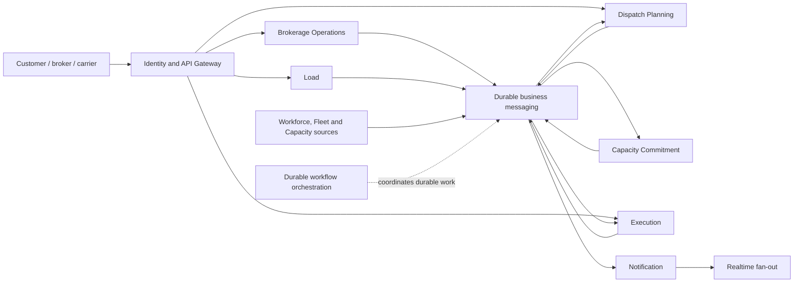

# TMS system blueprint

This is the single canonical blueprint for the TMS business strategy and
technical target: why we are building it, how the whole operation should
work, what each system boundary owns, which tools support it, and what is
agreed or unresolved. A capability can have a defined place before it is
implemented.

The expanded references are deliberately narrower: the
[business operating model](./OPERATING_MODEL.md) records detailed operating
rules and hypotheses; [responsibilities](./RESPONSIBILITIES.md) expands
roles; the [technical workflow](./TECHNICAL_WORKFLOW.md) expands transitions,
contracts, logical records, and failures; the
[first-slice candidate](./FIRST_SLICE_CANDIDATE.md) is a proposal; the
[open-decisions register](./OPEN_QUESTIONS.md) lists unresolved questions;
the staged roadmap below sequences implementation work. These references
explain the blueprint; they do not supersede its confirmed decisions.
Repository engineering guides specify implementation conventions, not TMS
business policy.

## Document control and authority

| Attribute          | Value                                                                                                        |
| ------------------ | ------------------------------------------------------------------------------------------------------------ |
| Artifact           | Target business and system architecture baseline                                                             |
| Status             | Working design baseline; not an implementation specification                                                 |
| Product validation | Owner-defined study model; no customer validation                                                            |
| Intended readers   | Business owners, operators, engineers, and reviewers                                                         |
| Change rule        | Update decision status and affected workflow/contracts together; do not silently turn a proposal into a fact |

This blueprint defines **what owns a business fact, why a boundary exists,
how a workflow must behave, and what remains unresolved**. It is not a
deployment promise, API specification, database migration, capacity
forecast, legal opinion, or production-readiness claim. A polished diagram
does not make an assumption true.

Use these evidence labels consistently:

- **Confirmed** — explicitly agreed company-model or architecture decision.
- **Proposed** — a recommended design that still needs review or an explicit
  decision.
- **Open** — multiple viable choices remain; do not encode one implicitly.
- **Implemented** — present in this repository, independent of whether it
  matches the target.
- **Verified** — tested against the stated behavior; verification scope and
  command are recorded. “Implemented” alone is not “verified.”

The blueprint owns architecture decisions and rationale. The
[open-decisions register](./OPEN_QUESTIONS.md) is the current list of
unresolved questions, not a second architecture source. The
[business operating model](./OPERATING_MODEL.md) contains richer
hypotheses; if a detail there is not confirmed here, it must not silently
become a system requirement. A legal or industry claim requires an
authoritative source and review before it becomes an executable rule.

## Business premise

We are building a realistic TMS as a software-engineering study, not for a
customer with validated requirements. The working company is a US carrier
and brokerage with approximately 50–100 trucks, based around LA and operating
across West, Central, and East areas. This scale and geography are modeling
inputs, not product limits.

The system should connect the broker's commercial commitment to protected
capacity, policy-driven Assignment under accountable human oversight, safe
execution, and a trustworthy operational history. Real-world practices and applicable law inform the
model, but hypotheses must remain labeled until researched and tested. The
goal is a coherent, flexible model that can grow without forcing unrelated
business concerns into one owner or imposing premature service boundaries.

## Operating philosophy

This TMS is intended to prevent avoidable mistakes and operational incidents,
not to maximize the number of incidents the team can recover from or to use
automation as a headcount-reduction target. The system should evaluate
trustworthy facts and explicit policy, show the best safe options with
understandable reasons, and complete routine reservation and assignment
without waiting for a person to repeat calculations the system can perform.

Automation is authoritative only inside its defined safe scope: it cannot
make a hard-ineligible choice, treat missing or stale facts as approval, or
silently bypass legal, contractual, safety, or concurrency constraints. If
the system cannot establish a valid decision from policy and current facts,
it must stop the automatic path, expose why, and give the responsible person
an actionable exception. People remain essential for customer and carrier
conversations, driver support, context the system cannot observe, policy
oversight, and exceptional judgment. The purpose is to give them time and
attention for that work.

The role and staffing model is an owner-defined study model informed by
real-world research, not a claim that a typical carrier would staff every
role at the illustrated ratio. We will test its operational and competitive
assumptions; we will not silently redesign the model around fewer employees.
Ring 1 defines the whole target architecture and a first implementation
boundary, not an instruction to build every target capability at once.
Fixtures and placeholders must be explicit about what they do not know and
cannot authorize.

### Selected human-agency and allocation policy

- **Separate eligibility, availability, preference, and willingness.**
  Eligibility covers verified hard requirements; availability covers
  non-overlapping capacity windows and verified next-available time.
  Preferences and route aversions are recorded separately and must never be
  presented as hard ineligibility unless an authoritative safety, legal,
  contractual, or company rule makes them so.
- **A strong avoid-preference or explicit driver objection blocks automatic
  finalization for that proposal.** The system explains the conflict and
  places the commitment in a bounded human-review hold while preserving its
  current claim. The accountable supervisor owns a conversation and recorded
  resolution; an unresolved hold expires through the existing release-to-queue
  path, without asserting that capacity is available. This is not an
  unqualified legal or contractual veto: the eventual authority and process
  must conform to the applicable work relationship and law. The system must
  not silently treat technical availability as willingness or automatically
  assign a rejected option.
- **Wiser oversight is not routine approval.** A wiser may challenge or
  redirect a Reservation before Assignment, or choose another feasible
  candidate where policy permits, with a recorded reason. The alternative
  must pass the same hard gates and obtain its own atomic CC claim. The
  wiser cannot approve an ineligible option or seize already-claimed
  capacity. An explicit objection or strong avoid-preference requires
  human resolution before Assignment.
- **Allocate across competing work, not one load at a time.** Dispatch
  Planning considers the eligible loads and capacity together within its
  planning horizon, seeking safe coverage while balancing stated
  preferences and prior preference outcomes over time. A load already
  reserved for another valid claim is shown as unavailable with its reason;
  the preference remains recorded for subsequent feasible opportunities.
  The system must not allocate a disliked leftover merely because preferred
  loads were claimed first.
- **A cancellation reopens options, not an obligation to take any remainder.**
  After safe no-start/claim closure, the system reassesses feasible same-day
  work against actual availability, rest, and preferences. If no acceptable
  choice is resolved, it creates a human-owned discussion/next-action task;
  it does not silently force a replacement trip. Applicable employment,
  carrier, and compensation rules require qualified review.
- **Accountability follows visibility and control.** Material stale or
  conflicting facts block automatic finalization and identify their source,
  age, and correction owner. The wiser remains accountable for operational
  oversight and for permitted overrides made with visible warnings; they
  are not presumed at fault for stale inputs the system failed to detect or
  expose. Review the causal chain and improve controls rather than assigning
  blame by role alone.
- **Keep decision evidence reconstructable.** Preserve fact sources and
  timestamps/versions, freshness checks, evaluated candidates and exclusion
  reasons, relevant preferences/objections, policy version, the recommendation
  and explanation, human intervention and rationale, and resulting
  Reservation/Assignment/Execution outcomes.

The allocation objective, preference weights/lookback, tie-break rules,
planning horizon, and exact response/coverage times remain open policy
parameters. They must not weaken the selected human-agency and hard-safety
rules above.

## Executive architecture summary

The system exists to keep four truths connected without confusing them:

1. **Commercial truth:** what the company agreed to carry and the current
   customer requirements — owned by Load after the broker's booking decision.
2. **Capacity truth:** what driver/equipment configuration is protected for
   which time window, and why it was held, finalized, or released — owned by
   Capacity Commitment (CC).
3. **Decision truth:** which policy and current facts selected the capacity,
   why the system chose it, and which human intervened if there was an
   exception — recorded by Dispatch Planning as the canonical Assignment
   decision.
4. **Movement truth:** what actually happened, who reported it, what
   evidence supports it, and what remains unresolved — owned by Execution.

Notification makes action visible but is never authority for any of those
truths. Identity establishes a principal; the owning business context still
checks that principal's authority over the specific record and transition.
The target uses a small number of explicit owners, versioned contracts, and
durable asynchronous coordination. It does not make each noun a service or
require every target capability to be a separately deployed process.

## Decision labels and current status

**Confirmed in discussion**

1. The product is a realistic, owner-designed trucking TMS study, not a
   customer-validated system. The reference company is a 50-100 truck US
   carrier/brokerage centered on LA, with West, Central, and East areas.
2. A broker alone decides whether to clarify, book, or decline an offer.
   Capacity approval is not a prerequisite to booking.
3. Ring 1 must define the complete architecture, tools, service duties,
   contracts, policies and profiles, then select a small end-to-end workflow
   after the full lifecycle and role journeys are reviewed. It does not mean
   implementing every capability in Ring 1 at once.
4. Load, Dispatch Planning, Capacity Commitment (CC), and Execution are peer
   service boundaries. CC is a standalone target service with its own
   business contract, state, and authority over capacity-window claims.
   Dispatch Planning and CC coordinate through a stable planning/assignment
   correlation ID while retaining distinct record identities and sources of
   truth.
5. Notification is a separate supporting service boundary, not scattered
   ad-hoc messaging calls.
6. The selected durable message transport, workflow orchestrator, and
   secondary fan-out tool each have distinct duties, described in the
   dedicated tool-responsibility section.
7. Shipment/trip profiles and policies are composable. Outbound and
   return-home, and short and long trips, must not be forced through
   identical decision logic.
8. The default path is automated: Dispatch Planning selects feasible
   capacity under policy, CC reserves the required load/capacity windows,
   and the system finalizes Assignment when its deadline and current hard
   gates allow it and no driver objection or strong avoid-preference is
   unresolved. Such an objection enters a bounded human-review hold, not a
   silent assignment or a mandatory approval step for routine work.
9. If an automated finalization hard gate fails at the deadline, do not assign:
   release the load claim, return the load to the queue, notify the
   responsible people, and preserve history. Neither releasing a load claim
   nor ending a commitment by itself proves the trio or any component is
   available; capacity-side claim handling must follow the reason and
   verified next-availability data.
10. Routine matching, reservation, and Assignment are system
    responsibilities by default when current trusted facts and active policy
    produce a valid choice. Human review handles missing/conflicting facts,
    policy exceptions, unresolved choices, and other work that genuinely
    needs judgment; it is not a mandatory approval step for every load.

**Proposed architecture for review**

- Load owns the commercial commitment and customer requirement revisions.
- Dispatch Planning owns capacity matching, feasibility and ranking
  explanations, planning decisions, and the canonical Assignment record.
- CC is a peer service that owns capacity claims, Reservation lifecycle,
  deadlines, and held/finalized/released commitment state. It validates and
  atomically claims the selected capacity; it does not rank business benefit
  or duplicate Dispatch Planning's Assignment. Both owners use a stable
  planning/assignment correlation ID while keeping distinct owner-local
  record IDs.
- Execution owns actual movement facts, exceptions, evidence, completion,
  and corrections.
- The selected messaging and workflow tools coordinate owner-to-owner
  changes; their responsibilities are defined in the dedicated tool section.
- Notification persists inbox work and delivery/acknowledgement state,
  consuming durable notification intents; notifications do not become
  business state.

**Open decisions:** do not silently encode assumptions. The current list is
maintained in the [open-decisions register](./OPEN_QUESTIONS.md).

## Target service map and ownership

The core service boundaries are peers; the table is not a ranking of
importance or an order of implementation. It describes the candidate service
landscape for the modeled TMS, not a commitment to deploy every row at once.
A bounded context can begin as an independently-owned module where deployment
cost is not yet justified, but its business data and authority must remain
separable.



| Area                   | Candidate service / context          | Owns                                                                                                                              | Boundary and growth note                                                                                                                                                        |
| ---------------------- | ------------------------------------ | --------------------------------------------------------------------------------------------------------------------------------- | ------------------------------------------------------------------------------------------------------------------------------------------------------------------------------- |
| Core operations        | **Load Management**                  | Booked transportation commitment, requirements and revisions, readiness, customer-safe load projection                            | Owns what the company promised to move; it does not own capacity selection or movement facts.                                                                                   |
| Core operations        | **Dispatch Planning**                | Capacity matching, eligibility presentation, preferences, benefit/ranking explanation, planning decision and canonical Assignment | Evaluates the full eligible pool, not only manually nominated options. Specialized optimization remains behind its contract.                                                    |
| Core operations        | **Capacity Commitment (CC)**         | Reservation/commitment lifecycle, load and capacity-window claims, deadline state, finalization/release and reconciliation        | Standalone peer service in the target. It validates and atomically protects capacity selected by policy; no Dispatch table access.                                              |
| Core operations        | **Execution**                        | Actual movement, milestones, incidents, evidence references, completion and corrections                                           | Starts from a valid Assignment; it does not choose capacity or rewrite Load requirements.                                                                                       |
| Core operations        | **Brokerage Operations**             | Offer conversation, clarification, commercial authority, booking/decline, sourcing coordination and customer communication        | Load is created/changed through its contract. Commercial negotiation and operational assignment remain distinct.                                                                |
| Shared operations      | **Notification**                     | Actionable inbox, recipient resolution, delivery attempts, acknowledgements and notification history                              | Makes owned work visible; it never becomes authority for the underlying business fact.                                                                                          |
| Capacity & people      | **Workforce / Driver Management**    | Worker profiles, driver status and future schedule inputs                                                                         | Driver availability and qualifications need sourced, time-aware facts; Dispatch cannot invent them.                                                                             |
| Capacity & people      | **Fleet & Equipment**                | Tractors, trailers, stable capacity configurations and equipment identity                                                         | CC references versioned configurations; it does not own equipment master data.                                                                                                  |
| Capacity & people      | **Maintenance & Serviceability**     | Inspections, defects, work orders, out-of-service and return-to-service records                                                   | Feeds equipment eligibility; technical serviceability is not inferred from a released load claim.                                                                               |
| Capacity & people      | **Safety & Regulatory Compliance**   | Validated compliance facts, qualification/HOS interfaces, safety controls and evidence                                            | Legal rules require authoritative sourcing and qualified review; do not substitute guessed rules or manual flags.                                                               |
| Planning & visibility  | **Trip / Route Planning**            | Route and stop plans, distance/time estimates, direction-aware repositioning and trip-pattern inputs                              | May start as a Dispatch capability; separate when its models, load, or consumers justify it.                                                                                    |
| Planning & visibility  | **Optimization & Decision Engine**   | Reusable optimization runs, candidate scoring/ranking outputs, model versions and evaluation evidence                             | Dispatch Planning remains the decision authority. Split this compute/model capability only if its workload, cadence, or reuse across contexts becomes independently meaningful. |
| Planning & visibility  | **Appointment & Stop Scheduling**    | Requested/confirmed facility slots, appointment changes, and scheduling constraints                                               | Load owns requested windows; Execution owns actual arrival/departure. This context owns slot coordination if it grows beyond those owners' workflows.                           |
| Planning & visibility  | **Tracking & Visibility**            | Sourced position/status observations and tracking subscriptions                                                                   | Execution remains authoritative for business milestones; tracking observations are attributed inputs, not assumed proof.                                                        |
| Commercial             | **Customer & Carrier Collaboration** | External-facing access, tenders, acknowledgements, instructions and scoped status exchange                                        | Portal/API channels are adapters to owned workflows, not direct cross-service database access.                                                                                  |
| Commercial             | **Carrier Sourcing & Procurement**   | Managed-carrier onboarding, capacity offers, procurement terms and sourcing outcomes                                              | Brokerage coordinates load-specific sourcing; longer-lived carrier qualification and procurement can become distinct.                                                           |
| Commercial             | **Rate & Contract Management**       | Customer/carrier agreements, rate schedules, accessorial rules and effective-dated commercial terms                               | Brokerage owns a load's negotiated decision; this context owns reusable contract/rate facts.                                                                                    |
| Commercial             | **Pricing & Revenue Management**     | Rate/margin calculations, pricing recommendations, market inputs and decision versions                                            | Brokerage retains commercial authority to negotiate/book; separate this capability when pricing models and governance need an independent lifecycle.                            |
| Commercial             | **Claims & Disputes**                | Claim cases, supporting evidence review, dispute status and authorized outcomes                                                   | Execution records facts; this context evaluates contractual claims. No heuristic may assert legal entitlement.                                                                  |
| Financial              | **Billing & Receivables**            | Customer invoices, billing status, adjustments and receivable workflow                                                            | Consumes completed/approved business facts; does not rewrite execution evidence or load history.                                                                                |
| Financial              | **Settlement & Payables**            | Carrier/driver settlement, payable calculations, statements and adjustments                                                       | Separate from assignment and customer billing; financial policies require explicit authority and audit.                                                                         |
| Shared data & platform | **Document & Evidence Management**   | File custody, metadata, access control, retention and evidence retrieval                                                          | The originating owner records why an artifact matters; this context controls storage and access.                                                                                |
| Shared data & platform | **Integration & EDI**                | Partner protocol connections, transformations, delivery state and integration-specific errors                                     | Adapters translate into owner contracts; they never write another service's records directly.                                                                                   |
| Shared data & platform | **Analytics & Decision Support**     | Read models, operational measures, explainable recommendations and historical analysis                                            | Consumes facts/projections; cannot silently become operational source of truth or block a safe command.                                                                         |
| Shared platform        | **Identity & Access**                | Authentication, account identity, role grants and coarse access scope                                                             | A token or role does not prove authority over a particular load; domain owners authorize resource transitions.                                                                  |
| Shared platform        | **Policy/Profile Configuration**     | Versioned policy/profile definitions and effective dates, if central management is justified                                      | Initially policies remain owned and evaluated by domain contexts; a generic policy engine must not hide domain behavior.                                                        |

These are candidate logical services, not a claim that a 50–100-truck
company needs every context as an independent deployment. The four core services above
are explicit target peers; other contexts become standalone services when
their independent owner, authoritative data, consumers, change cadence,
failure boundary, and operating value justify it. Cross-cutting audit,
observability, API ingress, storage, and workflow infrastructure are
platform capabilities, not automatically additional business services.
Profiles and policies compose behavior within owners; they are not services
for every freight/direction/trip combination. A fixture is allowed only
when its source is labeled, and unavailable behavior returns an explicit
unsupported result.

### Logical boundaries versus deployments

The boundary map is a business-ownership map, not a one-process-per-row
deployment mandate:

- The gateway is the authenticated user ingress. Internal business work is
  initiated by an owner and carried by the agreed durable message/workflow
  paths; the gateway does not coordinate a multi-service transaction.
- Load Management, Dispatch Planning, Capacity Commitment, and Execution
  are independent peer services in the target architecture, each owning its
  own records and business transitions. A first implementation may colocate
  deployables for scope, but may not merge their contracts, persistence
  ownership, or authority.
- Dispatch Planning creates a stable `planningId` for a planning outcome;
  both Dispatch and CC retain it as a correlation key. Dispatch owns its
  `assignmentId`; CC owns its `commitmentId` and capacity claims. Neither
  service reads or writes the other's tables.
- Brokerage, capacity-source contexts, documents, partner collaboration,
  financial contexts, and analytics have explicit future homes. A first
  slice may use a clearly identified fixture or adapter, but may not claim
  fixture data is authoritative real-world eligibility.
- Supporting capabilities need not all be deployed or fully implemented to
  define the target architecture. A placeholder has an explicit boundary
  and unsupported outcomes; it is not an invisible successful fake.

Every proposed extraction or new deployment must name the independent
business owner, data it controls, consumers, failure boundary, operational
owner, and evidence that the split is worth its deployment cost. A folder
split alone does not establish service autonomy.

### Current repository versus target

Repository state is separate from architecture intent. **Checked 2026-10-13**:
the repository has the Node.js/pnpm TypeScript foundation, Fastify,
PostgreSQL/Prisma, Zod, Vitest, OpenTelemetry, Prometheus, Grafana and Tempo
in its manifests/local environment. The checked Compose and dependency
declarations do not configure the selected messaging/workflow stack or TMS
business services. The target tools below are decisions for the architecture;
they are not claims that these tools are already installed, integrated, or
running. Recheck manifests and Compose before any implementation plan calls
them “available.”

## Common lifecycle and specialized policy hierarchy

Do not use inheritance as a growing tree of combinations. Compose typed
profiles and policies around a shared set of lifecycle records.

```text
Transportation commitment
  + Shipment profile
  + Route/direction profile
  + Trip-pattern profile
  + Capacity/eligibility policy
  + Commitment policy
  + Execution profile
  = Versioned workflow plan for this load
```

| Layer                | Example dimensions                                                                                       | Owner / effect                                                                                                                                           |
| -------------------- | -------------------------------------------------------------------------------------------------------- | -------------------------------------------------------------------------------------------------------------------------------------------------------- |
| Common lifecycle     | `loadId`, revisions, actor/audit, time fields, capacity reference, Assignment link, workflow correlation | Shared contracts and invariant validation; every profile must preserve them.                                                                             |
| Shipment profile     | General freight, temperature-controlled, oversized, hazardous or other validated types                   | Load owns required freight attributes; applicable profile adds validation and hard constraints. Do not implement legal rules until sourced and reviewed. |
| Direction profile    | Outbound-from-home, return-home, cross-area repositioning                                                | Dispatch Planning ranks feasible options using route objective, area coverage, repositioning and driver preference.                                      |
| Trip-pattern profile | Short/local, regional, long-haul, multi-day                                                              | Selects planning horizon, useful milestones, return timing and candidate policy. Thresholds remain configurable/decision-gated, not guessed.             |
| Capacity policy      | Driver/power unit/optional trailer, later additional configurations                                      | Fleet/workforce sources own facts; CC atomically protects selected component windows.                                                                    |
| Commitment policy    | Default automatic reservation/assignment, explicit exception review, deadline, stale/ineligible outcome  | Dispatch Planning selects within policy; CC enforces claims and commitment transitions. A durable workflow coordinates deadlines.                        |
| Execution profile    | Required milestones, evidence, exception categories, completion conditions                               | Execution applies a versioned workflow profile while preserving common audit and correction rules.                                                       |

Each policy has a stable key, schema/version, effective period, and
deterministic inputs/outputs. Persist the resolved profile/policy keys and
versions with nominations, Reservation revisions, Assignment decisions,
and relevant execution workflow. At runtime, validate that all required
policy slots resolve. Policy conflicts must fail visibly rather than use
silent precedence. Do not permit arbitrary dynamic code/plugin loading in
the first release; add a typed registry/factory seam and test combinations.

Shared invariants include resource-level authorization, immutable source
revision references, idempotency, audit history, one active commitment per
load, no overlapping claims per capacity component, safe no-start before
pre-movement reassignment, and no immediate capacity release after movement
begins. Profiles may add stricter checks; they cannot disable safety,
authorization, or concurrency invariants.

## Architecture quality attributes and proof

These are behavioral obligations, not unmeasured slogans. No request-volume,
latency, availability, retention, or recovery-time target has been supplied.
Do not invent numeric SLOs. Establish them from a usage/risk model before a
real operational pilot. For the study system, the following observable
checks are the minimum evidence gates:

| Attribute            | Required behavior                                                                                                                                     | Evidence before calling it verified                                                                     |
| -------------------- | ----------------------------------------------------------------------------------------------------------------------------------------------------- | ------------------------------------------------------------------------------------------------------- |
| Business consistency | A load, CC claim, Assignment, and Execution remain distinct records with one owner each; stale revisions cannot finalize                              | Contract tests for ownership, revision races, and state-transition guards                               |
| Capacity safety      | Never hold overlapping windows for a capacity member or multiple active commitments for the same load; claim release is not an availability assertion | Concurrent integration tests against the real persistence constraints                                   |
| Honest outcomes      | Pending, rejected, failed, and unknown are distinguishable; no accepted HTTP response implies downstream completion                                   | Fault-injection tests at each persisted/message boundary                                                |
| Delivery resilience  | Durable cross-owner messages survive process restart, duplicate delivery, delayed delivery, and consumer failure                                      | Outbox/inbox, retry, dead-letter visibility, replay, and reconciliation tests                           |
| Auditability         | Preserve decision actor, authority context, input revisions, rationale, source/time of facts, and append-only corrections                             | Readback tests proving the record reconstructs who decided/reported/corrected what                      |
| Security and privacy | Enforce record-level grants; minimize event fields; keep secrets and unnecessary personal/commercial data out of logs and projections                 | Authorization matrix, schema review, log/projection tests, and security review                          |
| Operability          | An operator can correlate a business operation across services, identify its owner/state, and safely retry or escalate it                             | Runbook-backed failure exercise including queues and durable workflow state                             |
| Changeability        | A profile or context evolves without changing another owner's records directly; independent service ownership remains enforceable                     | Boundary/contract tests and a documented service-failure/recovery exercise                              |
| Scale                | Support the modeled company while retaining headroom for growth                                                                                       | A workload and concurrency model followed by measurements; fleet count alone is not a throughput target |

## Architecture decision record

This register captures the design choice, why it fits this study model, and
the cost that must be managed. “Confirmed” means agreed in the design
discussion; it does not claim research validation or completed implementation.

| ID         | Decision                                                                                                                                                                                                     | Status               | Rationale and trade-off                                                                                                                                                                                                                             |
| ---------- | ------------------------------------------------------------------------------------------------------------------------------------------------------------------------------------------------------------ | -------------------- | --------------------------------------------------------------------------------------------------------------------------------------------------------------------------------------------------------------------------------------------------- |
| ADR-TMS-01 | Keep Load, Dispatch Planning, CC, and Execution as independent peer services; define further contexts in the target service map                                                                              | Confirmed target     | Prevents mixed authority and record duplication. Every service needs a clear owner and business boundary; implementation/deployment can be staged without collapsing ownership.                                                                     |
| ADR-TMS-02 | Make CC a standalone peer service with its own contract, state, persistence ownership, tests, and independent failure boundary                                                                               | Confirmed target     | CC owns load/capacity claims and commitment transitions; Dispatch owns matching and Assignment. A stable planning ID links distinct owner records without shared database ownership.                                                                |
| ADR-TMS-03 | Use separate tools for durable business messaging, long-running workflow coordination, and secondary fan-out                                                                                                 | Confirmed target     | Each solves a different delivery/coordination problem. Multiple systems add real operational burden, so responsibilities must not overlap and each must have failure/recovery evidence.                                                             |
| ADR-TMS-04 | Do not use a synchronous HTTP service-call chain as cross-service workflow coordination                                                                                                                      | Confirmed target     | Avoids hiding partial commits behind cascaded request failures. User-facing HTTP remains valid; owner transitions and durable results are asynchronous.                                                                                             |
| ADR-TMS-05 | Use typed composable profiles/policies rather than classes/services for each freight × direction × trip combination                                                                                          | Confirmed direction  | Preserves specialized handling while keeping shared lifecycle and safety invariants. Exact catalog and precedence remain open.                                                                                                                      |
| ADR-TMS-06 | Automatically match and reserve eligible capacity, then finalize Assignment by default after the configured review window when hard gates pass and no strong avoid-preference/driver objection is unresolved | Confirmed behavior   | Removes repetitive routine approval while preserving a bounded human-review path. An objection hold or failed gate cannot silently finalize; releasing a load claim does not establish capacity availability. Exact deadline protocol remains open. |
| ADR-TMS-07 | Keep one canonical Assignment decision in Dispatch Planning; CC owns the Reservation and exclusive claim ledger                                                                                              | Confirmed ownership  | Avoids duplicate Assignment truth while keeping CC independent. A stable planning ID correlates the owner records; the asynchronous commit/reconciliation protocol must be specified before implementation.                                         |
| ADR-TMS-08 | Use owner-local persistence and no distributed database transaction                                                                                                                                          | Confirmed constraint | Makes data ownership enforceable. Requires durable messages, idempotency, and visible reconciliation instead of pretending operations are atomic.                                                                                                   |
| ADR-TMS-09 | Separate eligibility, availability, preference, and willingness; allocate across competing work; require human resolution of strong avoid-preferences and objections before Assignment                       | Confirmed behavior   | Protects worker agency and fair consideration without turning preferences into unsafe eligibility overrides or requiring routine wiser approval. Exact legal/contract authority and allocation parameters remain subject to qualified review.       |

Any reversal or material refinement should include the decision ID, new
evidence, affected contracts/workflows, migration or compatibility plan, and
regression tests. Do not keep competing versions of the same decision in
several documents.

## Tool responsibilities and message rules

| Tool                                      | Primary job                                                                                                             | Must not be used as                                                                                         |
| ----------------------------------------- | ----------------------------------------------------------------------------------------------------------------------- | ----------------------------------------------------------------------------------------------------------- |
| RabbitMQ                                  | Durable commands/events between business owners; acknowledgements, retry/DLQ and replay controls                        | The source of truth, a workflow database, or a place to hide failed deliveries                              |
| Temporal                                  | Long-running workflow state, durable timers, retries, signals, human waiting, compensation/reconciliation orchestration | A replacement for service-owned business records or durable business messaging                              |
| NATS                                      | Secondary low-latency fan-out such as UI refresh/presence hints after durable facts exist                               | The only delivery path for assignments, load changes, reservations, execution facts, or notification intent |
| PostgreSQL                                | Authoritative service records, transactions, outbox/inbox and claim invariants                                          | A shared cross-service database schema                                                                      |
| Prisma                                    | Typed persistence access/migrations where suitable                                                                      | A cross-service data-access mechanism                                                                       |
| TypeScript + Zod                          | Compile-time types plus runtime validation at each boundary                                                             | Trust in unvalidated broker messages because producer and consumer share a package                          |
| Fastify + API Gateway                     | User-facing commands/queries and authenticated ingress                                                                  | Synchronous service-to-service chains that gather responses and forward them to other owners                |
| OpenTelemetry, Prometheus, Grafana, Tempo | Correlated logs/traces/metrics and health diagnosis                                                                     | Business audit/history or proof a workflow completed                                                        |
| Vitest                                    | Unit, policy-combination, contract, integration and failure/replay tests                                                | An assertion of real customer or legal validation                                                           |

These are target choices, not claims that their local development setup is
already configured. Their adoption brings independent configuration,
credentials, upgrades, recovery, and incident responsibilities. Prove each
tool in its bounded role before a business workflow depends on it; never
create a fake integration merely to show a green health check.

**Message pattern.** A service changes its own database and writes an outbox
record in the same local transaction. Its publisher sends the versioned
message through the durable transport and marks delivery; consumers validate and deduplicate
through an inbox/idempotency record. Delivery is assumed at-least-once.
Failures are retried with bounded policy and then exposed for repair; never
silently discard them.

**Workflow pattern.** The workflow engine starts or signals a workflow using stable
business IDs. Workflow activities are idempotent and invoke the owning
service through its message contract or owner-local worker adapter. Durable
commands/results carry cross-service work; engine task queues carry
workflow/activity scheduling. A workflow may wait for domain
events or human decisions, but it does not directly mutate another service's
database.

**Fan-out pattern.** Publish secondary ephemeral notifications only after a
durable owner/outbox commit, for example a connected UI receiving
`inbox.item.changed`. A missed fan-out message is repaired by querying the
Notification inbox. This channel is never a competing authoritative event
consumer; recovery reads the owning service.

**User requests.** A client sends an authenticated command to its owning
service through the gateway. The service can return `accepted` with an
operation/correlation ID and pending state. Subsequent state changes arrive
through notifications/read models. A gateway or client must not synchronously
call several services, combine transient responses, and treat that as an
atomic business decision.

## Contract and record catalogue

Records have one authoritative owner. Other contexts hold stable IDs,
policy/version references, and deliberately small read projections.

| Record                                  | Authority                                                         | Purpose                                                                                                                          |
| --------------------------------------- | ----------------------------------------------------------------- | -------------------------------------------------------------------------------------------------------------------------------- |
| Offer / OfferConversation               | Brokerage Operations                                              | Offer, clarification requests/answers, broker decision and source channel                                                        |
| Load / LoadRevision                     | Load                                                              | Booked commitment, changing requirements, origin/destination, pickup/delivery windows, shipment profile and customer-safe status |
| WorkQueueProjection                     | Derived from Load + policy                                        | Prior-day/same-day priority and eligible stack views; not a second commitment authority                                          |
| CapacityConfiguration                   | Fleet & Capacity (fixture initially)                              | Stable driver, power unit, optional one trailer and configuration version                                                        |
| CapacityReadinessReport                 | Reporting actor/context; authoritative source identified per fact | Dispatcher-verified availability/condition with actor and timestamps                                                             |
| Nomination                              | Dispatch Planning                                                 | Dispatcher priorities/preferences for a load-capacity option; does not reserve either side                                       |
| FeasibilityAssessment                   | Dispatch Planning                                                 | Versioned hard constraints, soft factors, reasons and policy versions                                                            |
| AssignmentDecision                      | Dispatch Planning                                                 | System- or human-authorized selection, rationale, source facts, policy/revision references, and `planningId`                     |
| CapacityCommitment / CommitmentRevision | CC                                                                | Claim state, Reservation mode, load/capacity window, revisions, deadline, hold/finalize/release history, and `planningId`        |
| CapacityClaim                           | CC                                                                | Atomic exclusive claim on load and each capacity component for a time interval                                                   |
| Execution                               | Execution                                                         | Movement lifecycle linked to one finalized AssignmentDecision                                                                    |
| OperationalFact / ExceptionCase         | Execution                                                         | Reported events, issue handling, owner, actions, resolution                                                                      |
| EvidenceReference                       | Execution; file custody in Documents                              | Proof/document reference, visibility, source, retention reference                                                                |
| CustomerChangeRequest / LoadRevision    | Load; intake may start in Brokerage                               | Customer requested change and accepted/declined commercial effect                                                                |
| Comment / Communication                 | Owning context or later collaboration capability                  | Internal/customer/carrier discussion; never silently changes authoritative fields                                                |
| NotificationItem / DeliveryAttempt      | Notification                                                      | User action item, recipient, source reference, delivery and acknowledgement                                                      |
| WorkflowRunReference                    | Owning workflow coordinator                                       | Workflow ID and correlation to business IDs; not the business status itself                                                      |
| Company/Customer ClaimCase              | Brokerage/Claims capability, later                                | Evidence-based review of customer or company impact; entitlement is a human/contract decision                                    |

### Terms that must not be conflated

| Term                          | Meaning in this model                                                                                                          | Not the same as                                                  |
| ----------------------------- | ------------------------------------------------------------------------------------------------------------------------------ | ---------------------------------------------------------------- |
| Load                          | The company's transportation commitment, requirements, revisions, and customer-safe projection                                 | A truck, a trip, or proof that capacity is secured               |
| Nomination                    | Non-reserving dispatcher proposal and priority information                                                                     | A reservation, commitment, or Assignment                         |
| Capacity Commitment (CC)      | The protected capacity-selection lifecycle from policy-selected candidate through finalization or release                      | Candidate ranking or a second canonical Assignment               |
| Reservation                   | The editable CC-owned record describing a commitment, its revisions, claim window, and deadline                                | A Dispatch Planning-owned Assignment                             |
| Assignment                    | Dispatch Planning's policy-driven or authorized human decision naming capacity for a load, with rationale and source revisions | A load booking or proof that movement started                    |
| Capacity claim                | CC's concurrency protection over a load and every selected capacity component for a time interval                              | Proof the driver/equipment is generally available or serviceable |
| Capacity configuration / trio | Stable driver + power unit + optional single trailer for the initial model; power-only is valid                                | Multiple trailers or an arbitrary interchangeable equipment pool |
| Execution                     | The movement record and actual operational facts after final Assignment                                                        | A plan, customer commitment, or capacity profile                 |
| Trip / itinerary              | A possible multi-load sequence and route coordination concept                                                                  | A synonym for Load, Assignment, or Execution                     |
| Command / event               | A command requests an owner transition; an event reports an owner-committed fact                                               | Interchangeable message labels                                   |
| Status / availability         | A status describes a record's lifecycle; availability is a verified capacity fact for a time                                   | A claim closure, timeout, or assumption from free text           |

Suggested event/command families below define the contract inventory, not
frozen names or payloads.

| Owner publishes / accepts        | Examples                                                                                                                                                                    | Consumers / effect                                                                                                                                |
| -------------------------------- | --------------------------------------------------------------------------------------------------------------------------------------------------------------------------- | ------------------------------------------------------------------------------------------------------------------------------------------------- |
| Brokerage -> Load command        | `BookOffer`, `SubmitLoadChange`                                                                                                                                             | Load validates and creates/updates its own commitment; broker decision remains auditable                                                          |
| Load facts                       | `LoadBooked`, `LoadReady`, `LoadRequirementsRevised`, `LoadCancelled`                                                                                                       | Dispatch/CC refresh projections; the workflow coordinator signals relevant workflows; Notification creates relevant inbox items                   |
| Dispatch Planning facts/commands | `NominationSubmitted`, `NominationWithdrawn`, `AssignmentProposedByPolicy`, `AssignmentOverrideRequested`                                                                   | CC receives a request to protect the exact load revision/capacity window; Notification informs affected roles                                     |
| CC commands/facts                | `CreateCommitment`, `FinalizeCommitment`, `ReleaseCommitment`, `CommitmentHeld`, `CommitmentFinalized`, `CommitmentReleased`, `CommitmentNeedsReview`, `CommitmentConflict` | Workflow coordination handles deadlines; Dispatch records the linked AssignmentDecision after CC result; Notification projects actionable changes |
| Fleet/workforce facts            | `CapacityConfigurationChanged`, `ReadinessReported`, `CapacityUnavailable`, `CapacityAvailableAt`                                                                           | Dispatch reassesses candidates; CC updates claim eligibility/review state without inventing authoritative readiness                               |
| Dispatch -> Execution            | `AssignmentFinalized`                                                                                                                                                       | Execution idempotently creates the execution record and returns accepted/started status through a fact                                            |
| Execution facts                  | `ExecutionCreated`, `PickupRecorded`, `ExecutionExceptionRaised`, `EvidenceAdded`, `DeliveryRecorded`, `ExecutionCompleted`, `FactCorrected`                                | CC updates use windows only from valid milestones/readiness; Load updates customer-safe projection; Notification informs recipients               |
| Notification intent              | `NotificationRequested` with source-event reference                                                                                                                         | Notification resolves recipients, persists inbox item, tracks delivery/acknowledgement and may emit a realtime wake-up                            |
| Comments/claims                  | `CommentAdded`, `CustomerChangeRequested`, `ClaimCaseOpened`                                                                                                                | Routed to owning context; comments are not authoritative requirement changes until broker accepts a Load revision                                 |

Every envelope should include a unique message/event ID, type and schema
version, source owner, aggregate/business ID, occurrence time, correlation
ID, optional causation ID, and typed payload. Receivers validate runtime
shape, authorization context, aggregate revision, idempotency and ordering.
Use explicit conflict/stale-version outcomes; do not trust queue order as a
business rule.

## Full business workflow: offer to the next load

### A. Offer, clarification and booking

1. Customer or another broker sends a load offer to Brokerage Operations.
2. The area broker owns review and may ask questions, negotiate within
   authority, decline, or book. The booking decision does not wait for a
   supervisor to check capacity.
3. Clarification is a conversation with its own messages and timestamps. A
   reply does not silently mutate a booked load. If already booked, the
   broker submits a change request; Load records the accepted requirements
   as a new revision.
4. On booking, Brokerage sends `BookOffer` to Load. Load creates a stable
   `loadId`, initial revision, commercial/customer relationship references,
   origin/destination and pickup/delivery information, applicable profile
   references, and booking audit. Brokerage owns offer history; Load owns
   the resulting transportation commitment.
5. Load validates the minimum fields for its profile. A booked load may be
   `not_ready` until required details are confirmed. When ready for capacity
   planning, Load publishes `LoadReady`.

### B. Queueing, visibility and automated planning

6. Dispatch Planning maintains a derived operational work view from Load
   events and applicable policies. Loads booked by the previous day receive
   planning priority through 4 p.m. in the departure area's local time;
   same-day bookings remain eligible for planning throughout the day.
   Ordinary loads target Assignment by the calendar day before pickup.
   Same-day emergency handling and after-hours coverage remain policy gates.
7. Notification tells the responsible broker, dispatcher, and supervisor
   about actionable work and exceptions. Recipient rules use load ownership
   and coverage, not merely a global role name.
8. Dispatchers maintain stable capacity configurations and report verified
   readiness, next availability, driver preference, and relevant operational
   context. A nomination may express priority, but it is advisory: an
   otherwise eligible trio is not hidden because nobody nominated it.
9. Dispatch Planning evaluates the full capacity pool under the selected
   profile/policy versions. It excludes hard-ineligible or stale options,
   ranks feasible choices using explainable company-benefit and employee
   preference factors, and records why the selected option is best. Missing
   or conflicting facts stop automatic selection and create actionable
   human-owned work; they are never treated as approval.

### C. Reservation / Capacity Commitment

10. Dispatch Planning chooses the best eligible candidate under the active
    policy and produces an explainable `AssignmentProposedByPolicy` linked
    to a stable `planningId`. A human may intervene where policy grants
    discretion, but routine work does not wait for supervisory approval.
11. CC receives that correlation ID and exact Load revision, capacity
    configuration version, selected candidate, policy versions, window, and
    deadline. It atomically claims the load and non-overlapping windows for
    the selected driver, power unit, and optional trailer. A conflict
    invalidates the proposed choice and triggers a fresh evaluation; the
    first valid commit wins. CC retains the complete Reservation history.
12. **Default mode: automatic reservation and Assignment.** A durable
    workflow tracks the deadline. When its finalization point arrives, CC
    rechecks the Load revision, capacity configuration/readiness,
    eligibility, window conflicts, cancellation/change state, and unresolved
    driver objections/strong avoid-preferences. If hard gates pass and no
    objection or strong avoid-preference is unresolved, CC finalizes the
    commitment and Dispatch records the linked Assignment without waiting
    for a person to click approve.
13. **Exception-review mode:** an authorized person may place an eligible
    commitment into a bounded review path when the case needs judgment. If
    that review deadline passes without resolution, CC releases the load
    claim and returns the load to Dispatch's queue. Capacity availability
    remains a separate fact.
14. **Failed automatic gate:** CC does not finalize stale or unverified
    selection. It releases the load claim, returns the load to the queue,
    records the failed gate, and requests notification. The capacity itself
    is not marked available by that release.
15. A Load requirement change or readiness report updates the relevant
    owner's record and signals the durable workflow. CC and Dispatch
    reassess the commitment; the responsible people are notified of material
    changes or exceptions. A stale commitment cannot be finalized. Exact
    hold behavior while an exception is being reviewed remains a policy
    decision.
16. A finalization result is idempotently consumed by Dispatch Planning,
    which records the canonical Assignment decision under the same
    `planningId`. If either side is temporarily unavailable, the operation
    remains visibly pending for retry/reconciliation. No duplicate
    assignment or untracked free capacity is allowed.

### D. Assignment and execution start

17. `AssignmentFinalized` is delivered to Execution. Execution creates
    exactly one execution record for the Assignment ID. Assignment creation
    is not a claim that the truck has physically moved.
18. The driver/carrier receives the assignment information and reports the
    required pre-trip/pickup milestones and BOL evidence under the applicable
    execution profile. The dispatcher reports readiness facts and handles
    operational exceptions; routine assignment is automated within policy.
19. On a valid pickup/BOL event, Execution records actual movement start.
    CC retains the active capacity-use claim; pickup is not delivery and
    does not make the trio generally available.
20. After an LA pickup and BOL, Dispatch may plan suitable return-home work
    while outbound Execution continues. A follow-on nomination/claim uses
    dispatcher-verified next availability and must have a non-overlapping
    capacity window. Short/local work may later support different sequencing
    rules through its policy, not through weakening common claim safety.

### E. Changed requirements, operational issues and capacity impact

21. A customer request is not yet a requirement change. Brokerage records
    the request, evaluates customer/contract terms, then either declines it
    or asks Load to append the accepted new revision.
22. Load publishes `LoadRequirementsRevised`. Before final Assignment, CC
    refreshes its revision reference and policy assessment; Dispatch Planning
    recomputes fit/ranking; affected reservations are marked for review and
    people are notified.
23. After final Assignment, preserve requested/effective/recorded times,
    prior/new requirements, execution milestone, trio status and decision.
    Reassess whether the original trio and remaining time can satisfy the
    new commitment.
24. If unsuitable before movement, terminalize the old Execution as
    `no_start`, then safely release that capacity window. Dispatch considers
    replacement in-house/managed capacity, then outside capacity through
    Brokerage, then broker-led amendment/cancellation. Record the released
    trio's real next availability, reposition/deadhead, and idle/lost
    capacity time. A load-claim release alone never asserts readiness.
25. If movement has started, Execution owns an open exception and safe
    handoff/recovery. Do not return the trio to candidate lists until its
    actual availability and repositioning permit it. CC changes claims only
    after the relevant operational transition is confirmed.
26. For customer or company “claims,” preserve operational facts and
    communication evidence. Brokerage/Claims reviews contract terms and
    decides whether to pursue a claim. No service automatically asserts
    legal entitlement or charges a customer based solely on a system
    heuristic.

### F. Completion, comments and next-work preparation

27. Driver/carrier records delivery and required evidence. Execution
    validates the profile-specific completion conditions, records
    `ExecutionCompleted`, and retains the full history.
28. Load updates its customer-safe projection from approved, verified facts.
    Notification tells the authorized broker/customer contact that status
    changed; it must not expose internal capacity, employee, or claim notes.
29. Customer comments, change requests and disputes are linked to the Load
    or a claim case. Company-only notes are linked to the owning operational
    case/decision. Neither kind silently edits requirements, facts, or
    decisions; accepted changes create new authoritative records/revisions.
30. Execution emits completion and final capacity-relevant facts. CC closes
    or updates the completed use window only according to verified
    availability; Fleet/Workforce sources remain authoritative for
    component serviceability/readiness.
31. Dispatch Planning refreshes capacity/queue projections and automatically
    prepares the next feasible load using the selected direction/trip policy.
    Employee preferences remain visible, and system decisions are
    explainable. Authorized human intervention remains available within
    policy; the next cycle begins with a new planning/commitment, not mutation
    of the completed Assignment or Execution.

## Reservation/CC state summary

Possible lifecycle labels for design discussion; final enum names come with
contract/schema design:

```text
policy-selected candidate
  -> held / automatic finalization scheduled
      -> finalized -> linked Assignment -> Execution created -> movement
      -> bounded exception review -> resolved and finalized
      -> review deadline missed -> released -> load back in queue
      -> finalization hard gate fails -> released -> load back in queue
      -> load/readiness changed -> reassessed -> revised, finalized, or released
```

The load claim is distinct from component readiness. Capacity claims are
time-window based and conflict atomically. A review timeout or failed gate
returns the load to planning; the trio may remain unavailable for repair,
rest, repositioning, or another active commitment. A retry must use the same
operation ID and return the established outcome.

## Role journeys

### Broker

- **One load:** receive offer, clarify/decline/book; ensure the booked
  commitment is represented in Load; answer customer requests; accept or
  reject changes; communicate only verified customer-safe status; review
  possible customer/company claims with contract evidence.
- **Daily:** see own area loads requiring readiness, customer response,
  sourcing or status action; coordinate outside capacity where needed;
  escalate a commercial risk without taking over supervisor assignment.

### Fleet dispatcher

- **One load:** verify the stable trio/configuration and current readiness;
  maintain availability, driver preferences, strong avoid-preferences, and
  operational context; relay a driver's objection to a proposed Assignment;
  inspect automated Reservation/Assignment status; report changed readiness
  and challenge stale/infeasible plans; provide pickup/BOL or other
  operational facts; handle the next-load opportunity. A missed nomination
  does not hide an otherwise eligible trio from the system.
- **Daily:** work assigned fleet groups and due nominations; check in-service,
  reserved, assigned, in-progress, out-of-service and available capacity
  with underlying details visible. A nomination or preference is not a
  routine approval gate; an explicit driver objection or strong
  avoid-preference nevertheless prevents silent automatic finalization.

### Departure-area supervisor / wiser

- **One load:** review options and reasons; choose a capacity and record
  rationale only when the case is routed for human judgment; challenge or
  redirect a Reservation before Assignment where policy allows; resolve
  driver objections/strong avoid-preferences through a recorded discussion;
  monitor automated choices and handle stale-fact, policy, and capacity
  exceptions with full reasons and CC protection. An alternative must pass
  hard gates and obtain its own CC claim.
- **Daily:** oversee area outcomes and decision quality, review patterns and
  policy performance, handle exceptions and coordinate local/cross-area
  support. The role is not a mandatory approval station for routine loads
  and is not presumed at fault for stale data the system failed to surface.

### Driver or carrier contact

- **One load:** receive authorized assignment detail; confirm/report required
  operational facts as defined; state route preferences or a strong
  avoid-preference; report an objection, readiness/rest, absence/defect,
  pickup, delay, exception and delivery evidence. A strong avoid-preference
  or explicit objection stops automatic finalization and requires human
  resolution; it is not silently treated as acceptance. The final process
  must follow the applicable employment/carrier agreement and law.
- **Across loads:** communicate actual next availability/rest/location
  constraints through the defined workflow. A canceled load does not itself
  mean the driver accepts any remaining route that day. Do not assume a
  future nomination guarantees a load or overrides rest/safety obligations.

### Dedicated outer-fleet broker / contract-capacity dispatcher

- **One load:** source or coordinate external capacity within delegated
  commercial authority; record carrier acceptance, capacity and milestone
  facts; route genuine company-side exceptions to the accountable supervisor.
- **Daily:** work low-priority/unmatched or overflow loads; report unavailable
  capacity early; do not silently replace an already committed carrier.

### Chief supervisor and transportation executive

- **One load:** act only under defined escalation/coverage rules; preserve
  the departure-area supervisor's accountability unless authority is
  explicitly delegated.
- **Daily:** coordinate cross-area coverage and policy/escalation decisions;
  avoid becoming a routine approval bottleneck.

### Customer / shipper and outside carrier

- **One load:** provide instructions or requested changes and receive only
  permitted status; carrier accepts/declines tender and reports contracted
  milestones. Both are scoped to their own relationships and records.

### Support / technical operator

- **One workflow:** inspect correlation IDs, queue/workflow status, retries
  and service health; repair technical failures through audited tools.
  Support may not fabricate broker approval, supervisor choice, readiness,
  delivery, or a successful assignment.

## Roadmap: architecture first, behavior in slices

| Stage                                    | Define or prepare                                                                                                                                                | Implement / prove                                                                                                                        | May remain explicit placeholder                                                                               |
| ---------------------------------------- | ---------------------------------------------------------------------------------------------------------------------------------------------------------------- | ---------------------------------------------------------------------------------------------------------------------------------------- | ------------------------------------------------------------------------------------------------------------- |
| A. Architecture baseline                 | Context map, ownership, decision status, full lifecycle, role journeys, record inventory, policy seams, tool responsibilities, quality attributes and open gates | Documentation review and acceptance scenarios; no business runtime                                                                       | All business behavior                                                                                         |
| B. Platform skeleton                     | Contract package, API ingress, health/readiness, observability, selected messaging/workflow adapters, local environment and operator procedures                  | Durable message retry/replay, workflow restart/timer recovery, fan-out loss/query recovery; small Notification inbox contract smoke test | Brokerage, Load, Planning, CC, Execution and source adapters expose only explicit unsupported/fake boundaries |
| C. Slice selection                       | Candidate workflows, actor journeys, data provenance, failure paths, exact measurable acceptance conditions                                                      | Agree one small vertical slice and exclude unneeded target behaviors                                                                     | Every capability outside that slice                                                                           |
| D. Offer-to-ready-load (if selected)     | Brokerage/Load contract, booking authority, profile validation and revision rules                                                                                | Broker books a clearly sourced fixture/offer into a real Load record; durable `LoadReady` fact                                           | Negotiation, external channels, customer portal, complex sourcing                                             |
| E. Plan-to-commitment (if selected)      | Dispatch Planning/CC contracts, automated match policy, atomic claims, deadline and hard-gate protocol                                                           | Explainable automated match -> CC claim -> automatic Assignment, plus an exception path                                                  | Real fleet/workforce authority may use versioned deterministic fixtures, explicitly labeled                   |
| F. Assignment-to-execution (if selected) | Canonical automated/exception Assignment protocol, Execution contract, outbox/inbox/reconciliation                                                               | Finalized CC commitment -> Assignment decision -> idempotent Execution creation/start                                                    | Advanced execution profiles and integrations                                                                  |
| G. Recovery/completion                   | Exception, no-start, evidence, correction, comments and capacity-release rules                                                                                   | One pre-start failure and one in-progress exception through completion                                                                   | External claim filing, settlement and customer/carrier portals                                                |
| H. Policy expansion                      | Typed profile/policy registry and acceptance fixtures for short/long, outbound/return-home, and other supported cases                                            | Add a profile when its scenario, distinct rules and expected outcome are testable                                                        | Unsupported profiles fail explicitly, not through generic unsafe behavior                                     |
| I. Production candidate                  | Security/legal validation, operational ownership, measured SLOs, disaster recovery, on-call, data lifecycle, audit and support                                   | Limited pilot only after business, legal and operational gates pass                                                                      | No production-readiness claim from diagrams, local tests, or tool installation                                |

The business lifecycle is not required to be implemented in this order.
Stage A defines the whole system; Stage B proves the selected tools; Stage C
chooses the first small workflow. Later stages are candidate increments, not
a commitment that every service ships in one release.

## Repository readiness snapshot

As checked on 2026-10-13, the local foundation includes Node.js/pnpm,
TypeScript, Fastify, PostgreSQL/Prisma, Zod, Vitest, OpenTelemetry,
Prometheus, Grafana and Tempo. The selected message transport, workflow
orchestrator, secondary fan-out, and target TMS services are not configured
in the checked Compose/dependency declarations. Their inclusion is a future
platform implementation task; cached images or remembered local containers
are not evidence of a supported development environment.

## Remaining decisions

The [open-decisions register](./OPEN_QUESTIONS.md) is the sole current list
of unresolved business, contract, and technical questions. Move resolved
decisions here with rationale and verification evidence; do not duplicate
the open list in this blueprint.

This blueprint is the sole target-system roadmap. It sequences architecture
review, platform-tool proof, slice selection, implementation, and later
expansion. A placeholder/fake must state its provenance, supported contract
surface, unsupported outcomes, and replacement condition.
